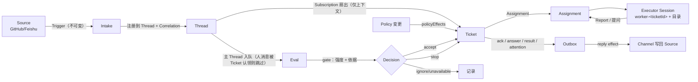

# dsh-superagent 架构与设计理念解读

> 交付物：对一个 3 万行 TypeScript 开源原型仓库的架构分析，供我们吸收经验做自研。
> 仓库：`deepseek-ai/dsh-superagent-prototype`，commit `8c32a9d`（2026-10-31）。
> 本仓库代码未做任何修改；三份逐文件深潜笔记见文末附录。
> 验证：`pnpm install --frozen-lockfile` + `pnpm check` 全部通过（类型检查 / 59 个测试文件 1197 个测试 / 构建）。

---

## 0. 事实卡片

| 项 | 值 |
| --- | --- |
| 定位 | 面向**单个 GitHub 仓库**的"常驻主动式编码 Agent"，打包为 DSH（DeepSeek Harness）bundle |
| 形态 | 不是独立应用，而是 DSH 插件：`dsh.bundle.patch` + 3 个 Node 入口（主插件、GitHub Source、Feishu Source）+ 1 个浏览器 client 入口 |
| 规模 | 216 个受版本管理文件；`src` 1.52 万行 TS/TSX（纯代码约 1.26 万行）；`tests` 1.50 万行；两者合计约 3.0 万行；测试 59 文件 / 运行器报 1197 用例（静态 `test()`/`it()` 调用 794 处，表驱动展开后为 1197） |
| 依赖 | 运行时只有 `zod` + `proper-lockfile`；其余全部是 DSH 的 `@deepseek-ai/*` peer 依赖（alpha 版本，锁死 0.2.1-alpha.2） |
| 存储 | 单文件 SQLite（`<stateDir>/orchestrator.sqlite`），schema v11 |
| 输入 | GitHub（通知、订阅的 Issue/PR、CI、可选"接收全部"）与 Feishu（事件、历史补收、主题轮询） |
| 输出 | GitHub 评论 / review 线程回复 / PR；Feishu 话题回复 |
| 文档 | 9 篇严格编号、只允许向后引用的设计文档 + 15 篇提示词 + 测试用例作为规格 |

一句话：**它把"一个人被 @ 了一下"变成"一条有授权、有生命周期、可恢复、可审计的工单"，并让两个不同职责的 Agent Session 协作完成。**

---

## 1. 设计理念：注意力经济学

`docs/000-philosophy.md` 只有 33 行，但它是全仓库的判据：

> **占用尽量少的人类注意力，交付尽量多的价值。**

这条原则被翻译成两条"硬"推论，和四条"软"推论：

### 1.1 对 Agent 的约束（写进提示词的硬边界）

| 原则 | 具体规则（提示词原文语义） |
| --- | --- |
| 只在被请求、或书面规则允许时行动 | 请求必须直接指向 Agent 且来自允许的人；无人请求的工作必须先有团队写下的规则，且先进 `observe` 模式只记录不执行 |
| 只在人必须行动或能用到结果时说话 | 确认一次、干活时闭嘴、有结果/需决策/做不了时才再说；消息默认一句话，硬上限 100 词 |
| 一次只问一个具体问题 | 结构化 `human_action`，让问题到人手上而不是埋在长报告里 |
| 按影响停止，而不是按努力停止 | 局部改动做到可评审；需要设计决策就带着明确问题停下 |
| 诚实报告 | 草稿标未完成、失败报失败、绝不为了不问人而绕过限制 |

### 1.2 对设计的约束（写进代码结构与元测试的软边界）

| 原则 | 落地方式 |
| --- | --- |
| **概念少** | 只有 Source/Thread/Trigger/Eval/Decision/Mandate/Ticket/Assignment/Subscription 等 10 个领域概念；业务需求必须落到某个概念的属性，或一段提示词，**不得新增概念**（`docs/001` 有"Rejected concepts"表，逐条说明为什么拒绝） |
| **设置少** | 一个默认值能适配几乎所有团队时就不做开关；团队用自然语言描述的行为进提示词，不进配置 |
| **面板只显示需要人的东西** | 健康状态不占空间；每个元素必须回答"现在需要我吗 / 系统健康吗 / 这段工作的历史是什么" |
| **文档按序阅读** | 每篇只依赖更早的编号，`tests/docs.spec.ts` 强制校验 |

这套理念的独特之处在于**它不是口号，而是被测试锁死的**：`tests/cards.spec.ts` 有 49 条断言，把"内置提示词必须表达/必须不得表达"的业务结论钉到具体文件的短语上；`tests/docs.spec.ts` 校验文档顺序与模块表完整性；`tests/model-surface.spec.ts` 校验模型看到的一切（提示词、工具 schema、技能、错误文案）彼此一致且在尺寸预算内。

---

## 2. 整体架构

### 2.1 三层 + 一条铁律

```
┌──────────────────────────────────────────────────────────────────────┐
│ 扩展层（可替换的部署相关实现）                                          │
│   src/sources/*   GitHub / Feishu 两个 Source 插件（含 poll、channel）  │
│   src/executor/*  DshExecutor：一 Ticket 一 Session 一目录              │
│   src/client/*    React 面板（Overview/Source/Trigger/Eval/Execution/  │
│                   Settings）                                          │
│   prompts/*.md + skills/*  模型可见文本                                │
├──────────────────────────────────────────────────────────────────────┤
│ 应用层（组合根 + 胶水，无领域规则）                                      │
│   runtime.ts 组合根与生命周期    passes.ts 每 2s 一轮                  │
│   effects.ts 持久副作用队列      outbox.ts 发件箱（收据）               │
│   store.ts SQLite 仓储/迁移      sessions.ts DSH Session 与提示词投递   │
│   settings/prompts/versions     tools/* + http.ts + views/* 对外界面    │
│   notices.ts / cards.ts / resources.ts  模型消息与卡片                  │
├──────────────────────────────────────────────────────────────────────┤
│ 领域核心（src/core，无 I/O、无外部 import，只依赖 node:crypto）          │
│   Engine（唯一写入口）                                                 │
│     ├─ Intake       Trigger 入库 / 关联 / 扇出 / 入队评估                │
│     ├─ Evals        批量评估、gate、超时、Decision                      │
│     ├─ Tickets      工单生命周期、Mandate、订阅、Input、resume/stop      │
│     ├─ Assignments  Executor 事实与 worker Report                      │
│     └─ Replies      按 purpose 的 Channel 写入                         │
│   model.ts 领域类型 + 共享谓词     ports.ts 端口 + 领域事件              │
│   stage.ts 阶段推导                policy.ts 授权与准入（其实在 core 外） │
└──────────────────────────────────────────────────────────────────────┘
```

**铁律（`docs/007` §Dependency rules，且被代码遵守）：**

- `src/core` 除 Node 哈希外不 import 任何东西，不做 I/O。
- `src/sources` 不得 import `src/app`；插件只能看到 `SourceContext`。
- 每种状态**只有一个写者**（见下表），其余人或读、或请求写者写。
- 调用方只拿到自己角色的 `Pick<Engine, ...>`；跨角色调用在类型层就不成立。

| 状态 | 唯一写者 |
| --- | --- |
| Trigger / Thread / Decision / Ticket / Assignment | `Engine` |
| Source 读位置、Thread 上的 Source 元数据（`label/url/facts`） | 该 Source，经 `SourceContext` |
| 设置与其历史 | `Settings` |
| 提示词版本 | `Prompts` |
| 副作用行 | `Effects` |
| Outbox 收据 | `Outbox` |
| 每条健康条目 | 认领它的部件（`HealthBoard` 拒绝二次认领） |

### 2.2 业务全链路



关键点：**读路径（扇出）与写路径（授权）分离**。订阅只送上下文、不授予任何权限；授权只来自 `Mandate`。

---

## 3. 十张核心设计牌

每张牌回答同一个问题：**它解决了什么问题，用什么机制，为什么值得我们学。**

### 牌 1｜唯一写入口 + 一命令一事务

- **问题**：Agent 系统天然多来源并发（webhook、定时轮询、人点面板、worker 上报），状态容易被并发改坏。
- **机制**：`Engine` 是 Trigger/Thread/Decision/Ticket/Assignment 的唯一写者，所有方法**同步**，每个命令用 `repo.atomic()` 包住；跨聚合协作由五个 `EnginePart` 在同一事务内串行调用，而不是走端口。
- **位置**：`src/core/engine.ts:48-256`、`src/core/part.ts`
- **价值**：并发问题被压缩成"单线程 + 事务"；推理成本极低。代价是必须单进程（见风险清单）。

### 牌 2｜事务性副作用：Effects 队列 + Outbox

- **问题**：领域里"该发一条消息 / 该启动一个 Session"这类意图，如果直接执行，会出现"写库成功但副作用失败"或"副作用成功但事务回滚"的双写不一致。
- **机制**：端口（`Assessor` / `Executor` / `Outbox`）在**事务内只入队**，提交后由适配器执行：

  - `Effects`：一张 `effect(kind, key, payload, seq, generation, due, attempts)` 表。
    - 同一 `kind+key` 单行合并，后来者替换 payload 并立即可执行，但**不改变队列顺序**；
    - `seq + generation` 双条件更新，防止"运行中的旧尝试覆盖后来替换的新 payload"；
    - 抛 `Later` 表示"现在不行"（如槽位满），**不计失败、不污染健康态**；
    - 有序 kind（`relay`/`notice`/`reply`）强制并发 1；其余按退避重试；
    - 关闭时 `drain()` 保留待办行，下次启动重跑 → 因此**每个 handler 必须幂等**。
  - `Outbox`：消息先落 `outbox` 收据（status `pending/sent/dropped`），再排 `reply` effect 发送；`behind()` 提供弱 FIFO（同票同会话的顺序，但队头连续失败 3 次后放行后续）。
- **位置**：`src/app/effects.ts`、`src/app/outbox.ts`、`src/app/store.ts:72-87`
- **价值**：这是整个仓库最值得抄的一块 —— **把可靠投递压缩进约 300 行代码，不需要外部 MQ**。

### 牌 3｜内容派生 ID：幂等是构造出来的，不是调用方保证的

- **问题**：重复投递（webhook 重放、effect 重跑、人点两次）会造出重复工单/重复消息。
- **机制**：所有 ID 由输入内容哈希派生：

  ```ts
  key('eval', threadKey, policyVersion, at, ...pending)
  decisionId   = key('decision', evalId)
  ticketId     = key('ticket', evalId)
  inputId      = key('input', ticketId, 'trigger', triggerId)
  ackId        = key('ack', triggerId)
  assignmentId = key('assignment', ticketId, index)
  policyVersion= key('mandate-v3', JSON.stringify({rules, mode, sources}))
  ```

- **位置**：`src/core/ids.ts`（5 行）、`src/core/evals.ts:107,311,329`、`src/core/intake.ts:50`
- **价值**：幂等性从"每个调用点写 if-exists"变成**数据模型的性质**；重放同一命令永远只产生一份记录，天然可审计。

### 牌 4｜授权与上下文分离：Mandate（strength + basis） vs Subscription

这是全仓库最精彩的设计。

- **问题**：既要"后续讨论自动到达执行者"（否则每条消息都要重新 @），又不能让"谁都能通过评论提权"。
- **机制**：
  - `Subscription`（Ticket ↔ Thread）只负责**扇出上下文**：订阅线程上的任何消息（包括机器人、CI）都会送到关联 Ticket，但**不授予任何权限**，不进 Eval、不检查发送者身份。
  - `Mandate` 负责**授权**：由 accept 创建，不可变，记录 `strength`（`explicit` / `inferred`）、`policyVersion`、`scope`、以及 `basis`（当初是怎么被准入的）。
  - `basis.via` 有五种：`addressed`（名单内的人 @ 了 Agent）/ `followup`（在有工单的线程上跟帖）/ `admission`（准入表某一格）/ `bot`（名单内机器人的消息）/ `listed`（旧数据兼容）。
  - **强度与依据分开建模**：`strength` 决定"这次能不能 accept"；`basis` 决定"以后还能不能恢复（revalidate）、要不要通知"。
- **位置**：`src/core/model.ts:106-133`、`src/policy.ts:167-241`
- **价值**：把"上下文可达性"和"行为授权"两个正交维度彻底解耦。多数 Agent 系统的混乱都源于把两者混在"会话成员"里。

### 牌 5｜准入表：三格矩阵，而不是一串 if

- **问题**：谁可以发起工作？不同群/不同仓库区域的策略不同。
- **机制**：每个 Source 的 Policy 有一张**准入表**，行是"接收范围"（某个群、DM、新 Issue、新 PR、默认分支 CI……），每行最多三格：

  | 格 | 含义 | 可选值 | 默认 |
  | --- | --- | --- | --- |
  | `listedUnaddressed` | 名单内、未 @ | inferred / ignore | inferred |
  | `unlistedAddressed` | 名单外、@ 了 | explicit / inferred / ignore | ignore |
  | `unlistedUnaddressed` | 名单外、未 @ | inferred / ignore | ignore |

  再叠加 `acceptMode`：`off`（推断类一律不准入）/ `observe`（评估但只记录"would accept"）/ `auto`（可自动接单）。显式请求在三种模式下都有效。
- **位置**：`src/admission.ts`、`src/policy.ts:191-211`、`docs/002-authorization.md:56-80`
- **价值**：用**二维查表 + 三值强度**替代散落的 if/else，策略可被面板渲染、可被测试逐格覆盖、可被版本哈希覆盖。

### 牌 6｜规则写成纯谓词，阶段是推导出来的

- **问题**：状态机字段（`ticket.stage`）一旦落库就会和事实不一致。
- **机制**：Ticket 不存阶段。`ticketStage(ticket)` 按 `docs/003` 的 8 行表**逐行推导**，第一行匹配即返回（26 行代码）。同类谓词还有 `waitsForPerson` / `followupOwners` / `settled` / `liveTicket` / `followsDone` / `canRetry`。
- **位置**：`src/core/stage.ts`、`src/core/model.ts:318-353`
- **价值**：领域、面板、执行器**共用同一份判定**，不会出现"面板说等待、执行器说工作中"的口径漂移。文档表 ↔ 20 行代码 ↔ 逐行测试，是这个仓库的标准写法。

### 牌 7｜生成列 = 活跃工作集：让周期性扫描与历史解耦

- **问题**：每 2 秒一轮的 pass 要处理"待评估的 Thread / 未结束的 Ticket / 待投递的 Input"。全表扫会随历史线性变慢。
- **机制**：SQLite 生成列 + 部分索引：

  ```sql
  -- ticket.open: 未结束时非空；ticket.active: 有待投递 input 或最新 assignment 未结束时非空
  CREATE INDEX ... WHERE open IS NOT NULL;
  CREATE INDEX ... WHERE active IS NOT NULL;
  -- thread.active（有待评估或评估中）、thread.subscribed（有 Ticket 订阅）
  ```

  pass 只读 `threads.active()` / `tickets.active()`，成本与历史数据量无关。同理 `outbox.pending` 用复合生成列做"同票同会话序"的等值 join。
- **位置**：`src/app/store.ts:30-120`、`src/core/engine.ts:75-85`
- **价值**：长跑型 Agent 服务遇到的第一个性能悬崖就是"扫描成本随历史增长"。这个模式约 50 行 DDL 就能根治。

### 牌 8｜双 Session 角色分工 + 槽位计量

- **问题**：一个 Agent 又要在群里接活、又要写代码，两类任务对工具、时间、上下文的需求完全不同。
- **机制**：
  - **主 Session（orchestrator）**：只**路由**。评估主动候选、一键批量决策（`orchestrator_route` 一次 1–20 条）、转发报告。它在提示词层面被禁止读代码、写计划、定技术方案。并被 `noWait` 守卫强制"不许等"（拒绝 `sleep`、30s 以上 shell 超时、5s 以上 job 等待）——因为**等待会阻塞新候选**。
  - **执行器 Session（worker）**：每个 Ticket 一个 `worker-<ticketId>` Session + 一个目录（默认 `<stateDir>/work/<short-name>`，可用 `git worktree` 准备）。它拥有实现、验证、PR、review 的完整自主权。
  - **并发用槽位表达**（`WorkerSlots`）：`used = 运行中 ∪ 启动预留`，去重并集；**人的消息可以用 `maxWorkers + 1` 的额外槽位，且唤醒优先于新 launch**；准备命令也占槽。
  - **后台工作计价**：turn 结束但 shell job / subagent 还在跑时，Ticket 保持"工作中"并占槽；每个 turn 后给后台工作 **30 分钟预算**，超时杀 shell job 并报 `waiting`（subagent 允许继续）；**handoff 给人时立刻释放槽位**，留下的 server 类 job 不计槽、不计预算、结束时也不唤醒 Session（`collectJob` 吞掉结束事件）。
- **位置**：`src/executor/dsh.ts`、`src/executor/background.ts`、`src/app/sessions.ts`
- **价值**：**"给人看的活"和"占并发的活"分开计价**，是 Agent 产品化的关键细节；"人优先于批处理"的槽位策略可直接复用。

### 牌 9｜提示词工程：文本可改，闸门不可改

- **问题**：团队要定制 Agent 行为，但**不能让团队改出安全漏洞**。
- **机制**：
  - **优先级（强→弱）**：工具与主机强制的事实（身份、权限、参数校验、长度上限）> 内置/生成段（团队可覆盖）> 匹配规则的流程要求 > 团队三段与技能 > 外部文本（消息/评论/引用，只是数据）。
  - **团队只能改三段**：Communication（怎么说话、GitHub 免责行、review 处理）、Ticket scope（做到哪停）、Delivery requirements（PR 证据、auto-merge 条件、commit 作者）；外加每个内置 part 的 override 与团队技能。
  - **组装顺序固定**（`promptParts`）：shared+角色 → 团队三段 → 订阅/回复 → dispatch 或 work → admission（仅主 Session）→ handoff → environment 生成段 → policy 生成段（仅主 Session，且放最后，使策略变更不影响前面的文本）。
  - **override 记录"被覆盖的内置文本内容哈希"**（`builtInBase = key('prompt-built-in', text)`）：升级后若默认文本变了，面板标 **Default updated** 并显示 diff，团队选择"保留我的"或"用新默认"；没有 override 的 part 自动跟随新默认。不需要迁移表。
  - **每次模型请求绑定当时的提示词版本**，并记录每个 Session 用过哪些版本；worker 只能读自己工作过的版本（`mayRead`）。
- **位置**：`docs/004-prompts.md`、`src/app/prompts.ts`、`prompts/*.md`
- **价值**：把"可定制"与"不可越权"用**分层优先级**隔开；用内容哈希解决"默认文本升级 vs 团队文本保留"这个所有可配置系统都会遇到的难题。

### 牌 10｜元测试：把文档、注释、提示词、构建配置变成 CI 门禁

| 测试 | 锁住什么 |
| --- | --- |
| `tests/docs.spec.ts` | 文档编号连续、只引用更早编号、本地链接可解析、无冲突标记、007 的模块表/测试表与 `src`/`tests` **双向一致** |
| `tests/class-docs.spec.ts` | `src` 下每个 class 前必须有 JSDoc |
| `tests/model-surface.spec.ts` | 模型可见面（提示词段、工具 description+schema、技能、错误文案、投递消息）与 schema enum / 环境变量 / 资源白名单 / 术语表 / 词数上限 / 尺寸预算一致；`KNOWN_FAILURES` 必须为空（强制偿还技术债） |
| `tests/cards.spec.ts` | 49 条业务结论必须/不得出现在指定提示词文件 |
| `tests/bundle-patch.spec.ts` | 用 DSH 自己的解析器真实解析 `cordis.patch.yml`，断言 worker preset 里 shell 5s、job wait 5s、subagent 用 `standard`、禁掉 ask/present/plan/plugin-manager 等 |

**价值**：这几百行测试把"人会忘"变成"CI 会拦"，是团队协作下保持文档与代码同步的最有效手段。**代价**：任何跨面改动要同时改代码 + 007 表 + cards 规则 + 预算，小团队需评估维护带宽。

---

## 4. 三个必须理解的机制细节

### 4.1 一次 Eval 的生命周期（为什么它不会丢请求）

1. Trigger 进入 Thread 的 `pending`（**批量缓冲**，Eval 运行期间到达的 Trigger 合并进下一批）。
2. pass 发现 `pending` 非空且无进行中的 Eval → 开始一个 Eval：取 gate 判定的**最强** Trigger 作为 `primary`（决定工单来源、强度、依据）。
3. 交给 `MasterAssessor`（effect `assessment`）把候选卡 steer 进主 Session 的 turn。
4. **候选真正送达后才开始计时**（`candidateDelivered`）—— 送达前永不过期，避免"排队排到超时"。
5. 超时 → 把该批 Trigger 重新入队，连续 2 次后第 3 次记 `unavailable`（面板可 dismiss / 重评）。
6. 暂停处理时：Eval 记下暂停起点，恢复时把 deadline 顺延暂停时长；**暂停不消耗超时**。
7. 策略版本变更 → 进行中的 Eval 重新排入队列，并重判；已接受的 Trigger 不会二次建单（`accepted()` 查重）。

### 4.2 人的跟帖归谁管（follow-up ownership）

这是"订阅只给上下文、不给权限"之后的二阶问题：**人在工单线程里说话，是新请求还是这个工单的事？**

规则（`followupOwners`，`model.ts:75-88`）：只要消息通过扇出到达了某个仍存活的 Ticket（或已结束但不是人手动停止、且有等待恢复的 Input），该消息就**归这个 Ticket 的 worker 判断**：范围内的自己做，超出范围的 `handback` 一次并附理由；主 Session 只能"停"，不能 accept/attach/requeue。所有 owner 都交还后，消息才作为候选进入 Eval。

配套的 `handback`/`requeueUntaken`/`letGo` 三件套保证：工单结束时，**worker 没读到、没确认、没交还**的人消息会回到 Eval，不会静默丢失。

### 4.3 策略变更的影响面：反事实重算

`policyEffects(tickets, old, now, scope)` 不手写"哪些字段变了影响谁"的规则，而是：

> 用旧配置重算一遍 `revalidate`、再用新配置重算一遍，**找出翻转的那些**；如果翻转只是因为 accept mode 或规则变化，再进一步判断是"请求人失去资格"还是"推断类工作不再被接受"。

然后只给受影响的 Ticket 发 `policy-changed` Input（附具体规则变更/失效原因）。

**价值**：规则越复杂，"影响面推导"越容易写漏。反事实比较是把正确性外包给同一份 `revalidate` 实现，天然不会漂移。

---

## 5. 工程取舍与代价（读这套代码最该记住的部分）

| 选择了 | 放弃了 | 代价 / 何时不适用 |
| --- | --- | --- |
| 同步命令 + 单写者 + 单 SQLite 文件 | 多进程/多实例横向扩展 | 引入第二进程立刻出现丢失更新（整行 JSON 覆盖保存，无版本列）；目录锁 `stale 30s` 崩溃后需等锁释放 |
| 聚合以 JSON 整行存 SQLite | 规范化表、字段级更新、DB 级约束 | "每 Thread 至多一个 Eval"等不变量只有内存保证；跨行查询靠生成列补偿 |
| 内容派生 ID | 自增/顺序 ID | ID 不透明，排障需反查；输入稍有变化就换 ID（因此派生输入必须稳定） |
| 无删除、只追加 | 存储成本 | trigger/decision/outbox 收据/提示词与设置版本**永久增长**，`search` 是全表 `LIKE` |
| 策略细节放提示词 | 确定性 | 提示词是软约束，行为漂移无测试兜底（cards.spec 只验词句存在） |
| 一 Ticket 一 Session 一目录 | 资源复用 | 每个工单一份上下文与进程级开销；worker 数量受 `maxWorkers` 限制 |
| 复制 DSH 的 UI 控件（不 import 私有包） | 主题/交互自动跟进 | 视觉一致性靠人，DSH 升级需手动对照 |
| 元测试锁死文档/提示词/构建配置 | 改动自由度 | 跨面改动成本高 |
| 每 2 秒一轮 pass 驱动一切 | 精确调度 | 退避的最小粒度是 2s；`NextDue` 无定时器（见风险） |
| 只支持 schema 10→11 单步迁移 | 向后兼容 | 再升级一次就需要引入"迁移链" |

---

## 6. 已识别的风险与改进点（按优先级）

### P0｜自研时必须提前设防（否则会以事故形式暴露）

1. **未投递的 Eval 会活锁**（`src/core/evals.ts:43`）：候选送达前永不过期。若 assessor 从未回调（Session 不可达、effect 长期失败），该 Thread 的 `evaluating` 被永久占住，后续 Trigger 全堆在 `pending`。建议：加"最长未投递"护栏，或对超期未投递的 Eval 在 pass 里报警并释放。
2. **时间戳靠字符串比较，归一化只有两个入口**（`intake.ts:21`、`engine.ts:64`）：`isoTime` 对不可解析值**原样返回**，Source 传本地时间/非法格式会静默破坏所有时序比较（`trigger.at > lastAt`、`deadline <= now`、`input.at > report.at`）。建议：边界处拒绝非法时间，或保存前统一校验。
3. **单一写入口没有 DB 约束**：多线程/多进程立即丢失更新；`store.save` 是整行覆盖。若我们未来要多实例，必须加乐观版本号/行级事务。
4. **无保留策略**：`trigger`/`disposition`/`decision`/`outbox 收据`/`settings-version`/`prompt-version` 永不删除。长跑必然膨胀；`store-read.search` 用 `LIKE '%…%'` 全表扫。建议：收据改紧凑表 + 归档、trigger/decision 分区或 FTS5、版本快照保留最近 N 个。
5. **有序 `relay`/`notice` 全局串行**：一条永久失败会冻结**整条**主 Session 通知管线（3 次失败只进健康态，不跳过）。建议：ordered kind 也支持"连续失败 N 次后跳过并单独记录"。

### P1｜值得注意

6. **后台 30 分钟预算与槽位计数纯内存**（`executor/dsh.ts:32`、`WorkerSlots`）：重启后"谁在超时/占槽"失真，可能短暂超卖或误杀。建议把 deadline 持久化到 assignment 字段并在启动时 reconcile。
7. **信任边界**：`actor`/`human`/`addressed`/`threads` 直接参与授权判定，而它们由 Source 适配器声明——**授权完全信任 Source 的翻译结果**。Source 被攻破或插件 bug（把 bot 标成 human）即可伪造授权。建议：Source 层严格校验（如 webhook 签名），对"人类"标记做交叉验证。
8. **提示词是软约束**：`cards.spec` 只保证"结论被写到"，不保证模型照做。高风险规则应尽量下沉为工具参数校验（现有 `purpose`、`pr_number`、ack 幂等是正例）。
9. **内存仓储与 SQLite 的行为差异**是测试盲区：`MemoryRepositories` 用全量快照、无 `afterCommit`/生成列/索引表，领域测试全跑内存版。建议：新查询/新字段必须两侧同时实现，并用同一脚本对照（已有 `store.spec` 的对照范式可扩展）。
10. **迁移只有 10→11 一步且是 DDL 文本比对**：列定义字符串任何格式化差异都会触发 DROP+重建；迁移全表重写、无进度、无自动备份。建议改为版本驱动的列变更表 + 迁移前自动备份。

### P2｜细节

11. `Effects.handle` 没有"未注册 kind"的处理路径（handler 未注册时该 kind 的行会永久滞留且无健康条目）。
12. `sameOrigin` 用固定自定义头，本机任意进程可伪造；建议启动生成随机 token 或改 Unix socket + peer credential。
13. `noWait` 是 shell 文本启发式（匹配 `sleep`/超时参数），结构化参数校验更可靠。
14. `prepare` 命令失败不自动重试是刻意取舍，但网络类失败（clone 超时）也会直接 fail 工单；`transient()` 已可区分，可只对后者重试。
15. `followupOwners` 对"Trigger 行存在但 disposition 行缺失"返回空（迁移/脏数据下会静默改变归属）；建议加健康检查。

---

## 7. 对我们的启示

### 7.1 可以直接吸收的模式（P0，按收益排序）

| # | 模式 | 从哪抄 | 为什么 |
| --- | --- | --- | --- |
| 1 | **事务性副作用队列**：`(kind, key)` 合并 + `seq/generation` + `Later` 哨兵 + 有/无序 kind + 健康阈值 | `src/app/effects.ts`（约 160 行） | 一次解决重试、合并、顺序、并发、观测；不需外部 MQ |
| 2 | **收据 + 幂等键的发件箱**：消息先落收据再排发送 effect，`authorize/accepted` 三段式（写前校验、写后记账、确认前落盘） | `src/app/outbox.ts`、`src/app/delivery.ts` | 把不可靠外部世界（CLI/IM/LLM 流）接进状态机的标准答案 |
| 3 | **内容派生 ID** | `src/core/ids.ts` | 幂等从"调用方纪律"变成"数据模型性质" |
| 4 | **strength 与 basis 分离** + **上下文（订阅）与授权（Mandate）分离** | `src/core/model.ts`、`src/policy.ts` | Agent 系统最常见的越权/漏权根因就在这两处混淆 |
| 5 | **规则写成纯谓词，阶段推导而不存储** | `src/core/stage.ts`、`src/core/model.ts:318-353` | 领域/UI/执行器共用判定，消除口径漂移 |
| 6 | **生成列 + 部分索引表达活跃工作集** | `src/app/store.ts:30-120` | 周期性扫描成本与历史解耦，长跑服务的第一个性能悬崖 |
| 7 | **能力位插件 + registry 派生**：插件只声明 schema/fields/scope/channel/threadContext/policy/environment，校验/健康/作用域全在 registry | `src/sources/kind.ts`、`src/sources/registry.ts` | 加一个来源 = 一个文件 + 三处构建配置；插件无法绕过核心 |
| 8 | **槽位 = 运行 ∪ 预留，人类唤醒有独立配额且优先** | `src/executor/dsh.ts` 的 `WorkerSlots` | 多租户/交互优先于批处理的通用调度器 |
| 9 | **提示词 override 记内置文本内容哈希 + Default updated** | `src/app/prompts.ts:72` | 无需迁移表的"可定制 + 可升级" |
| 10 | **元测试三件套**（docs / class-docs / model-surface）+ `KNOWN_FAILURES` 必须为空 | `tests/` | 文档、注释、模型可见面的一致性变成 CI 门禁 |

### 7.2 需要适配后再用的（P1）

- **Source 适配层**：把 GitHub/Feishu 换成我们的渠道（IM、工单系统、邮件、内部事件总线）。`SourceKind` 能力位模型可直接复用，但要重新实现 `scope`（"我是否监听这条消息"）与 `channel`（能否发送/是否已消失）。
- **执行器**：`DshExecutor` 与 DSH 的 Session/jobs/subagents API 强耦合。若我们用别的 Agent 运行时，需要重写 `start/deliver/stop` + 后台工作回收；但**"一工单一会话一目录 + 槽位 + 30 分钟预算 + handoff 释放槽位"的语义值得保留**。
- **策略表**：准入三格矩阵是通用形态，但"格子的取值含义"要按我们的权限模型重定义；`policyVersion` 的哈希范围（哪些字段算授权相关）必须显式列出并有测试。
- **面板**：DSH 的控件复制策略不建议照搬，除非我们也被禁止 import 私有包；但"三个问题"的信息架构（需要我吗/健康吗/这段工作历史）和"草稿-保存条-历史"的交互值得学。

### 7.3 不要照搬的（P2）

- **无保留策略**：自研第一天就该设计清理/归档（至少 outbox 收据与 trigger）。
- **单步迁移**：直接做"迁移步骤列表 + 版本分派"，别等第二次 schema 变更。
- **每 2 秒全量 pass 的调度粒度**：如果能用定时器/最小堆按 `due` 唤醒，比固定 tick 更省。
- **把授权细节放进提示词**：能下沉为工具参数校验的，一律下沉。
- **复制 UI 控件**：维护成本高于收益的地方要重新评估。

### 7.4 建议的落地路线（三步走）

1. **领域内核**（1–2 周）：`Engine` + 五个 part + `Repositories`（先内存版）+ `Effects` + `Outbox` + 内容派生 ID + 共享谓词。用 `core-engine.spec` 的用例名当需求清单（它们是自然语言写的不变量）。
2. **一条真实链路**（1–2 周）：一个 Source（比如内部 IM）+ 一个 Executor（先无沙箱的 shell）+ 完整"消息→工单→报告→回复"。此时补 P0 的 5 个护栏（Eval 超时、时间戳校验、保留策略、ordered 失败跳过、单进程约束文档化）。
3. **可控性与可观测性**（1–2 周）：设置版本化 + 提示词组装/override + 健康看板 + 最小面板（或 CLI status）+ 元测试骨架（先 docs/class-docs，再 model-surface）。

### 7.5 自研时必须自己补的三个护栏

1. **活锁护栏**：任何"等待外部回调才推进"的状态，都要有"最长等待 + 释放/告警"。
2. **时间护栏**：时间戳在**进入领域前**统一格式并拒绝非法值；不要依赖调用方。
3. **并发护栏**：如果未来要多进程/多线程，先加乐观版本号（`version` 列 + CAS），否则整行覆盖会静默丢失更新。

---

## 8. 继续在这个仓库上开发

```bash
pnpm install          # Node ^22.19 || >=24；pnpm 11.7.0
pnpm check            # typecheck + vitest + tsdown（当前全绿）
pnpm build            # 产物 lib/：index.js / github-watch.js / feishu-watch.js / client.js
```

| 想做什么 | 从哪开始 |
| --- | --- |
| 接入新的事件来源 | `docs/008-cookbook.md` 的 "Add a Source"；实现 `SourceKind`，在 `tsdown.config.ts`、`package.json#exports`、`cordis.patch.yml` 三处登记 |
| 改 Agent 行为/说话方式 | `prompts/*.md`（团队三段优先），改后同步 `tests/cards.spec.ts` 的规则断言 |
| 加一个工具 | `src/app/tools/main.ts` 或 `executor.ts`，在 `src/app/api.ts` 之外就近定义 zod schema；记得更新 `model-surface.spec` 的预算与 `docs/007` 模块表 |
| 改数据结构 | `src/app/store.ts` + `src/app/migration.ts` + `SCHEMA_VERSION`；同步 `tests/migration.spec.ts`、`tests/store.spec.ts` |
| 改 UI | `src/client/*.tsx`；路由与请求类型由 `src/app/api.ts` 约束 |
| 理解领域规则 | 按 `docs/000` → `001` → `002` → `003` 顺序读；`src/core/stage.ts`/`model.ts` 是规则的代码版 |

**注意**：该仓库依赖 DSH 的 **alpha** 包（`0.2.1-alpha.2`），`bundle-patch.spec.ts` 与 preset/事件名强耦合；升级 DSH 前先跑 `pnpm check`。

---

## 9. 附录

### 9.1 文档阅读顺序（仓库自带，质量很高）

`docs/000-philosophy`（理念）→ `001-domain`（概念与规则，含"被拒绝的概念"表）→ `002-authorization`（授权/准入/重验）→ `003-execution`（阶段/执行/恢复/后台工作）→ `004-prompts`（提示词组装与版本）→ `005-panel`（面板信息架构）→ `006-deployment`（部署运维）→ `007-architecture`（开发者指南 + 模块表 + 测试表 + 持久化 + Open questions）→ `008-cookbook`（加 Source）。

### 9.2 深潜笔记（本次分析产出，git 已忽略）

| 文件 | 行数 | 内容 |
| --- | --- | --- |
| `.artifacts/analysis/core.md` | 755 | 领域核心逐文件索引、T/E/S 不变式、事务模型、Policy 全解、9 条风险、2 条关键时序、移植清单 |
| `.artifacts/analysis/app.md` | 1001 | 模块职责地图、Runtime 全流程、SQLite/生成列/迁移、Effects/Outbox 行语义全解、DSH 集成的 9 个机制、23 条可复用模式、13 条具体改进建议 |
| `.artifacts/analysis/ext.md` | 708 | 执行器与后台工作、Source 协议与新增步骤、GitHub/Feishu 实现、提示词工程全解、面板前端、六层测试体系、12 条风险 |

### 9.3 最值得先读的 8 个文件

| 文件 | 行数 | 为什么 |
| --- | --- | --- |
| `docs/000-philosophy.md` | 33 | 全仓库的判据 |
| `docs/001-domain.md` | 112 | 概念表 + 规则 + 拒绝的概念（最省时间的一篇） |
| `src/core/engine.ts` | 270 | 唯一写入口与角色化 Pick |
| `src/core/model.ts` | 353 | 领域类型 + 5 个共享谓词 |
| `src/core/evals.ts` | 340 | 批量评估、超时、Decision（最复杂的规则之一） |
| `src/app/effects.ts` | 161 | 事务性副作用队列（最值得抄） |
| `src/policy.ts` | 242 | gate / 准入表 / revalidate / policyEffects |
| `src/executor/dsh.ts` | 673 | 一工单一会话一目录 + 槽位 + 后台工作 |

---

*本文件由 Lead 汇总三位分析员的逐文件笔记与自身通读结果写成。仓库源码未做任何修改。*
