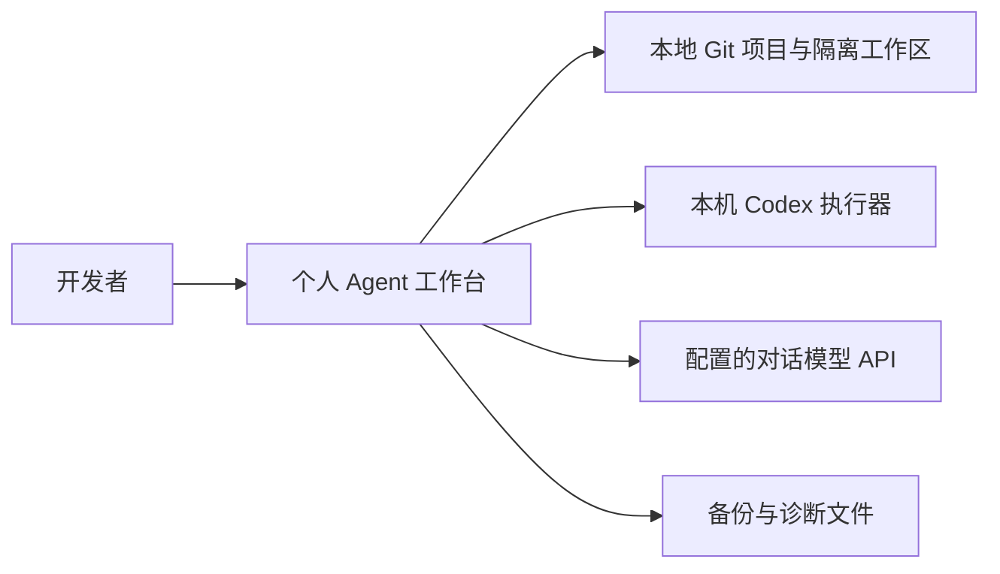
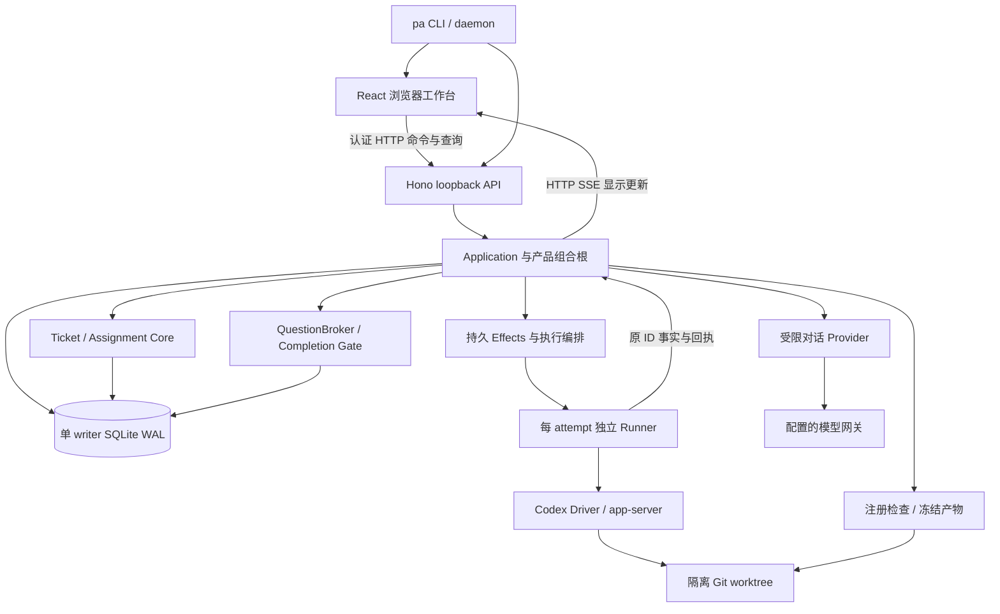
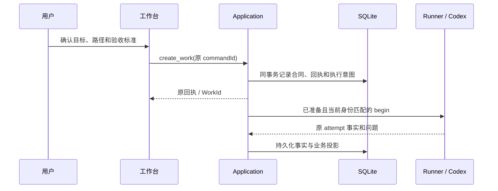

# 个人 Agent 助理：当前架构与代码地图

2026-11-19收尾：原同Work真实Codex/SIGKILL恢复与原工作台审批、plan澄清、steer、物理停止已完成两项冻结里程碑；具体版本、范围和实际发送数见唯一[汇总](MILESTONES-01-02.zh-CN.md)。原native profile支持可选plan/default模式，变更在恢复时重新核对；single澄清选项由原表单显示，执行生命周期/授权/验证权威保持原实现。临时B/H修改权已结束，以下图与历史检查点按其范围读。

> 本地优先的开发工作台：讨论需求，明确委托已有 Agent，在隔离工作区执行，查看可核对的检查与变更，再人工接受交付。

## 一览

| 项目 | 当前事实 |
| --- | --- |
| 仓库 | `https://github.com/JokersDH/dsh-superagent-prototype` |
| 本文基线 | 2026-11-19；main6d309128受控同run原Work恢复/交付/原2&4槽/第3&5项前进；真实终态持久确认/清退仍待闭合 |
| 首个用户界面 | React网页工作台；本机CLI负责启停/发行，暂无桌面壳 |
| 技术栈 | TypeScript、Node24、pnpm workspace、React18/Vite、Hono、Zod、SQLite、Git worktree |
| 原生执行 | 当前生产路径为Codex app-server；历史准入版本`codex-cli 0.164.0`，新版本需重新验证 |
| 本机范围 | darwin/arm64、Node24.21.0/ABI137为本次冻结包实测组合；其它平台和真实跨机部署不借此认证 |
| 证据范围 | 源码/受控流程/准确安装包/真实原生/恢复/收益分别验，不以测试总数替代 |
| 可信度 | 主路径及受控owner退出后原问题接续有实际consumer；真实OS故障/全窗口/物理/原槽与收益未达 |

### 先理解三件事

1. 主对话和执行器是两条链。主对话可使用配置的OpenAI兼容模型，但自身没有任意文件/终端工具；开发执行由独立Runner中的Codex承担。
2. 产品的增量是委托、身份、人工决定、验证与交付治理，不是又造一个通用LLM/tool循环。DSH原型复用了核心，未把整个DSH应用或CAC当产品宿主。
3. Work是产品身份；Ticket/Assignment是唯一执行生命周期。网页、恢复工具、复核意见均不能再造一个推进工作的状态机。

阅读顺序：[使用指南](../ASSISTANT-GUIDE.zh-CN.md)→[进度](STATUS.zh-CN.md)→本页→[创新](INNOVATION.zh-CN.md)→`product-spec/`原设计。原设计是目标，不等于本文已实现范围。

## 产品与边界

用户在本机浏览器管理项目/会话、讨论需求、确认委托、集中回答问题、审阅检查与patch、接受当前候选。后台协调器与网页独立，关网页不等于停止工作。每个内部试用者应有自己的本机安装、私有根、账号与项目，不是多人共享服务。

2026-11-16范围调整：当前完整方案B不包含CAC接入或CAC专属subteam协作实验；不占当前实现、验收、排期或完成度分母，不作为当前交付门槛。现有DriverKit扩展边界保留，后续独立实验时再确定适配设计，不提前实现CAC专用基础设施。

外部系统是本地Git项目、原生Agent CLI、已配置模型API和明确授权的离线包缓存。ZCode、DeepSeek Harness、CAC、跨机共享/组织ACL、自动合并部署、动态多writer竞速均不是当前生产能力。

## 运行形态

最新[0092](../rfcs/WP-16/0092-main-completion-history-consumer.md)复用A production keyset，在原Application/UoW授权后投影合同/检查/人工标准验收metadata，认证GET和HMAC当前Scope游标进入原WorkDetail。它不是新history ledger，旧timeline/当前接受gate保持；新控制/Csync未准入，见[0093](../rfcs/WP-16/0093-wave-36-reviewed-architecture.md)。

网页模型配置已沿原ModelPanel/typedtransport/认证POST接到原PrivateModelProvider原子私有写；保存不发送模型请求，原后续SDK streaming仍唯一对话调用。F组件在main修复StrictMode/身份迟到后消费，未新增设置中心/模型循环。[0089](../rfcs/WP-16/0089-main-model-configuration-consumer.md)列出契约和边界。

最新接线见[0095](../rfcs/WP-16/0095-main-original-running-callback-composition.md)：原NativeProductAttempt.launch登记与policy-ready后，从实际返回的RunningAttempt取同源port/callbacks，bind完成后才返回发送begin；原attempt持有poll任务，lease丢失即停，不自动重绑/业务重放。fact/payload/native-write共用原Store和一次性guard，stdio业务命令与原物理屏障保留。Node-only RunnerLink依赖默认仍是原真实连接，不能由HTTP/profile/env切换。

2026-11-18的原start/resume在新coordinator中核原start receipt/current合同/profile/policy/project/environment和原注册endpoint/资源，才以随机lease接管同一active Runner；原watch负责最终检查/人工接受。受控旧coordinator worker直接退出、父宿主原Runner仍存活时，同原问题到交付已通过，四拒绝对照成立。未改变只做物理核对的reconcile语义，也没有第二调度/ledger。真实stdio EOF/已ACK terminal和原2/4资源不由此推断。

该原入口的受控Work已实际问答、native_applied、注册Node检查、当前候选、人工接受及三产物重开；撤销授权反例零效果。ProcessHost/协议对端为受控虚拟资源，verifier信号被屏蔽，不能充当崩溃恢复/真实物理/原2&4槽证明。Gmetadata支持仍是认证只读GET到App下载；候选新runtime-identity未采用，未知安装身份保持null。

### 进程与入口

| 入口 | 职责 | 代码 |
| --- | --- | --- |
| 开发入口`pnpm start` | 构建必要包、核对/复用指定本机实例、启动API和Vite；不是发行静态入口 | `tools/dev/start.mjs`、`tools/dev/workbench.mjs` |
| 安装入口`install/bin/pa` | first-run、静态console/代理、daemon、status/doctor/stop、备份与升级 | `apps/launcher/bin/pa.mjs`、`apps/launcher/lib/` |
| 产品API进程 | 加载私有状态/WriterLock/配置，选择normal或恢复只读模式，组装HTTP与产品 | `apps/coordinator/product/demo.ts` |
| 产品组合根 | 组合Application/core、Broker、execution、上下文/决定/提案、观察/模板 | `apps/coordinator/product/runtime.ts` |
| 每次执行Runner | 独立进程，有限bridge/journal/恢复endpoint，消费原native协议 | `apps/runner/src/runner-service-entry.ts`、`runner-service.ts` |
| 网页入口 | 主对话、项目、工作、待决定、详情、设置和试用状态 | `apps/console/src/App.tsx` |

网页有流式连接，不持有执行生命周期。重连显示不等于重发命令。Runner存活也不自动证明完整业务恢复已经可用。

## 代码地图

原`src/`、`tests/`、`prompts/`、`skills/`保留DSH原型与MIT归属。新产品在根`packages/`和`apps/`，不是另一层嵌套仓库。

| 七个关键模块组 | 职责 | 主要位置 |
| --- | --- | --- |
| 确定性业务核心 | Work/合同映射、Ticket/Assignment、命令幂等、当前候选和人工接受 | `packages/orchestrator-core/`、`packages/application/` |
| 持久事实与事务 | 单writer、command/fact receipts、effects、消息/合同/来源/结果、schema18迁移 | `packages/storage/`、`packages/workflows/`、`packages/effects/` |
| 执行与人工交互 | DriverKit、Codex协议、每attempt Runner、原问题与逐target答案、资源核对 | `apps/runner/`、`packages/driver-kit/`、`packages/drivers/`、`packages/execution/`、`packages/questions/` |
| 工作区与可信完成 | 独立worktree、有限环境准备、注册检查、冻结产物、完成证明 | `packages/workspaces/`、`packages/environment-preparation/`、`packages/verification/`、`apps/coordinator/product/completion.ts` |
| 助理上下文与明确决定 | 选定来源、预算/期限、单条消息绑定、提案确认、决定撤销/替代 | `packages/context/`、`packages/proposals/`、`packages/knowledge/` |
| 用户体验与只读派生 | 工作台/HTTP/SSE、注意力排序、任务模板、7/30观察与导出 | `apps/console/`、`apps/coordinator/http/`、`packages/routing/`、`packages/project-recipes/`、`packages/usage-insights/` |
| 发行与运维 | 完整闭包/manifest/源码绑定、启停、升级、备份恢复、支持材料 | `apps/launcher/`、`packages/portability/`、`tools/distribution/` |

`packages/contracts/`是这些模块共用的运行时schema与类型边界；新增展示接口可加法演进，冻结Runner v1身份不能随意改变。浏览器只消费公开DTO，不导入Node分析、私有路径、凭据或原始账本。

## 主要流程

### 讨论与明确委托

普通消息先持久化，再由受限`PrivateModelProvider`按有限会话上下文请求流式模型回复。请求/结果有原ID与持久记录；未知结果不自动补发计费请求。需要项目事实时，用户先选来源并预览，发送前重验，保存那一次选择的来源绑定。

模型提案是数据。回复中的“已经完成”“用户授权”不能变成执行权限。用户确认表单中的project/profile/scope/criteria后，原Application创建Work/不可变合同与Ticket关联，再经effects进入队列。

网络丢响应时核对原commandId，不能通过创建新Work“解决未知”。修订会产生新合同并处理旧执行屏障，不能在后台偷偷改旧要求。

### 问题、批准与恢复

Driver归一原生事件，但保留request ID、attempt、session、connection epoch等原身份。QuestionBroker持久化问题、答案和逐target投递结果。业务答案和permission/authentication不同：权限答案不能作为通用长期知识共享。

实际写入前必须核对当前合同、原问题绑定和fresh write admission。排进队列、收到ACK、原生已消费是不同事实。I的attach-channel只负责通信，B adapter负责注册/auth/dispatch/lifecycle；都不代替main/Broker授权。

当前通信模块及受控回调已存在，但“原协调器故障→新协调器接管同Runner/同问题→同Work候选/检查/接受→槽位归还”的完整产品纵链仍未验通。unknown保持unknown，不自动重发业务或启动第二writer。

### 检查与交付

执行器的`end_turn`不是交付。产品确认当前绑定及物理资源状态，冻结候选内容，运行操作者注册的检查；验证绑定合同、候选generation、环境和artifact digest。通过后用户审阅patch与证据，明确接受当前候选。

机器FAIL不能由人工接受或模型复核覆盖。接受只确认交付，不自动合并、提交、push、部署或覆盖原项目。原项目/worktree/基线可查，patch与检查证据可下载。

### 任务模板、观察与知识

任务模板只从已登记项目根读取有限元数据，把当前配置允许的原子路径/检查/profile组成草稿。点击建议只进入原表单；预览/应用不自动创建，创建前重验当前输入。

使用观察复用公开的授权证据reader，返回7/30天、项目范围、覆盖与未知。下载重新读取新快照，正文与DTO/摘要/真实UTF8字节绑定；formatted值不反解析成数字。快照不是权限，样本不是收益证明。

明确决定只来自可信用户消息，并有范围、来源digest、版本、期限和撤销/替代。推断长期规则的自动推广当前明确关闭。来源失效会阻止后续复用，但不承诺抹除此前所有外部影响。

## 数据、接口与外部集成

| 数据/接口 | 用途 |
| --- | --- |
| SQLite schema18 | core、Work/合同、消息/决定/提案、command/fact receipts、runtime bindings、completion记录；迁移append-only |
| 私有state与artifact/workspace根 | 持久项目注册、密钥引用、不可变产物、journal、独立worktree；不入Git/发行包 |
| `/v1/configuration`、`/v1/readiness` | 当前项目、执行器与可用动作的公开投影，不代表全原生兼容 |
| `/v1/commands`、`/v1/works/:id` | 原业务命令和原工作状态 |
| `/v1/assistant/stream`、`/v1/events` | 有限SSE显示更新；不是事件溯源写入口 |
| `/v1/assistant/context/*`、`/v1/context/history` | 选定上下文发送、历史绑定和原始来源读取 |
| `/v1/proposals/*`、`/v1/decisions/*` | 明确预览/确认、审计和撤回 |
| `/v1/attention` | 跨项目待决定/候选/阻断的可解释排序，动作仍回到原对象 |
| `/v1/insights`、`/v1/insights/export` | 7/30观察、明确下载；export在main/R2，R1无该新入口 |
| `/v1/projects/:id/recipes/preview` | 有限只读草稿预览，POST不等于写业务 |
| `/v1/recovery/*` | 源审阅/准备/诊断与未完成目标激活设计；恢复文件不授执行权 |

HTTP仅loopback，使用本机session/Bearer和origin校验；恢复只读单独限制写入口。`PA_MODEL_CONFIG`可指定私有模型文件；`PA_*_ROOT`选择安装/config/data/cache/logs/workspace，须对同实例保持一致。

## 开发与运维

| 工作 | 命令/位置 |
| --- | --- |
| 使用与启动 | [实际操作指南](../ASSISTANT-GUIDE.zh-CN.md)，先区分源码、R1安装与R2候选 |
| 构建工作区包 | `pnpm -r --workspace-concurrency=2 run build` |
| 契约检查 | `pnpm check:contracts` |
| 普通界面与后端回归 | `tests/integration/`、`apps/console/test/`；真实native命令另授权，不混普通测试 |
| 安装/诊断/备份 | `pa first-run / start / status / doctor / stop / backup / verify-backup / restore` |
| 产品独立验收 | E-owned `tests/product-acceptance/`；准确source/tar/运行模式/证据层必须一致 |

只读文档核验不启动用户实例。完整source→tar→manifest→实际安装UI/API→独立结论，不能用源码绿灯替安装结论。旧5180–5191入口可能是历史版本；文档更新不自动替换正在运行的代码。

## 架构取舍

| 已观察到的决定 | 原因与代价 |
| --- | --- |
| 复用DSH core slice，不复用完整宿主 | 保留成熟领域规则与MIT来源，避免让产品绑定上游整个应用 |
| 单writer SQLite + 持久effects | 本机事务关系简单可审计；不承诺多机多writer |
| 独立Runner + 原生Driver | 复用厂商模型/工具循环、进程隔离；跨崩溃业务接管仍是难点 |
| 类型/运行schema共用 | 拒绝漂移/跨范围/旧身份；加法接口需main统一组合，不能各owner复制 |
| 确认/检查/人工接受分离 | 模型建议不会自授权限；增加人工步骤，自动接受需另有证据与授权 |
| 历史真实性与当前可执行性分离 | 旧记录保留可查，但不复活旧授权；coverage必须保留unknown/truncated |

未来增加Agent，优先复用DriverKit和原Questions/Completion/UI，只新增真实协议adapter、版本/profile/capability证据及隔离/停止/恢复conformance。仅换模型不算第二协议。CAC接入及其native subteam仅作后续独立实验候选；当前不实施，未来再验证是否沿CAC内部团队能力和产品原身份/批准链适配，不能另设调度权威。

## 风险与未决项

原Work故障恢复纵链、完整原生审批/steer/停止与版本兼容、固定W36独立安装、可信两项目重开及跨机/长期运行仍缺实证。本轮已关闭的旧问题、新B重登记/I借用状态树/G身份晋级及Dselected audit缺口见[验收](../../reports/releases/wave37-admission/README.zh-CN.md)。工具问题与默认产品问题按实际受影响路径区分。用户已确认本阶段不推进复核价值、第二协议复核与路由收益研究；原设计/ledger保留、价值未测。

## Evidence Index

| 证据 | 支持 | 可信度 |
| --- | --- | --- |
| `apps/coordinator/product/runtime.ts`、`demo.ts` | 产品组合/进程/恢复只读/provider | High |
| `packages/application/src/service.ts`、`packages/orchestrator-core/README.md` | 命令/合同/core唯一生命周期与完成gate | High |
| `packages/storage/src/migrations.ts` | schema18、单库中的持久实体与事实 | High |
| `apps/coordinator/product/native-attempt.ts`、`apps/runner/src/runner-service.ts` | 原Runner/guard/通信边界 | High（完整恢复未达） |
| `apps/coordinator/product/completion.ts`、`packages/verification/` | 当前候选/注册检查/人工接受 | High |
| `apps/coordinator/product/assistant-replies.ts`、`model-provider.ts` | 受限对话/流式/请求幂等/私有key | High |
| `packages/knowledge/src/governance.ts` | 明确决定/来源/撤销与自动推广关闭 | High |
| `apps/coordinator/product/attention.ts`、`review-timing.ts`、`usage-observation.ts` | 注意力/活动代理/只读观察 | High |
| `apps/coordinator/http/app.ts`、`apps/console/src/App.tsx` | 公开路由与实际用户入口 | High |
| `apps/launcher/bin/pa.mjs`、`tools/distribution/` | 安装/启停/构建闭包 | High（平台与包范围限定） |
| `reports/releases/wave32-admission/` | 本次候选实测和准确包证据 | High（仅记录范围） |

本页按repo-to-obsidian-docs的inventory/证据/架构视图方法整理；不把目录存在或规格规划当实际上线。
