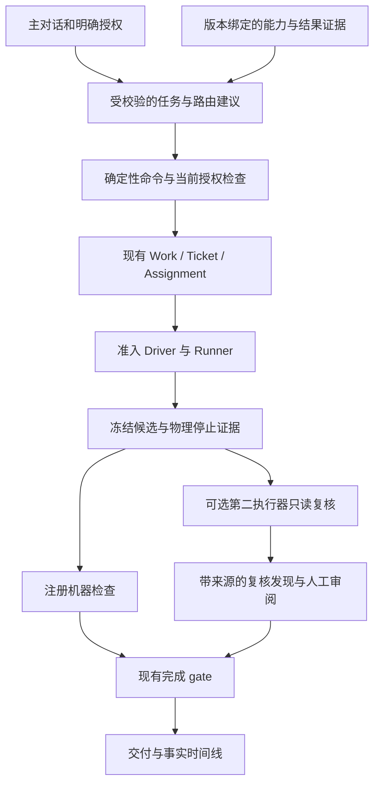

# 架构与创新评审回应及整改建议

日期：2026-11-10。代码基线：`654765e`。状态：基于源码的评审与整改提案，不是架构变更已批准、产品准入或创新收益证明。

输入是用户本地的`docs/reviews/architecture-and-innovation-review.zh-CN.md`，本次保留原文及其未跟踪状态，不把其中的派工建议当成已授权执行指令。实现约束和当前A–E任务仍以AGENTS、product-spec和WP-16记录为准。

## 1. 结论

**接受产品方向的提醒，修正实现前提与创新表述，不推倒现有内核。** 下一阶段应更早回答“相比直接使用一个编码Agent，多了什么可测量的价值”，但不能用增加Router/Planner名称代替可用性、质量与授权证明。

建议采用：**确定性的执行控制＋有证据、可解释的决策建议＋候选绑定的独立复核**。推理建议仍经过可信命令执行，这不妨碍它承担任务刻画、执行器推荐和复核安排。无需在“最小转发器”和“全自动大脑”之间二选一。

近期目标是推荐路由与串行只读复核；机器置信度自动接受、同合同多writer竞速、动态Ticket DAG均不进入当前生产整改包。原有学习研究保留为后续实验，不作为个人Alpha可用或差异化价值成立的前置条件。

## 2. 必须修正的判断

| 输入位置 | 复核结论 | 代码证据与影响 |
| --- | --- | --- |
| 82–86行：每次都必须“机器＋人工”，置信度自动接受不改变安全边界 | **默认体验判断部分成立，改法不能直接接受。** 内核只在human_review或合同有必需human条款时要求人工；当前产品入口仍显式accept_candidate，默认真实项目含人工条款 | `packages/orchestrator-core/src/core/completion.ts:50`；`packages/application/src/service.ts:627`；`tests/integration/product-execution.case.mjs:211`。以后可设计预先授权的machine-only自动完成策略，但不能用分数伪造当前合同所需humanAcceptance |
| 131–139行：隔离已存在，竞速只缺编排逻辑且不碰不变量 | **低估改造范围。** 当前一个Ticket只有current attempt，完成只接受latest Assignment/current candidate；产品还等待该Work全部旧writer屏障 | `packages/storage/src/ingress.ts:109`；`packages/orchestrator-core/src/core/completion.ts:76`；`apps/coordinator/product/execution.ts:452`。直接开两个writer会破坏当前性、取消、候选与接受语义，不能当小功能加进去 |
| 98–102行：单writer/单进程在结构上阻止团队注意力优化 | **概念混淆。** 单writer指控制数据库权威，不是全系统一个工作进程或只能跑一个任务。当前Runtime已有多attempt容量 | `apps/coordinator/product/execution.ts:469`。多个本机Agent已经会竞争同一个人的注意力；这类实验不要求Redis/Temporal/K8s或多用户多机 |
| 90–94、182行：必须重写上游哲学，否则新产品被元测试锁死 | **存在组织约束，但不是所述硬冲突。** 上游“少概念”应保留；新产品已经通过packages/apps/product-spec独立演进 | `tests/docs.spec.ts:58`主要约束上游src及其模块表，并非禁止产品增加模块。可以新增产品ADR明确概念预算，不必改写上游000/001或删除旧测试 |
| 110–135行：“别人没有”“市面没人”“单个Agent永远做不到” | **无足够证据支持，不能作为创新结论。** 路由、coder/reviewer、工作流追踪已有先例，原生Agent也可以有子Agent | 见第5节官方资料。潜在差异在跨native协议、证据当前性/失效治理和质量—费用—人时的实际收益，需要实验，不是功能命名 |
| 119–127行：现有conformance＋InterventionRecord即可产生可信质量reward并路由 | **数据前提不成立。** 协议兼容性不是任务质量；当前InterventionRecord主要是schema/fixture，未形成生产质量样本集；仅一个实际执行器没有可优化的选择 | `packages/contracts/src/schemas.ts:154`；`packages/catalog/src/index.ts:80`。先做准入过滤、版本绑定与事实采集，再冷启动推荐，不能立即训练在线质量路由 |

另外，“worktree隔离”不能表述为安全沙箱。`packages/workspaces/src/workspace.ts:8`已明确共享Git对象、refs、hooks和remote。复核Agent若有写工具或共用可写目录，并不因为有新worktree就成为独立只读裁判。

## 3. 应当采纳的部分

1. **保护执行权威和可靠性内核。** 单writer、原子命令/receipt/effect、原生未知发送先核对、可信完成与资源屏障继续保留。
2. **减少平台铺设与价值验证的脱节。** 第二真实协议值得前置一个窄的只读复核试点；不需要先实现全部steer/team/远程能力，但该路径使用到的身份、权限、问题、停止、恢复不能跳过。
3. **创新不只押学习。** 明确决定与普通助理必须好用；研究性自动学习可后置。近期先测推荐与复核是否减少失败和人工返工。
4. **注意力可以成为指标。** 先做待办排序、截止时间、跨项目汇总和批量审阅；批准仍逐target执行，权限/认证不合并成共享答案。
5. **证据可视化应进入产品。** 先提供单任务事实时间线、候选/合同/检查关联及恢复原因；不必等完整学习实验，也不必立即做“反事实重放平台”。

原评审把最小人工注意力近似为UI排版原则也不准确。上游`docs/000-philosophy.md`同时约束请求授权、消息时机、问题和责任；原规格06已包含总人工成本、等待与返工指标。整改是把这些已有设计落实和测量，不是从零发明该原则。

## 4. 更直接的当前问题

相较“分发层没脑子”，目前更影响交付的是**跨模块闭环与证据可信度没有完全闭合**：

- 决定模块在真实A存储端口上重复提交不兼容；决定还缺适合主线同步事务的prepare/commit消费入口。最新实测是6通过/1失败，见WP-16/0018及`reports/releases/assistant-storage/`。
- 实际产品仍只准入一个Codex；Catalog存在不代表异构执行已经可调度，也不能把fixture、源码测试或原生品牌当成真实兼容。
- B的生产停止/问题/恢复证据、D的恢复与回滚/发行闭包、E的发布gate仍需逐项准入。已发现的问题都有任务归属，修复候选不能因自报完成就升级为全产品PASS；最新候选需另行复验。
- 应用侧已出现多处command digest、actor、receipt、事务重放的重复组合；async领域写入与sync UnitOfWork约定不齐，已经造成真实接线阻断。应收敛为稳定消费接口，不能继续靠每个caller记住不同顺序。
- 产品入口目前将原生配置绑定到单Codex/单NativeProductConfiguration。第二协议前先统一已验证的执行入口，避免在UI/router里继续增加品牌分支。

这些问题不否定已实测的Codex成功路径、会话管理和版本设置；也不因为基础设施代码已存在就算整个G2/G3通过。需要从模块测试数转向固定源码上的用户纵向和故障出口。

## 5. 创新性需要怎样表述

本次读取官方项目文档作必要的先例核对，不是完整市场/论文综述，也没有复现对方结果：

| 资料 | 已有机制 | 对本项目的含义 |
| --- | --- | --- |
| [RouteLLM固定版本README](https://github.com/lm-sys/RouteLLM/blob/88b8dec894809e2a3ed77096623910eb9f861563/README.md) | 偏好数据训练路由、质量/费用权衡、阈值校准、路由基线评估 | “用评价数据路由”本身不是首创。它主要路由模型请求，不等同于本项目跨native Agent的身份/恢复问题，不能直接当替代品或收益证明 |
| [AutoGen Reflection固定版本](https://github.com/microsoft/autogen/blob/89841b6aaf08b8ad24698e2cae457fcaca355f9f/python/packages/autogen-core/docs/src/user-guide/core-user-guide/design-patterns/reflection.ipynb) | coder生成、reviewer批评、结构化消息与有界反馈循环 | 跨Agent审查已有先例；另一Agent“同意”不自动成为可信完成证据。此资料仅作先例，不要求引入该框架 |
| [LangGraph固定版本README](https://github.com/langchain-ai/langgraph/blob/37014c09b9fafbfec9f336da80d8624d75a9ff7f/README.md) | 持久执行、人工介入、状态与轨迹可观察 | 持久化/追踪不是独占资产；应明确本项目增加的跨native证据与失效语义 |
| [OpenHands Agent Canvas固定版本README](https://github.com/OpenHands/OpenHands/blob/e14b76cca01a71597cee242c202eed730e745ce3/README.md) | 多编码Agent/ACP、多后端控制台和自动化入口 | “一个界面管理多个Agent”已是可参考的实现方向；项目价值需体现在有测量的可靠交付与人工成本，而非入口数量 |

更可防守的候选定位是：**把执行器兼容、任务质量和用户授权分开，用带失效条件的证据进行分工推荐，并对冻结候选做可追溯的异构复核。**

这仍是产品差异化假设，不是已证明的学术贡献。可研究的问题包括：版本/环境变化后如何正确废止旧路由证据；什么时候增加独立复核比让原Agent多思考一轮更值；在同质量与预算下，如何降低一个用户处理多任务的总注意力成本。

## 6. 整改后的最小架构

只增加两个必要的产品概念：RouteAdvice和ReviewEvidence。执行/停止/重试仍由已有生命周期管理；计划不能发native命令，模型复核不能写humanAcceptance，Router也不是第二个调度权威。

Catalog准入回答“能不能在这个版本/政策下做”；Router回答“允许的候选中建议选谁”；Verifier回答“当前候选的注册检查结果”；用户或事先明确授权的策略回答“是否接受”。四者不可混成一个模型分数。

还要区分“可信执行证据”和“软件完全正确”：注册检查PASS证明该检查对该候选的实际结果，不证明检查覆盖全部需求；候选若同时修改测试或package脚本，不能把相应通过直接记为独立质量reward。收益评测需要独立、不可由被测Agent改写的验收材料，并单列对测试/检查脚本的修改。

## 7. 推荐实施顺序与出口

| 阶段 | 实施内容 | 必需验收出口 |
| --- | --- | --- |
| R0：闭合当前个人版 | 继续wave-04的决定事务、原生控制、恢复/发行和独立gate；明确可用/未测状态 | 真实存储消费者全部必需项通过，当前任务可查/可停/可恢复，完整发布gate能拒绝缺失/假证据 |
| R1：事实采集与推荐 | 先做确定性能力/政策过滤和解释型建议；采集版本/任务族/检查/接受/返工/费用unknown；训练路由仅shadow | 单执行器时明确只有一个选择；未测/漂移/越权候选不入选；模型离线仍可人工选择；建议本身不执行 |
| R2：第二真实协议＋只读复核 | 先实现一个冻结patch交给第二执行器复核的窄路径；作者先停止和冻结 | 两个实际不同协议；只读约束有证据；review绑定candidate/digest/环境；旧review失效；机器FAIL不被模型意见覆盖 |
| R3：证明推荐/复核价值 | 固定任务、独立测试和同预算对照，观察质量、漏报/误报、返工、主动人时和总费用 | 比较固定Codex、规则推荐、同Agent多一轮、异构复核；不能把多用模型预算或不同测试条件误算成异构收益 |
| R4：有证据后再扩 | 有界注意力排序、受授权的低风险完成策略；再单独研究竞速/任务图/学习 | 每项独立RFC与预算/停止/授权门槛；无显著收益则不默认启用，不为创新名称强上功能 |

R0和R1的只读设计/合成测试可并行，不要求所有远期功能做完；但R2生产调度不能越过它使用到的身份、停止和恢复门槛。没有训练数据时，不把它叫“学习型最优路由”。

**先采纳“第二执行器复核”，暂不采纳“两个执行器同时改同一合同”。** 前者能较早检验价值；后者需单独设计候选竞争组、winner接受、所有loser停止、问题隔离、崩溃恢复与双倍预算，明确是现有单当前候选语义的扩展。

## 8. A–E调整方式

当前wave-04不取消、不自动改派。以下是完成现有阻断后的下一包建议，须消费主线后续RFC与稳定接口：

| 角色 | 保留当前优先项 | 下一步差异化任务 |
| --- | --- | --- |
| 主线 | 完整助理命令/页面、事务接口和产品准入 | 路由建议/复核证据的公共表示、确定性组合、用户审阅入口 |
| A | 决定来源/提案持久化、快照与索引 | 版本绑定的执行结果和复核证据读取；先必要字段，不预建通用分析仓库 |
| B | 真实控制/预算/恢复与测试真实性 | 再接一个可验证只读能力的真实第二协议；不直接开发多writer竞速 |
| C | 真实存储重放兼容与决定同步提交 | 任务刻画和受校验RouteAdvice；复核发现是数据，不是权限或完成证明 |
| D | 当前发行/回滚/恢复门禁 | 将第二执行器安装/版本/资源需求纳入包与doctor，不引入云集群 |
| E | 发布gate与当前个人版独立验收 | 独立坏候选/漂移/复核偏差测试和等预算收益实验，模型调用另立预算 |

不建议现在改写上游哲学、放开core权限或给B默认增加模型任务。完整接口、失效规则和实验口径见 [WP-16/0019提案](../rfcs/WP-16/0019-evidence-routing-and-review-plan.md)。

## 9. 这次做了什么

读取并核对了原评审、当前源码、既有验收记录及上述官方先例文档；形成整改提案。没有修改生产代码、内核/共享wire、数据库迁移、当前派工和预算，没有启动模型任务或新原生执行。原评审及用户ARCHITECTURE-NOTES保持原状。文档检查只证明链接/规格一致，不是整改功能已实现。

另运行`node --test --test-name-pattern='a machine-only contract completes' tests/integration/product-execution.case.mjs`，1项受控回归通过：完成记录没有humanAcceptanceRef，但测试仍显式发送accept_candidate，不能把它写成现有产品已经自动完成。`verify-spec --check`、新文档本地链接和`git diff --check`通过；未重跑整套产品/原生/研究实验。
