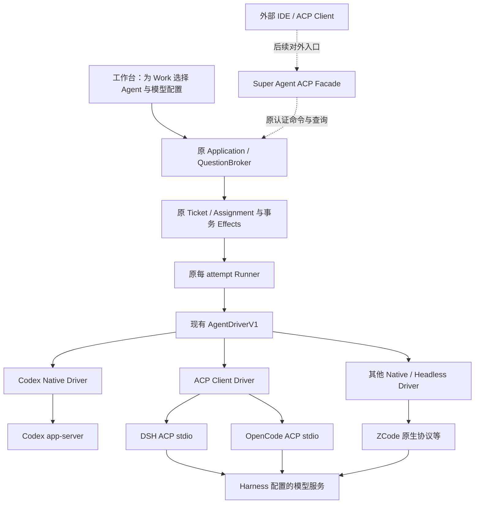

# 0097：统一 Agent 接入与 ACP 边界

日期：2026-11-27。依据用户提出的“每个 Work 可连接不同 Agent，支持 CLI 等标准接入，并支持标准 ACP”。状态：接入架构决定与实施约束；不是新执行器的准入或完成报告。源码核对基线为 `febf05271f582396beffe7a11a309fe698a12969`。

同日后续用户决定：先只实现标准 **ACP Client**，并已创建对应实现 goal。下文第8节的对外 Facade 和 CLI 转 ACP 仅保留为设计背景，不进入此 goal、当前排期或完成条件。

本文补充 [0096](0096-milestone-04-protocol-admission-and-target-authorization.md) 和[里程碑04](../../product/MILESTONE-04.zh-CN.md)。当前只实施原第二协议结果线所需的统一接入，不增加里程碑清单、真实调用预算或第三条结果线。对外 ACP 服务、第三个执行器和通用 headless CLI 的实施顺序在下文单列，不能因接口设计完成便自动开工。

## 1. 决定

产品以 Work 为用户入口，以现有 `AgentDriverV1` 为执行适配标准。ACP 是优先支持的开放协议；原生协议与受限 CLI 可以并存，不强制所有执行器先转换成 ACP。

1. 每个 Work 显式选择一个执行配置；多个 Work 可以分别使用 Codex、DSH、ZCode 或其他通过准入的 Agent。
2. 同一种协议复用一个 Driver，不为每个模型、每个品牌复制 Driver。DSH 和 OpenCode 若均符合已实现的 ACP 子集，使用同一个 ACP Driver、不同 Profile 和各自的证据。
3. 连接方式、消息协议、Agent 产品、模型资源、权限与验证等级分开表达。CLI 不是一种完整消息协议，模型 API 也不是一个具备工具循环的 Agent。
4. ACP 接入端与对外服务端分别实现。接入外部 Agent 时我们是 ACP Client；被 IDE 等工具调用时我们是 ACP Agent/Server。原生 CLI 转 ACP 是第三种桥接用途，不是接入的必经链路。
5. 标准能力提供共同体验，厂商扩展保留独有能力。界面与后端按实际能力启用操作，不把最低公共子集变成所有 Agent 的功能上限。
6. 原 Store、Application、QuestionBroker、Ticket/Assignment、Runner 和资源屏障不变。连接插件不拥有第二个任务状态机、数据库写入者或模型/工具循环。

“标准接入”的承诺是稳定的适配契约和明确的兼容等级；不是给任意命令填一个路径便自动获得提问、审批、恢复与安全停止。

## 2. 五个需要分开的对象

| 对象 | 含义与例子 | 落在现有系统的位置 |
| --- | --- | --- |
| Agent 产品 | Codex、DSH、ZCode、OpenCode；拥有自己的工具与模型循环 | Driver 解释其协议，Profile 指定实际安装与配置 |
| 连接方式 | 本机子进程 stdio；未来可能是受信任的服务连接 | 当前使用 `AgentProfile.executable/argv` 和 `OwnedProcessHost`；服务连接需另行准入 |
| 消息协议 | ACP v1、Codex app-server、ZCode app-server、特定 headless JSON 协议 | `driverId` 与已审 Driver 实现；同名 app-server 不代表同协议 |
| 执行配置 Profile | 某个 Agent、安装版本、配置、模型选择与权限设置的不可变修订 | 现有 `AgentProfile`、配置引用、`CompatibilityIdentity`、准入回执 |
| 模型资源 | 模型名、供应商或自定义 Base URL、私有凭据引用 | 由 Harness 自己支持的 provider/config 机制消费；不能从主对话模型设置隐式继承 |

例如，“DSH＋内部 DeepSeek 网关”和“DSH＋另一个模型”可以共享 ACP Driver，具有不同的受审配置。模型确实支持会话内选择时，可以通过协商后的原生配置选项选择；没有该能力时创建另一份配置修订。不能猜一个参数名或把任意模型名传下去就宣称配置成功。

首个落地版本复用 Profile 表达“Agent＋模型配置”，暂不增加独立模型池调度器。以后有真实的多资源选择需求，再把资源目录做成配置层的独立投影；不把它变成第二张业务调度表。

## 3. 调用结构

实线描述目标主调用链，不表示图中执行器已全部实现；虚线是后续对外入口。当前默认产品真实执行仍是 Codex，ACP 为待准入候选，ZCode/OpenCode 尚无完整产品验收。

常用路径只有一层 Driver。DSH 原生提供 ACP 时直接连接，不再套“DSH Native→自制 ACP→ACP Driver”。原生 Driver 的事件直接规范化到已有事实入口，避免无收益的协议往返和能力损失。

## 4. 接入类型和支持边界

| 接入类型 | 适用情况 | 可复用的部分 | 必须核实的限制 |
| --- | --- | --- | --- |
| ACP stdio | DSH、OpenCode 或其他实际提供 ACP 的 Agent | 官方 SDK、同一 ACP Driver、原 Runner | 精确版本握手、模型配置、权限、问题、取消、原资源观察；一个产品通过不认证其他产品 |
| 原生结构化协议 | Codex、ZCode 等有双向协议的 CLI | 原生服务自身、DriverKit、原进程与事实通道 | 厂商字段、请求身份、运行中控制和恢复，不按命令同名推断兼容 |
| Headless JSON CLI | 有文档化输入、事件和退出语义的批处理 Agent | 原进程宿主、分帧与控制辅助；按协议编写小型 Driver | 可能只有开始/进度/产物/停止，没有审批、澄清、steer 或恢复；依然要过权限和物理屏障 |
| 人机交互 TUI/纯文本 CLI | 只有给人看的终端 UI | 可提供说明或未来显式受限桥接 | 不能靠正则猜问句、自动按键或 exit 0 获得完整执行资格 |
| Agent SDK/服务 API | 远端或进程内服务本身拥有工具循环与会话控制 | 原生 SDK、未来受审服务 Driver | 会话隔离、凭据、远端写入与取消证据；断开连接不等于停止 |
| 单纯模型 API | 只有 chat/completions/responses 等模型接口 | 交给支持该资源的 DSH/ZCode/OpenCode 等 Harness | 不能作为 Agent Driver 直接运行；本产品不再实现工具循环 |

当前 `AgentProfile` 要求可信本机 executable。未来接服务时，若有真正的本地桥接进程，可按其真实路径与身份接入，远端身份另行绑定；不能填虚构 executable 让 schema 通过。无本地进程的新连接契约须另行 RFC，不在本次修改冻结 Runner wire。

`spawned_process` 与 `shared_service_session` 沿用原 ownership。只能停止自己拥有的资源或会话，不能为了结束一个 Work 关闭共享服务。网络断开、服务不再响应或 cancel ACK 都不能填成完整静止。

## 5. 内部标准：深化已有 Driver，移除产品里的厂商假设

唯一 Driver port 继续使用 [ports.ts](../../../packages/contracts/src/ports.ts) 的三个方法：

| 方法 | 责任 | 禁止行为 |
| --- | --- | --- |
| `inspect(profile, host)` | 核实安装、配置、协议和能力，输出原 `ProbeReport` | 以探测名义发送模型 prompt；握手或安装成功便授予完整开发权限 |
| `serve(spec, io)` | 消费原 `RunnerCommand`，通过原 `AttemptIO` 发送业务、持久关键事实、发布流式进度 | 直接修改 Work、批准权限、读取 Store、自建调度器或解释任意 shell 字符串 |
| `reconcile(ref, host)` | 核对原会话、journal 与已登记资源，报告有证据的状态 | 重新 begin、换 ID 重试、用新会话伪装原会话恢复 |

注册分为两处职责，使用同一份受审 Driver 身份：B 在 Runner 组合根注册 Driver 工厂；main 在产品组合根注册可选 Profile、策略准备与公开视图。它们不是两套能力真相，公开视图只能消费原 Catalog 的判定。

工厂仅允许安装包内已审实现。Profile 可以引用已注册 `driverId`，不能提供任意模块路径、JS 代码或环境变量工厂。未知 Driver 明确拒绝，不回退到 Codex、fixture 或裸 CLI。新增同协议 Agent 只加 Profile 与验证材料；新增协议才加 Driver 和受审注册。

当前需要改的具体位置：

| 位置 | 当前问题 | 实施要求与责任 |
| --- | --- | --- |
| `apps/coordinator/product/native-config.ts` | 只有单个 `profile`，混入 Codex approval/mode/model | main 改为可信 Profile 集合和按 Driver 注册的策略准备；旧单 Profile 配置可作为过渡输入，内部统一解析 |
| `apps/coordinator/product/runtime.ts` | 默认配置/项目授权/恢复解析仍使用单 Profile | main 为每个项目投影可用 Profile，逐 Profile 准入；ACP 不可用不影响已准入 Codex |
| `apps/coordinator/product/execution.ts` | 按 `this.native.profile` 查找，直接解析 `NativeCodexSettingsSchema`，事实 source 固定 Codex | main 从已确认绑定解析配置，调用受审策略构造器，绑定对应 producer；产品通用执行不按品牌分支 |
| `apps/coordinator/product/native-attempt.ts` | 原生 Runner 启动仍带 Codex 场景假设 | main/B 使用可信实现选择，保留原启动/恢复/answer guard/资源屏障；fixture 路径单独保留 |
| `apps/runner/src/runner-service-entry.ts` | 默认工厂/准备仅认识 Codex | B 交最小真实 Driver 注册闭包和通用准备入口，main 审查导入；不得夹带旧环境场景覆盖或信号工具 |
| `packages/catalog/` 与公共兼容 DTO | 已有能力、证据、试用投影 | B 提供同源事实，main 消费；不再复制品牌白名单或另一份兼容状态 |

不另建 `UniversalAgent`、通用 Job Engine、连接生命周期数据库或插件市场。工厂与受审策略回调是安装时组合，不是新的公共调度接口。

## 6. 每个 Work 的绑定与后续输入

当前 `create_work` 已有 `profileId`，`AttemptSpec` 已包含完整 Profile；缺的是默认产品对多个 Profile 的实际解析与持续绑定，不必新造 Work 模型。

1. 用户确认委托时，沿原命令回执保存该选择所对应的 Profile/revision/identity，复用现有 `ExecutionProfileRef` 等身份结构。模型选择、非敏感配置与策略也绑定到不可变修订。浏览器不决定可执行文件和私有凭据。
2. 排队期间配置变化不能静默替换用户确认的执行器。开始前重验该修订与准入；若已失效，保持待处理并请求明确重新确认。
3. 原 start receipt、`AttemptSpec.profile` 与 policy snapshot 记录实际解析结果，原事务保证合同、Assignment、Attempt、epoch 和授权仍当前；然后才发送 begin。
4. answer/steer/cancel/reconcile 永远按原 attempt 的配置与原生绑定投递，不能查“当前默认 Agent”代替。连接重建后也不能把旧 JSON-RPC ID 用在新 epoch。
5. 运行中不热换 Harness 或模型。切换执行器须沿原显式修订/新派工流程，先核原 writer 静止；只交接已冻结代码、合同和可授权上下文，不声称迁移原生 session。当前 API 不支持的切换保持禁用，不直接改 trigger/profile。

模型服务密钥继续保留在私有配置/凭据系统；不能写入合同、Profile 公开 DTO、问题文本、原始 argv 或普通日志。讨论模型和执行模型在界面上分别标示，避免“设置了对话 Key 却仍只有 Codex 能开发”的误解。

## 7. ACP 接入端：本阶段的实际工作

### 协议和库

以 ACP 稳定 v1 为基线，先支持官方定义的 stdio。2026-11-27核对的官方 SDK 默认导入仍是 v1，`experimental/v2` 是 Preview；SDK 包版本与 wire major 分别记录。官方协议仓库已经包含一些比本机 Agent 更新的可选能力，不能照最新文档替旧 Agent 宣传支持。

优先复用 `@agentclientprotocol/sdk` 稳定入口的协商、类型/校验与 JSON-RPC 实现，DriverKit 继续负责产品事实、控制优先级和原宿主。锁定实际选择的版本、entrypoint、schema 与许可证，根依赖由 main 修改。B 当前候选尚未依赖 SDK；集成时明确已有实现与 SDK 的替代边界，不让两套 JSON-RPC reader 同时消费 stdout，也不为更换库重写业务生命周期。

当前标准传输并非“任意 HTTP/SSE 地址”。官方远程传输仍在制定；以后可支持文档化的自定义传输，但必须标明自定义，不作为标准 ACP 远程互操作的保证。

### 行为映射

| ACP 行为 | 原产品消费 | 限制 |
| --- | --- | --- |
| `initialize` 与能力协商 | `ProbeReport`、兼容身份与逐能力观察 | 省略能力视为不支持；声明、受控观测与真实验证分开 |
| session 创建及真实可用的模型配置 | 原 attempt 的 session/config 引用 | session 创建不发送业务；模型/模式只使用该端点支持的配置机制 |
| `session/prompt` | 原 `begin` 或受准入的 `deliver` | 读 `ExecutionInputSchema` 的正文，不能把 inputRef 当 prompt；禁止未知业务自动重试 |
| `session/update` | 原进度、工具展示与关键事实 | 支持文本增量/语义事件流；不伪造逐 token 流，不把显示结束当交付 |
| `session/request_permission` | 原 QuestionBroker、NativeQuestionBinding、用户答案 | 保留原选项、session/request/command 身份；写响应前调用原新鲜 guard |
| 已协商且实际实现的业务提问 | 原 clarification 问题与逐 target 回答 | 权限请求不等于业务提问；无业务提问能力时禁用并说明，不解析终端问句代替 |
| `session/cancel` | 原 cancel 和资源观察 | 处理本连接待决权限取消；prompt 返回 cancelled 仍不等于完整资源静止 |
| `session/load` 等可选历史功能 | 原恢复能力投影 | 能读历史不等于接管运行中的旧 attempt；未经验证的 native resume 不开放 |

客户端只广告已经实现且经策略允许的能力。没有实现 `fs/*` 或完整 `terminal/*` 就不广告支持；终端能力涉及创建、输出、等待、停止、释放，不能只实现一个方法。需要这些能力的端点保持不兼容/未就绪，或通过原宿主完成真实实现，不能用能力声明骗过握手。

审批严格沿原选项，不能把 Harness 的宽泛自动批准模式当成已受限；scope 写在 prompt 里不等于文件/网络/凭据限制已强制生效。策略准备缺乏实际证据时不 begin。取消与关键问题通道必须能在 prompt Promise 未完成时工作，不能被流式显示背压锁住。

### 可用性与降级

标准ACP不要求Agent另行提供私有schema导出命令。协议兼容可依据一次成功的标准v1协商、准确安装/配置身份和官方稳定v1 schema建立，但证据必须标为`protocol_declaration`：只把initialize列入已观察，把必选方法列入规范声明；保留`nativeOperationsVerified=false`、能力NOT_TESTED和无执行权。B可在原Catalog增加明确的标准符合性分类入口，满足这些前提时返回`compatible_unverified`，不能覆盖/改写原partial观察，更不能把它升级为verified/native_test_passed。main消费同一Catalog事实，禁止自行将unknown改绿。

在该路径上，原受控产品消费者检查、可信原生策略与当前身份核对、原命令回执中的逐Profile显式试用确认仍共同约束开始执行；握手或规范声明单独不启用begin/answer/cancel。Codex等原生协议的schema检查规则不因此放宽。真实厂商能力仍由原预算内的产品验收给出，native版本与ACP agentInfo实现版本分别记录。

先提供“委托、流式进度、审批、产物、运行中停止”所需能力；steer、原生恢复、澄清分别显示支持程度。后端同步拒绝不支持的命令，不能只隐藏按钮。若只能下一 turn 收到补充，则明示“本轮结束后送达”，不假装立即 steer，也不在后台悄悄新发一次 prompt。

原生扩展可用于更完整的计划、子团队、replay 或运行控制。扩展必须按 ACP 的 `_meta`/`_` 方法与实际协商规则标明，不能向标准对象根部塞私有字段或称之为标准 ACP；不协商扩展的客户端仍能使用标准子集。具体扩展须有真实消费需求再定义。

## 8. 对外 ACP 服务：单独的外观层，后续实施

为了覆盖“其他工具也能连接我们的 Super Agent”，保留标准 ACP Server 方向。它是原 Application 的入口适配器，不能直接连 Driver、绕开检查或成为新的协调器。本阶段不为它开第三条工程线。

首版建议是本机 stdio Facade，通过已有认证连接到原 coordinator；命令名称和安装入口在实施时冻结。stdout 仅协议消息，日志走 stderr。已有本机连接身份与显式授权需经过原受信任启动入口，不能仅凭进程能访问 localhost 就认为它拥有任意项目执行权。

| 外部 ACP 操作 | 设计映射 | 保留的产品语义 |
| --- | --- | --- |
| `initialize` | 返回 Facade 实际支持的版本和能力 | 只公布已经实现的协议子集，不转发下游所有声明 |
| `session/new` | 建立一个与原产品会话关联的 ACP session | 不创建业务执行；cwd 只是候选位置，不是项目/检查/文件访问授权 |
| `session/prompt` | 在明确的原项目、Profile、合同、检查与委托权限下调用原 Application | 信息不全则引导用户完成原确认；一个 prompt 不隐式授权一组跨项目 Work |
| `session/update` | 消费原 changes，投影进度、工具信息和产物链接 | 不从标准 ACP 表面反向制造业务事实 |
| 权限/问题回传 | 仍以原 QuestionBroker 为权威，保留本连接映射 | 原生权限才能用对应 permission 语义；业务澄清使用协商能力，否则回到工作台 |
| `session/cancel` | 作用于该 prompt 明确关联的原活动执行 | 不取消其他会话/其他 Work；槽位释放仍等原完整屏障 |
| session 历史加载 | 仅在确有实现和授权时投影原历史 | 不重发 begin，不承诺失去连接后的旧 request ID 能继续使用 |

标准 `end_turn` 只表示本次 ACP 交互结束。例如生成候选并检查后可以返回“待人工接受”和工作台链接；不能因此把 Work 写成 delivered。人工接受沿原当前 candidate/verification 身份完成，不用一个普通权限批准替代。如果未实现标准客户端中的可靠人工接受交互，就明确要求回工作台，不发明同名标准方法。

同一问题可能在工作台和外部客户端同时可见，答案仍通过原回执与原 target 校验，失效/重复响应拒绝。不得另建 Facade 问题队列。外部连接丢失按原未知结果核对，不自动重发，不默认停止所有后台 Work。产品不得把自己的 Facade 再注册为自身下游执行器形成递归调用。

原生 CLI→ACP 的桥接只在外部用户确实需要它、且该原生 Driver 已验证时再评估；复用已有映射，并将不能表达的功能标成不支持，不为扩大“ACP 支持数量”重复实现一个 Agent。

## 9. 在现有结果线内实施

| 顺序 | 连续责任 | 完成出口 |
| --- | --- | --- |
| 现在：main＋B | main 完成上文多 Profile、策略构造与绑定消费；B 连续修完 ACP 实际策略证据、兼容观察和真实客户端能力，交最小 Driver/Runner 闭包 | 原工作台的零模型受控消费者完成两种协议的选择、正确投递、问题与拒绝、停止屏障，未知 Driver 无回退 |
| 接着：B 唯一真实发送，main/E 消费 | 仅在 main 确认准确 source/consumer 已就绪后，使用原 M04 共享上限验证同一产品里的 ACP 开发 | 沿原 L2 七项：真实交付、审批允许/拒绝、运行中停止、真实降级与简短复盘；不是直接 CLI 演示 |
| 同步原同事线：D/E | D 在 main 点名准确源码后冻结原安装结果，E 独立验同包，选择器与安装依赖纳入原旅程 | 没有开发环境也能选已准入执行器；缺失/未登录/不兼容有可操作说明，故障不影响其他已准入配置 |
| 原出口通过后的候选 | 首先复用 ACP Driver 加一个确有需求的其他 Profile；ZCode 对齐安装版原生协议；再按实际需要做对外 Facade/受限 CLI | 各自选择一个真实结果后实施，不同时启动全部候选，不预先派维护任务 |

这不是新的多轮派工计划。B/D/E 沿原持续责任工作，main 不修改他们的候选工作树；公共契约/产品组合根由 main 修改。共享语义变化先 RFC，冻结 Runner v1 不变；新增持久事实若原 Store 不能表达，由原 A 路径实现，不用私有 JSON 账本替代。

M04 仍为最多两个结果线，B 唯一实际发送者、共享最多6次且目前未获 LIVE_READY；main/D/E 模型发送为0。本文不授权新 prompt、服务启动、信号、账号借用或全局安装升级，不恢复旧预算。能力检查和受控测试也不能启动旧故障注入用例。

## 10. 实现验收要抓的失败场景

下表是对原 L2 接入要求的工程测试细化，不新增里程碑分母；真实协议验收仍由原清单判断。

| 需要证明 | 最小正向消费者 | 关键反例 |
| --- | --- | --- |
| Work 选择确实生效 | 两个受控 Profile 走原 Application→原 Runner→各自 Driver，记录准确绑定 | 未注册 ID、Profile 修订变化、配置失效不得落到默认 Codex；ACP 拒绝不禁用其他配置 |
| 业务正文和模型未串线 | Driver 收到原 input payload 与该 Profile 的真实模型配置 | inputRef 不是正文；对话模型设置不能覆盖执行配置，凭据不出现在公开 DTO |
| 原问题身份不丢 | 原 question/answer 经 Broker 和 Runner fresh guard 到同一 session/request | 错 target、旧 epoch、过期答案、响应丢失不得重发或报 native_applied |
| 协议与能力诚实 | 公开 DTO、按钮和后端同一判定 | 未实现的 fs/terminal、unknown 探测、protocol-only 不启用业务；选定 SDK 与安装 Agent 不匹配明确拒绝 |
| 控制不会被流式卡死 | prompt 未结束时可受理原审批答案和 cancel | 进度洪泛不能饿死控制；自然结束后再 stop 不当运行中停止 |
| 原资源与恢复不变 | 完整登记资源静止后原槽位释放 | 只有 cancel ACK、turn ended、EOF 或静态 journal 不得升级静止；UNKNOWN 占位，重开不重复 begin |
| 原可信交付不变 | 当前候选、注册检查、人工接受到 delivered | CLI exit0、ACP end_turn、报告或对外客户端一句“完成”都不能代替接受 |

通用 Driver 契约测试用于验证适配规范，厂商版本测试用于验证真实实现；共享 ACP Driver 的通过结果不能自动授予新 Agent 原生 PASS。未来新的同协议 Profile，至少重验其实际策略、身份、问答与停止/交付，不要求重复实现 Driver。

## 11. 用户最终看到什么

“Agent 连接”先给预设入口：ACP Agent、本机已支持的原生 Agent；高级入口允许受信任的 CLI 参数数组配置。普通用户不用理解 Runner、epoch 或 wire。自定义连接不能直接粘一行 shell 执行，也不下载/执行任意未审插件。

用户流程是：选择已安装 Agent或受审命令 → 选择其原生模型配置/登录 → 零模型检查 → 查看缺失能力与未验证提示 → 在原准入规则下确认可用 → 为项目设置默认值，并允许每个新 Work 改选。未通过的连接可保存供修复，但不能显示成可执行。

委托卡显示“Agent＋模型”，详情再显示协议与能力。例如 DSH 的 steer 未验证时，补充按钮禁用并说明；其他 Profile 仍能独立使用。只读版本/配置检查不发送模型任务，实际验证需要沿原授权入口，不能让“测试连接”偷偷跑开发任务。

同一个工作台可以同时显示多个 Work 的执行器和进度，问题仍在同一个问题中心，交付仍在原检查/审阅流程。接入面扩大，日常操作保持一致。

## 12. 依据与证据范围

### 本仓直接核对

- [公共 Driver port](../../../packages/contracts/src/ports.ts)、[Profile/Attempt/事实 schema](../../../packages/contracts/src/schemas.ts)、[逐操作兼容与验证等级](../../../packages/contracts/src/execution-compatibility.ts)。
- [单 Profile 配置](../../../apps/coordinator/product/native-config.ts)、[产品执行消费](../../../apps/coordinator/product/execution.ts)、[Runner 默认工厂](../../../apps/runner/src/runner-service-entry.ts)。
- B 候选 `9dd07424` 的 `packages/drivers/acp-v1/` 与 `apps/runner/src/driver-factory.ts` 已存在；候选不等于已导入、已准入或真实产品通过。本文没有导入该闭包。

### ACP 官方来源，2026-11-27读取

协议源码固定到 `927e31867b31b1e3c961c7edee7e3680b90be718`，SDK 来源固定到 `6b84c6da9430a1e4aba9c87c0b45f8b43a6aea9a`；这是文档调研锁定，不是本仓安装版本。

- [ACP v1 传输](https://github.com/agentclientprotocol/agent-client-protocol/blob/927e31867b31b1e3c961c7edee7e3680b90be718/docs/protocol/v1/transports.mdx)：标准 stdio、JSON-RPC 换行分帧、远程传输仍在制定。
- [初始化与能力](https://github.com/agentclientprotocol/agent-client-protocol/blob/927e31867b31b1e3c961c7edee7e3680b90be718/docs/protocol/v1/initialization.mdx)：版本协商、能力省略即不支持、客户端 fs/terminal 等责任。
- [请求取消](https://github.com/agentclientprotocol/agent-client-protocol/blob/927e31867b31b1e3c961c7edee7e3680b90be718/docs/protocol/v1/cancellation.mdx)：通用取消与嵌套传播可选，不保证全部活动停止。
- [扩展机制](https://github.com/agentclientprotocol/agent-client-protocol/blob/927e31867b31b1e3c961c7edee7e3680b90be718/docs/protocol/v1/extensibility.mdx)：`_meta`、自定义方法与协商，不在标准对象根部加字段。
- [官方 TypeScript SDK](https://github.com/agentclientprotocol/typescript-sdk/blob/6b84c6da9430a1e4aba9c87c0b45f8b43a6aea9a/README.md)：稳定 v1 默认入口、实验 v2、Agent/Client 示例。仓库 package.json 标为2.12.0，不据此声称已在本仓安装或完成兼容验证。

### 目标 Agent 的方案依据

此前2026-11-27的版本/help调研观察到本机 ZCode0.16.5、DSH0.2.1-rc.2、OpenCode1.18.34；均不是新协议真实执行验收。以下上游设计不能直接替代本机版本观察：

- [DSH ACP](https://github.com/deepseek-ai/deepseek-harness/blob/4b399c39a6d1479cd84ca591b4d7c88e24d38a96/packages/acp/acp/README.md)与[Provider配置](https://github.com/deepseek-ai/deepseek-harness/blob/4b399c39a6d1479cd84ca591b4d7c88e24d38a96/docs/user/guide/providers.zh.md)：复用其 ACP automation 和模型资源，DSH SDK 是另一协议，ACP 不自动包含全部 UI/提问功能。
- [ZCode原生协议设计](https://github.com/zai-org/ZCode/blob/a4b4445141eb7d3b3e99eada9292775383bfc44e/apps/zcode-cli/docs/design/v2/zcode-protocol-agent-server.md)：app-server 是 ZCode 自有协议，不能直接套 Codex/ACP Driver；安装版仍需对齐。
- [OpenCode ACP](https://opencode.ai/docs/acp/)与[Provider配置](https://opencode.ai/docs/providers/)：可作为同协议其他 Profile 的候选，网页配置版本不能盲套本机1.18.34。

本RFC初版仅产出设计。后续用户授权的源码实现检查点如下，不能把该层证据移用为真实执行器或安装包验收。

## 13. 标准 Client 源码检查点

- 主线锁定官方 `@agentclientprotocol/sdk@2.12.0` 稳定 v1 入口；`packages/drivers/acp-v1/` 不保留第二个私有 JSON-RPC reader，只广告已实现的客户端能力。
- `executor-profiles.ts`、原 runtime/execution 组合根支持多个 Profile，原 `create_work` 事务把 `ExecutionProfileRef` 记入原 trigger。旧未开始且没有身份快照的工作须明确修订，不能继承新 Codex 准入；同项目的路径、检查或环境冲突在组合时拒绝。
- 原 Runner 的 `registered-native` 工厂按不可变 Profile 选择 Driver，未知 ID 不回退。现有 `AgentDriverV1`、Store/Application/QuestionBroker 和 Runner wire v1 均保留。
- ACP 的标准 prompt response 才是该 prompt 已消费的依据，不把写出当受理。审批仅报告真实 `response_written`，关键回执失败或停止时仍对自己的原 session 取消，未知结果不重发。
- 标准协议没有开始 ACK 时，原生写入可能早于 core Assignment 的 `running`。`stop_work` 因此也沿原非终态物理 binding 入原停止/核对队列；逻辑结束仍不能释放资源。原 endpoint 给标准取消有限投递机会，随后仍须完整原资源屏障。
- 原进度帧进入 `application.execution.progress` 与工作详情，按合同分别保存最近快照。展示不产生业务权威，也不声明完整对话归档。
- 新只读 `WorkExecutionSchema` 和 `/v1/works/:id/execution` 暴露所选 Profile 与运行中输入能力，不包含启动路径、参数或凭据，不改变冻结 wire。原 Application 在接纳补充前检查实际 attempt 能力，避免无 steer 的 Agent 留下不能消费的输入；界面同步降级，主对话保持可用。

受控验证跨原认证 HTTP、Application、Broker、实际 Runner 和官方 SDK 两端：允许审批后经原注册检查、当前候选和人工接受到 delivered；拒绝零写；在途取消及原 begin 回执窗口取消；每个场景只发一个受控 prompt。虚拟 native 资源不是 OS/厂商静止证据。实际浏览器另验输出快照、合同/Work 隔离、HTML 纯文本与窄屏布局。

生产 ACP 工厂在缺少可信实际策略宿主时继续拒绝，不能从 Profile 文本、握手或试用同意中生成 `enforced/passed`。当前继续实现 DSH 的专用私有配置及原生受限工具策略，保持 ACP wire 标准；真实产品发送和独立验收尚未完成。本检查点真实 vendor/model prompt 为0、故障信号为0、没有新安装包；M04 L1 0/6、L2 0/7和原分数不因此上调。

接续已加入 `acp-connections.ts/configure-acp.ts/acp-inspection.ts/acp-startup.ts`：专用配置不授执行权，正常personal入口逐Profile核标准协商、原试用回执和当前策略；已有Codex不因另一ACP配置失败而全局禁用。版本检查可以选择具体Profile，开始前还会核原配置快照。模型Key只在专用home凭据文件，原白名单备份排除整个连接目录；不迁移旧账号或权限。使用方法见[产品手册第11节](../../PRODUCT-GUIDE.zh-CN.md#11-标准-acp-client接入-dsh-与自己的模型资源)。

真实DSH0.2.1-rc.2在本机独立私有根的stdio initialize/session-new、原OwnedProcess身份与guard activation绑定已通过，模型端使用本机trap且请求0，没有session/prompt；EOF后的leader正常退出，不推断完整group物理静止。另一消费者实际经过标准initialize、专用连接加载、原Store试用确认、重新准备及正常项目/配置HTTP，仍未执行Work。它们属于原生**setup**证据，不是L2③–⑤的真实开发或停止。SDK/Runner另修复了响应完成后合法复用RPC ID、关键回执拒绝时取消自身在途prompt，以及拒绝/token-limit不能成为成功候选；原未预检exit→SIGKILL已移除，未知材料保留。
