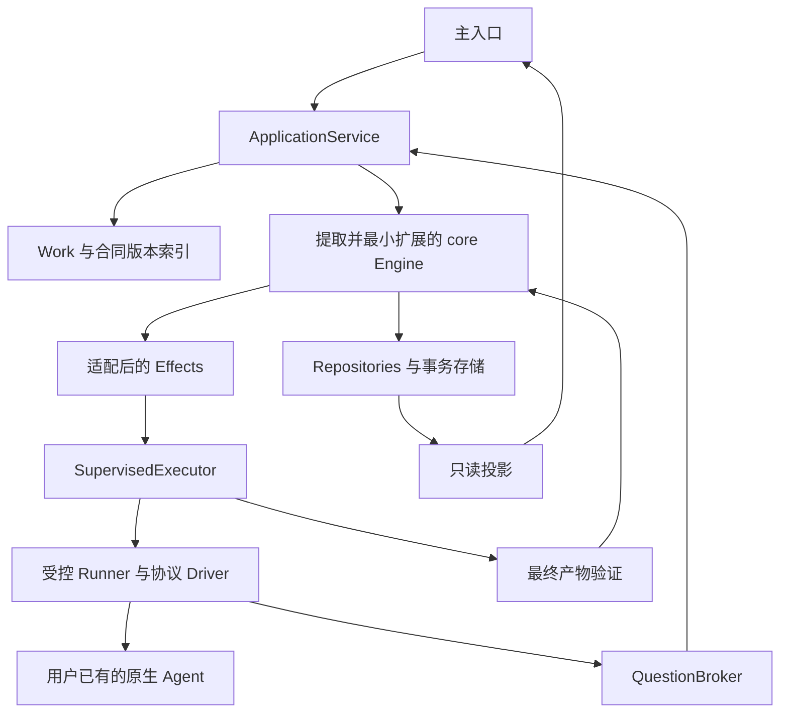

# 02 架构、代码复用与唯一状态来源

日期：2026-11-07。本文是方案 B 的实施蓝图，不代表已经完成源码提取或生产实现。

## 1. 最终选择

**优先提取本仓库 superagent 领域内核，保留 Ticket/Assignment 作为唯一执行生命周期。** 独立产品新增的是本地入口、目标版本、原生执行器适配、可靠人工交互和可信验收，不重新发明同等职责的 WorkKernel。

Work 是用户的一次长期委托：稳定 ID、项目、原始请求、不可变 ContractRevision 和 Ticket 关联。它的排队、推进、停止、就绪等显示来自关联 Ticket、当前 Assignment 与物理资源事实的投影。Work 不拥有另一个 running/ended/completed 状态机。

首版每个当前 ContractRevision 默认一个授权 Ticket，其 Executor 可以使用目标 agent 原生 team/subagent。复杂跨 Ticket 派工作为后续受约束能力；首版完整产品不依赖它。

## 2. 核实结果与复用门槛

源基线为本仓库 commit `8c32a9dc5d72c033816c6a8110b37f40cf94fba4`。

- [src/core](../src/core/index.ts) 的运行时依赖为本目录模块和 `node:crypto`，不直接依赖 Cordis、DSH Session、GitHub 或 Feishu。
- [core-engine.spec.ts](../tests/core-engine.spec.ts) 使用 MemoryRepositories、fake Policy/Assessor/Executor/Outbox；[stage.spec.ts](../tests/stage.spec.ts) 直接测试阶段和重试语义。
- 本轮主任务在**原仓**运行上述两文件，结果为 2 个文件、144 个测试通过。该结果是 reference baseline，不是独立提取、原生 agent 兼容或产品完成的证据。
- [Store](../src/app/store.ts) 通过迁移、策略、提示词和通知存在应用耦合；[Effects](../src/app/effects.ts) 直接使用 Store SQL；[Outbox](../src/app/outbox.ts) 连接 SourceRegistry/Commands，不能整包无差别复制。

### R0：先证明可以提取

R0 必须在独立 harness 中复制精确 core slice 和对应测试、提供最小 package 入口，并重复 reference baseline。需要同时检查运行时和 TypeScript type graph 不含 `@deepseek-ai/*`；不能仅凭本次 import 阅读就宣布提取成功。

R0 之前不接原生 agent，不做生产状态迁移，不给 UI 编造完成率，也不让别的实施包重写 Ticket 规则。

R0 失败时默认动作是定位并裁剪真正的应用依赖、补测试或缩小首版功能。只有形成具体阻塞证据、确认无法以小范围适配保留领域规则，并由负责人批准新的 ADR 后，才讨论替代内核。不得将“写起来更顺手”当作全量重建理由。

## 3. 唯一权威与新增记录

| 数据 | 唯一权威 | 新增部分允许做什么 |
| --- | --- | --- |
| Trigger、Thread、准入 Decision、Mandate | core Engine | 本地 Source 翻译可信输入，PersonalPolicy 收窄入口 |
| Ticket、Assignment、Input、Report | core Engine | 原生 adapter 报告事实；投影不能另写执行阶段 |
| Work 与 ContractRevision | 产品 ApplicationService | 保存用户目标和版本；关联 Ticket，不替代其生命周期 |
| RuntimeBinding、DispatchReceipt | Executor/Supervisor | 原生身份、发送和取消证据；不自行完成 Ticket |
| NativeQuestion、AnswerDelivery | QuestionBroker | 原生请求、可信用户答案、逐 target 投递 |
| Verification、Artifact | 可信 verifier | 生成验收事实；通过 core 完成命令结束 Ticket |
| PolicyCandidate、PolicyRevision | 学习 module | 单独管理经验；不更改当前 Ticket 的授权来源 |

尤其要区分三个名字：core `Decision` 是准入/路由决定，core `Attention` 是 Ticket 的待人工摘要，产品 `NativeQuestion` 是完整的原生问题及答案生命周期。它们可以关联，不能因都叫“决定”就混存或互相授予权限。

RuntimeBinding 可以记录 `nativeObservedStatus`、进程身份、connection epoch、取消回执与静止证据。这些是物理运行观察，不是另一个 Ticket/Assignment 状态机。

## 4. 选定的模块和进程



规范性逻辑 module：

```text
packages/orchestrator-core   原 core slice；仅本包拥有 Ticket/Assignment 转换
packages/contracts          产品命令、ContractRef、原生请求与 Driver schema
packages/storage            core Repositories、QueueStore、产品附加表、迁移
packages/effects            复用队列算法、Channel Outbox 与重试分类
packages/execution          SupervisedExecutor、原生绑定、工作区和停止屏障
packages/driver-kit         连接、帧、原生事实流和 conformance 辅助
packages/drivers             协议差异：Codex native、ACP v1、ZCode native
packages/verification       冻结产物、新鲜事实与可信完成提案
apps/coordinator            组合根、ApplicationService、Source/Policy、HTTP/SSE
apps/console                委托、问题与结果；只调用产品 interface
```

这是归属划分，不要求一次创建全部空 npm 包。首次实现可以在一个 workspace 内先按目录隔离，真实消费者出现后再发布包。

默认技术栈沿用已选方案：TypeScript、拟锁 Node 24.22.2、拟锁 better-sqlite3 13.0.3、一份本机 SQLite WAL、一个 coordinator writer、受控 Runner。该发行组合仍需 native load、恢复、备份和兼容测试；本次没有安装或验证它。

提取 core 不需要把根 package.json 的 DSH peers 全部带入。不能直接 import 原插件根入口 `src/index.ts` 或 `Runtime`，再称为独立版。

## 5. 按文件的复用决定

| 原文件 | 决定 | 具体范围与限制 |
| --- | --- | --- |
| `src/core/model.ts`、`ids.ts`、`errors.ts`、`reasons.ts` | 原样提取后小扩展 | 保留已有概念、ID 与错误语义；产品字段采用明确可选扩展 |
| `src/core/engine.ts`、`part.ts`、`ports.ts` | 原样提取后小扩展 | 保留事务入口与角色 interface；补可信完成、报告 fence，禁止平行状态机 |
| `src/core/intake.ts`、`evals.ts` | 直接复用 | 保留去重、batch、gate、授权与候选超时；本地 Source 负责正确 Thread 划分 |
| `src/core/tickets.ts` | 直接复用并加有测试的最小差异 | 现有 retry/resume/stop/handback；完成 gate 与业务输入失效需在这里保持一致 |
| `src/core/assignments.ts` | 直接复用并最小修改 | 上游 ready 会终结未跟随 Thread 的 Ticket；个人模式必须延迟可信完成 |
| `src/core/replies.ts`、`stage.ts` | 直接复用为基线 | 结果发送需再检查完成 gate；产品显示验证中属于投影，不重复写 Ticket stage |
| `src/core/memory.ts` | 测试复用 | MemoryRepositories 用于 R0 和快速核心测试，不能代替真实事务/effect 验证 |
| `src/app/store.ts` | 拆出并适配 | 保留领域表、active index、事务/savepoint、afterCommit 与 receipt 算法；去掉设置和旧应用迁移耦合 |
| `src/app/store-read.ts` | 选择性复用 | 保留领域查询；产品索引另加，不把所有旧 panel 查询带进来 |
| `src/app/effects.ts` | 复用算法并适配 port | 保留 key/coalescing/generation/并发/backoff；替换具体 Store 类型和 effect payload |
| `src/app/outbox.ts` | 适配复用 | 保留 Channel 消息 receipt/顺序；ChannelTransport 取代 SourceRegistry/Commands |
| `src/app/passes.ts` | 适配复用 | 保留串行 pass、合并请求；configured/closing 改为产品 readiness |
| `src/infra/health.ts` | 适配复用 | 保留每项 health 单 writer，Health 类型不再引入 Sources host |
| `src/policy.ts` | 提取所需算法，不整包照搬 | PersonalPolicy 实现 core Policy；默认只接可信用户与显式规则 |
| `src/kv.ts`、`src/app/migration.ts` | 新建产品版本体系 | 不默认承担 schema10→11、GitHub/Feishu 历史数据兼容 |
| `src/app/runtime.ts`、`sessions.ts`、`executor/dsh.ts` | 不作平台运行依赖 | 产品自有组合根和原生 Driver；其中调度/恢复经验作为参考 |
| `src/sources/github*`、`feishu*`、旧 client panel | 非首版依赖 | 保留原代码；B 版不以 GitHub/Feishu 账号和 DSH Web 宿主作为启动条件 |

### Store 为什么不能原封不动搬走

`store.ts -> migration.ts -> notices.ts -> executor/dsh.ts` 是一条实际 import 链；还有 `policy.ts`、`prompts.ts`、`context.ts` 及来源链接/旧数据处理。`kv.ts` 的一些依赖虽然只是 type import，也会影响提取后的 type graph。

所以选择复用领域存储的 SQL 与行为，裁掉产品不需要的应用历史，而不是装完整 DSH 来让原 Store 编译。新增产品 schema 使用自己的标识和版本，默认新建 state directory，不能误开用户旧 superagent DB。

## 6. Work 到 Ticket 的确定映射

```text
Work stable-id
  ContractRevision 1 --authorized-by user-message-A--> Ticket T1
    Assignment A1 -> A2       正常失败重试仍由 core 管理
  ContractRevision 2 --authorized-by user-message-B--> Ticket T2
    Assignment B1             目标变化后新授权，旧版本保留历史
```

ContractRevision 只存目标、验收、scope、来源和 digest。关联表存 `workId/revision/ticketId/role/sourceCommandId`，不存自己计算的 Ticket running/completed 字段作为真相。

V1 每个当前 revision 一个 primary Ticket。多个 worker 的协作先交给该 Executor 所用原生 agent 的 team/subagent 能力；不支持 team 时可以顺序执行，不伪造支持。

两个独立用户请求通常是两个 Work/Ticket，可由现有 scheduler 并行。不要为了展示并行而让模型伪造几个“用户已授权”的 Trigger。

## 7. 本地 Source 与授权

本地 Source 将可信 UI/CLI 用户消息变成 Trigger，actor 和 human 标志来自认证入口，不来自文本。每个新请求/合同版本有自己的 domain Thread；一个聊天窗口不是所有 Tickets 的共同广播 Thread。

- 新需求：新的 request Trigger，经过 core gate/Eval/accept。
- 同范围补充：明确指向当前 Ticket，复用 attach/Input；上下文不扩大 Mandate。
- 只读查询：查投影，不逐个唤醒 worker。
- 模型/peer 报告：是上下文或执行事实，不能自行升格为 human request。
- 已撤销 revision 的 Thread：LocalSource/Policy 拒绝其恢复或重新关联；显式用户继续动作重新核对授权与当前目标。

默认 proactive mode 为 off 或 observe。当前用户提出的工作按明确授权推进；定时或外部事件产生的新工作，必须通过单独的书面规则和准入方式。

未来 V2 的 internal delegation 需要明确的父 Mandate、允许的项目/路径/动作和条款范围，以及经过验证的子范围关系。core 目前没有这种完整的继承 interface，届时应以新 ADR 和测试扩展，不能把内部 agent 的任务消息标记为用户亲口要求，也不能复用普通 peer 消息绕过 gate。

## 8. 需求修订：新授权加物理屏障

默认流程保持原 Mandate 不可变：

1. 用户的修订命令、ContractRevision v2 和来源立即持久化，UI 显示“已记录，执行切换中”。
2. 通过 core 停止当前 revision 的 live Tickets，清理尚未派发的旧业务 effects；保留已有产物。
3. Supervisor 请求原生取消并核实受控 writer 静止。未知状态不能被 core 的 ended 代替。
4. 完成屏障后，才物化 v2 的新 domain Trigger，并受理为新 Ticket；原用户命令与新 Trigger 通过稳定 key 关联。
5. 新 Ticket 的 Assignment 由 core 创建，Executor 从选定快照和新策略执行。旧报告及旧问题不能推进新 Ticket。

延迟的是域内新工作的启动，不是用户原始修订记录。若在屏障前就启动 Eval，它可能在等待物理停止时无谓超时，因此默认到屏障完成后再 receive/evaluate 新 revision。

已经完成的旧 Ticket 调 stop 不一定能把它改成 human-stopped；上游 `Tickets.end` 对已结束 Ticket 直接返回。必须额外用当前 revision/Policy/SourceScope guard 阻止旧版本因后续消息复活。对旧 Ticket 的显式 attach 同样要检查该 guard。

若旧 writer 不明，首版不自动在新副本重复同样外部写操作；只能进入受控的只读/patch-only 核对或等待可靠 fence。不能仅因新目录隔离，就声称旧外部副作用不存在。

## 9. 完成语义的最小 core 扩展

上游 [Assignments.report](../src/core/assignments.ts) 收到 `ready`，当 Ticket 没有 follows 时会直接以 completed 结束。它尚不提供本产品的最终快照验证与用户主观验收。

### 选定：显式 completion gate

在 vendored core 加入可选 completion mode 与 candidate generation：legacy 保持上游语义；产品 Ticket 必须选择 verified 或 human-review 模式。

产品模式中：

- worker ready 记录报告与候选，但 Ticket 仍 open；不能先 completed 再由 Work 宣称等待验证。
- generation 随后续业务输入、重新执行或新候选失效。时间戳不能充当可靠的唯一版本号。
- 新增可信完成入口，核对 Ticket、当前 Assignment、合同/候选 generation 和验证结果引用，最后仍由 core 调用 Tickets.end。
- 该入口不在 worker 的 EngineForExecutor interface 中；QuestionBroker 的用户接受也经 ApplicationService 检查当前版本和所需证据。
- 确定性任务由可信 verifier 自动确认；主观条件由真实用户确认。用户点击接受不能伪造尚未通过的机器条件。
- input/report 改变候选后，旧 verifier 结果、旧按钮和旧接受命令失效。

`dropped/closed/stopped` 均不自动表示满足用户目标；投影显示相应原因和未完成项。只把对应当前合同的可信 completed 展示为完成。

原 `replies.ts` 对 ready 结果的发送规则也要纳入 gate：候选可作为 preview 展示，但正式结果通知不能在验证前以最终完成名义发送。

### 不选定：伪造 GitHub 或验收 Thread

虽然 `bindThread/threadClosed` 能让 ready 暂不结束，它当前的结束结果是 merged/closed。把用户接受伪装成 PR merge 会污染领域语义，并把机器验证依赖藏到来源实现里。

真实存在的 review conversation 可以作为普通 Channel/Thread，但不能靠虚假 GH Thread 代替 completion gate。默认扩展集中在 core 的完成规则，保持 Locality。

## 10. 报告与重启的 fence

现有 `assignmentStarted/inputsDelivered/turnEnded` 带 assignmentId，但 `Engine.report(ticketId, report)` 没有 assignmentId，内部会选当前 running/latest Assignment。旧 runner 的迟到 report 在重试后可能落到新 Assignment。

产品接线必须增加单一的 fenced report 入口：建议 additive `reportAssignment(ticketId, assignmentId, report)`，旧入口只保留在上游兼容测试范围，产品 worker interface 不导出它。

检查包括：当前 core Assignment ID、NativeBinding 所属、revision 关联与资源 epoch。Runner 不能只提供 ticketId 让接收方自行猜执行身份。

启动时不能无条件调用 `assignmentInterrupted`。先 reconcile：仍存活的旧 runner 重新绑定；确认已停止且需要继续时才调用 core 的中断/重试路径；未知情况保留物理不确定记录，不创建新 writer。

## 11. 逻辑停止不等于物理停止

[Tickets.end](../src/core/tickets.ts) 先写 Ticket.ended、结束 Assignments、释放相关输入，然后调用 Executor.stop。该 port 设计要求只排外部工作，因此事务提交并不证明原生进程静止。

本产品不反转这一授权撤销顺序：用户 stop 后 core 立即撤销继续工作的资格，同时以持久 effect 请求物理停止。

UI 的“停止中”由 core stopped 加未确认的 StopReceipt/WriterLease 投影；“已停止”还需要所有相关受控 writer 的静止证据。不能把原本的 `ticketStage=ended` 直接翻译成“所有进程已停止”。

retry 的上游实现也会先结束旧 Assignment、创建新 pending Assignment，并调用 stop/start。SupervisedExecutor 的新 launch 必须检查旧 writer 的停止屏障，不能因为 core 已生成新 Assignment 就立即复用旧目录。

共享 DSH/ZCode 服务的所有权是 external_service；取消本产品的一次原生 run 不允许停止整个服务。Coordinator 崩溃也不证明独立 runner 或外部工具已经退出。

## 12. Effects 与 Outbox 的保留方式

保留 [Effects](../src/app/effects.ts) 的 key、coalescing、generation、queue order、并发与 backoff 算法；把 Store 类型收窄为 QueueStore，payload 扩展为本产品有类型的 launch/delivery/cancel/reconcile/verify/notify。

**未知发送不能落入原来的普通异常重试。** 原代码对 handler 抛错有限延迟后重试，隐含外部 handler 已具备适当幂等性。原生业务可能已接收但回执丢失时，handler 必须先持久化 indeterminate DispatchReceipt，再安排只读 reconcile，原业务 effect 不再盲目重发。

可选择保留队列算法、让 handler 成功表示“已可靠分类并交给 reconcile”，而非“原生工作成功”；也可以给队列增加明确的 held/indeterminate 分类。首版默认前者，避免为所有 effect 扩展第二份执行状态。

[Outbox](../src/app/outbox.ts) 继续承担产品 Channel 文本通知。移除 Feishu 专有长度判断，注入 ChannelTransport。原 receipts 的 pending/sent/dropped 不够表达原生答案的 written/native-applied/indeterminate，QuestionBroker 的答案投递必须有单独的原生绑定回执。

同一事务写 core 状态、effect、命令 receipt 和必要产品索引；外部 I/O 在提交后。MemoryRepositories 的 rollback 只覆盖其内存 maps，fake ports 数组不会自动成为真实持久队列，不可用纯内存全绿证明该事务边界。

## 13. 数据库和 schema 选择

新产品一个数据库包含 core 领域表、effect/outbox，以及 Work/Contract/Question/RuntimeBinding/Verification 等附加表；通过一份事务连接保持受理和派工一致。多个独立 DB 之间不能声称同一个 atomic。

产品新 schema 从独立版本开始，记录 upstream commit/model revision。复用核心 JSON shape 与索引算法，不把原 schema 10/11 应用迁移带入首版。旧 superagent 状态导入另立迁移任务，不静默处理。

better-sqlite3 与 node:sqlite 在 statement、整数、错误和 backup 上有差异。SQL/Repositories facade 负责适配；原 SQL 可复用不代表换个 import 即完成。必须验证 rollback、nested savepoint、afterCommit、active working set、receipt 去重和真实恢复。

Node/binding/SQLite engine 的发版选择及 WAL 入场、backup/restore、回滚限制沿用 B 可靠性规格；不能因本次复用 core 就宣称这些生产条件已经通过。

## 14. 原测试保留与新测试

| 测试 | 处理 |
| --- | --- |
| `tests/core-engine.spec.ts` | R0 精确复用，保留全部已有断言；源版本 baseline 144 测试的一部分 |
| `tests/stage.spec.ts` | R0 精确复用，保留 legacy 阶段和 retry 规则 |
| `tests/effects.spec.ts` | 保留行为断言；用提取后的真实 QueueStore/数据库 fixture 替换旧 Store 装配 |
| `tests/store.spec.ts` | 复用 Repositories parity、transaction、receipt/working-set 用例；旧 settings/KV/迁移部分独立保留为源参考 |
| `tests/outbox.spec.ts` | 原 fixture 启动 Cordis/Runtime/来源，不能当成独立可跑；保留通知行为并改为 fake ChannelTransport 集成 |
| `tests/passes.spec.ts` | 适配 readiness/health 装配后保留串行 pass 断言 |
| `tests/runtime*.spec.ts`、`tools.spec.ts` | 当前是 DSH 插件集成；不冒称已适配，产品另补新组合根/Driver 用例 |

以下是在**当前原仓**可用的命令，后续提取包需提供对应脚本：

```sh
./node_modules/.bin/vitest run tests/core-engine.spec.ts tests/stage.spec.ts
./node_modules/.bin/vitest run tests/effects.spec.ts tests/store.spec.ts
./node_modules/.bin/vitest run tests/outbox.spec.ts tests/passes.spec.ts
pnpm typecheck
pnpm check
```

本次只获得第一条 reference baseline 的实际结果；未运行其余命令，不以命令存在代替通过。

产品必须新增：ready 不提前完成、旧 generation 验证拒绝、用户主观接受、原生权限不被接受结果代批、旧 Assignment report 拒绝、stop/retry 物理屏障、旧 revision 自动恢复拒绝、未知发送不重发、Source 不广播聊天、完整 App 的事务与崩溃窗口。

## 15. 多 agent 实施包的所有权

| 实施包 | 独占责任 | 交付给其他包的契约 |
| --- | --- | --- |
| R0/Core | core slice、上游测试、completion/report fence 扩展 | Engine 与角色 interface；其他包不得复制 Ticket 转换 |
| Storage/Effects | 领域 Repository、事务、队列、receipt 和迁移 | 同一 atomic、只读查询、稳定 effect key |
| Execution/Drivers | SupervisedExecutor、Runner、原生 Driver、物理停止与恢复 | core Executor port 与 fenced facts；不得改用户目标 |
| Application/UX | LocalSource、PersonalPolicy、Work 索引、合同命令、投影和 UI | 小型用户入口；不得写第二份执行 stage |
| Verification/Questions | 原生问题投递、候选产物、可信验证和接受提案 | 绑定 Ticket/Assignment/generation 的结构化事实 |
| Learning | 原始介入、候选解释、实验与策略 | 有范围、有版本的提案；不得修改核心评分依据 |

首先冻结 core interface 和契约测试，再并行实现包。涉及 core 转换的修改只由 Core 包合并；用同一变更集评审上下游，不让多个 agent 同时各写一套“兼容 Engine”。

## 16. 不可绕过的验收顺序

1. R0 独立 harness 导入闭包、原样核心基线和 MIT 来源记录通过。
2. core 完成 gate、report fence、产品 factory 强制模式通过新旧测试。
3. 真实存储的 Repository parity、事务 effect、restart 和未知发送处理通过。
4. fake runner 证明停止、重试、合同修订和旧 revision 恢复屏障。
5. 一个原生 Driver 在 scratch 项目走完输入、问题、验证和重启，不以 mock 代替。
6. 第二种真实 agent 检验同一 Executor seam；Work UI 无品牌执行分支。
7. 日常 beta、备份恢复、发布矩阵和最终产品验收通过后，才启用推断学习实验。

## 17. 许可、来源与升级

[原 LICENSE](../LICENSE) 为 MIT，copyright 为 2026 DeepSeek Harness Team。提取或实质改写 core、SQL、队列和测试时保留许可证与版权声明，记录源 commit、源路径、内容 hash 和本地修改清单。

建议分发包中保留 `THIRD_PARTY_NOTICES`、vendored MIT License 与来源 manifest。原研究原型非官方产品的性质不能被新 branding 混淆；产品自己的运行验证由自己的发布证据承担。

上游升级先比较源码和测试差异，在隔离分支运行 legacy suite 与产品新语义 suite；不能覆盖本地 completion/fence 改动，也不能让两个版本的 model 同时写同一数据库。

## 18. 本章的边界

本文明确了复用和实现责任，没有完成提取、兼容适配、数据库迁移或原生执行。R0 的独立验证仍是下一步必须完成的工程任务。
