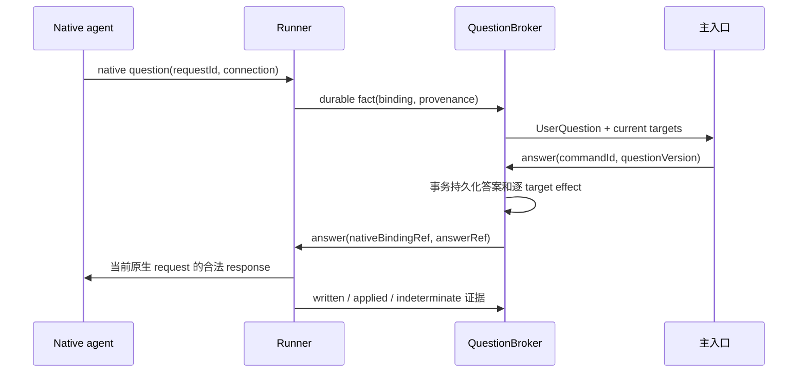

# 03 公共契约、数据和关键时序

版本 `B-1.0-draft`。实现前由 WP-00 冻结为 contracts v1；[contracts.ts](contracts/contracts.ts) 是单一可编译草案，不是已经发布的 SDK。core 原有领域类型继续从提取内核导出，不在产品 types 中重定义。

## 1. 术语与权威

| 术语 | 定义 | 可写入者 |
| --- | --- | --- |
| Conversation | 用户可见主对话，可跨多个 Work | Conversation module |
| Work | 长期委托的稳定身份、项目与合同关联 | ApplicationService |
| ContractRevision | 不可变目标、验收条件、scope 与授权来源 | 可信应用命令 |
| domain Thread | 某个请求/版本的核心输入范围 | LocalSource；不是整个主对话广播 |
| Ticket / Assignment | 核心接单和一次派工 | core Engine |
| Attempt | 某 Assignment 的物理执行绑定与恢复身份 | Supervisor；不成为第二套工作生命周期 |
| UserQuestion | 原生澄清/权限/认证请求及有效绑定 | QuestionBroker |
| UserDecision | 用户明确声明的规范与适用范围 | 可信应用入口 |
| candidateGeneration | 当前完成候选的逻辑版本 | core completion 扩展 |
| PolicyRevision | 经验策略的不可变版本 | PolicyRegistry，推广须有证据 |

02 的 NativeQuestion 指这里的 UserQuestion；统一代码名采用 UserQuestion。核心 Decision 仍然是接单/路由；核心 Attention 是摘要，不能替代完整原生问题。

WorkRecord 没有 running/completed 字段。WorkView 可以有 `phase`，但只能由 Ticket、当前 Assignment、Question、Verification 和 Supervisor 事实计算。缓存可删除重建，禁止 UI 直接 PATCH phase。

WorkView.actions 是派生的可操作上下文：当前 Assignment、当前 CandidateRef/验证引用、可执行操作及 dispatch hold revision。刷新后所有按钮从公共投影恢复，不读取私有 coreSnapshotRef。失败启动可能没有候选，因此 retry 绑定 AssignmentRef + 当前 action token，不强制 CandidateRef；token 是乐观并发检查材料，不是新的授权来源。点击时仍在事务内重新检查 core canRetry、合同/绑定/资源屏障。pause/resume 核对 expectedHoldRevision，防止旧页面覆盖新控制。

## 2. 必须保持的不变量

1. 一条受理命令在一个事务内保存命令 receipt、Work/合同索引、核心变更和 durable effects；缺一项回滚。
2. 所有核心与产品存储调用使用同一连接和嵌套 savepoint。事务内不 await，不调用原生进程、网络或模型。
3. 当前写入身份是 `ticketId + assignmentId + attemptId + fenceEpoch + contractRef`；任何异步事实和答案不能只带 workId。
4. 每个资源的当前 writer lease 唯一。租约过期只代表平台失联，不能证明进程死去，也不能据此重复外部写。
5. 核心停止先撤销授权，物理停止随后核对；新 attempt 的 begin 必须等待资源屏障。
6. 相同 commandId 的语义参数必须相同；同 ID 异 payload 返回 conflict，不能覆盖历史。
7. 原生收到了命令但回执丢失时，状态为 indeterminate；稳定本地 ID 不等于原生支持幂等。
8. 当前候选、机器验证和必要的人类接受必须一致，只有可信应用入口可以确认 core 完成。
9. worker/tool 输出不能伪造 trusted user，模型提案不能创造 human Trigger。
10. 原生权限请求不能通过批量答案复用获得批准；认证完成必须有原生事实。

## 3. 公共 interface 与依赖方向

```text
UI / CLI -> ApplicationService.dispatch, inspect, changes
ApplicationService -> Engine + product repositories + QuestionBroker
Engine -> synchronous ports -> durable Effects
Effects -> Supervisor -> Runner -> AgentDriverV1
Runner -> CriticalFact ingress -> atomic fence -> core fact methods
Verification -> CompletionProposal -> trusted completion gate
Reasoner -> read-only context + proposal tools -> ApplicationService
```

ApplicationService 的 dispatch 只受理命令，不等待模型结束。返回 command receipt、关联 workId 和 event cursor。inspect 读取一致投影；changes 提供可恢复 SSE。只读查询、回答、停止、接受、撤回决定不依赖 Reasoner 可用性。

Driver interface 固定 inspect/serve/reconcile。Driver 只对规范化输入输出负责；其本地 SQL、调度器、长期记忆和核心生命周期修改均禁止。Reasoner 用结构化提案，不能调用 Driver、数据库、用户批准或 shell。

### 3.1 输入的可信来源

HTTP 请求体不允许提供 actor.kind=human。身份由本地认证入口生成 TrustedActor，token 只用于认证不入事件正文。重放模型 transcript 或导入文件得到的是 untrusted/context provenance。

同一个用户消息可以在主对话展示，但只路由到明确选择的 Work。多个活跃任务时用 replyAnchor；无目标的补充先澄清，不全量 fan-out。

### 3.2 核心最小新增接口

- `reportAssignment(ticketId, assignmentId, report)`：带绑定的 additive 入口；完整 attempt/epoch/合同 fence 在同事务 bridge 中核对。
- `completionMode`：legacy / verified / human_review；个人产品必须选后两者。
- `confirmCompletion(ref)`：仅可信 verifier/ApplicationService 可用，核对当前 Assignment、generation、合同和证据，最终由原 Tickets.end 完成。
- candidate invalidation：新业务输入、新结果、重试，或会恢复业务执行的原生答案，使旧 generation 失效，按当前候选重新验证。Broker 在排 answer effect 的同一事务中调用受限失效入口，不制造重复 core Input。

确切新增字段和返回值在 WP-01 的 ADR 中与原 core model 对齐；不得同时由 WorkDB 实现一个替代完成状态机。旧模式的 144-test baseline 必须保留。

## 4. 数据表及约束

以下是逻辑 schema 和约束，迁移作者负责将它与提取 core SQL 对齐；这不是可直接迁移生产数据的 DDL。

| 表/组 | 关键字段与约束 | 所有权 |
| --- | --- | --- |
| core_* | 保留 Ticket、Assignment、Input、Trigger、Eval 等领域索引和不变量 | core + storage |
| works | id PK, project_id, conversation_id, title, created_at；无执行 phase | Application |
| contracts | (work_id, revision) PK, digest, immutable_json, authority_ref；更新采用新 revision | Application |
| work_tickets | (work_id, revision, ticket_id) UNIQUE，role；Ticket 不能误属多个合同 | Application |
| revision_transitions | command_id UNIQUE，from/to，屏障事实 ref，intake_key | Application/Supervisor |
| messages | id, conversation_id, reply_anchor, provenance, body_ref | Conversation |
| commands | command_id PK, actor_ref, payload_digest, result_ref | Application |
| effects | 复用 key/generation/nextAt/claim 等队列语义 | Effects |
| runtime_bindings | attempt_id PK，Assignment、epoch、ownership、native refs、config fingerprint | Supervisor |
| writer_leases | resource_key 唯一有效所有者，binding，fencing evidence，last_seen | Supervisor |
| runtime_facts | fact_id PK, binding tuple, payload_ref, received_at, disposition | ingress |
| dispatch_receipts | command_id + target UNIQUE，not_sent/written/native_accepted/indeterminate | Supervisor |
| questions | question_id, contract_ref, kind, decision_key, native_binding, validity | QuestionBroker |
| answers | answer_id, question_id, trusted_actor_ref, answer_ref, idempotency_key | QuestionBroker |
| answer_deliveries | answer_id + target_binding UNIQUE，local/written/applied/indeterminate | QuestionBroker |
| artifacts | id, contract_ref, generation, tree/diff/content digest, immutable path | Verification |
| verifications | id, artifact_digest, criteria_digest, tool/env identity, outcomes, provenance | Verification |
| user_decisions | id, scope, version, source, supersedes/revokes, normative content | Knowledge |
| policy_* | 候选、实验、不可变 revision、部署范围和撤回 | Learning |
| event_log | 单调 seq PK, topic, entity_ref, payload_ref；与变更同事务 | Application |
| channel_receipts | 复用文本 Outbox 的 pending/sent/dropped；不存原生答案 ACK | Outbox |
| schema_meta | product_schema, upstream_commit, migration checksum, release identity | Storage/Release |

大产物和日志放 state directory 的受限文件中，DB 存引用、digest、大小和保留策略。先写临时文件再 fsync/rename，事务引用只指向已完成文件；失败产生 orphan 由宽限期 GC。不能把大型 base64、native token 或整份 home 配置塞进事件表。

时间用 UTC ISO8601 或统一 epoch，持续时间另存；逻辑先后使用 seq/generation 而非本地时钟。约束检查包含外键、唯一索引、payload hash 和 core active working set。SQL 执行参数化。

## 5. 接受一项委托

1. UI 提交 create_work(commandId, projectId, request, scope)，入口建立可信 actor 与 conversation anchor。
2. 同步事务去重、保存 Work 与合同 v1、LocalSource Trigger、core 受理/评估请求和必要 effects/event。若准入评估异步，receipt 表示已记录，不提前显示已派工。
3. effect 在提交后运行；core 接受后创建 Assignment，Executor port 仅排 launch effect。
4. Supervisor 预留 workspace/lease、Runner 握手和权限准备；critical fact 持久化。
5. 核对 PreparedExecutionPolicy、绑定、合同、当前 profile fingerprint 和资源屏障后 begin。
6. 进度可合并；问题、权限、终止、受理和候选必须有 durable fact。

崩溃恢复从 command receipt 与 effects 继续，不从聊天文本重新猜是否接单。

## 6. 原生问题与答案的唯一通路



关键约定：**回答原生问题只走 QuestionBroker 的 answer effect，不再额外生成相同内容的泛化 chat deliver 或 core Input。** 主对话可以记录一份展示消息，但它带 answer provenance，LocalSource 排除其重复业务路由。若业务答案还需要影响合同/长期决定，另发显式修订或记录决定命令，各自去重。

业务问题可以使 WorkView 显示 blocked_question，而 core Assignment 保持进行中的合法生命周期；核心 Attention 若要镜像，只存关联摘要，不成为第二个答案队列。Broker 负责原生问题的有效性，不通过 worker report/block 再次投递同一答案。

共享答案前同时检查：语义决定键、项目/路径/合同 scope、尚有效的来源、答案适用时点、原生 target 绑定。文本相似不够。每个 target 保存送达结果；一个成功不使全组都成功。

旧连接 requestId 不能在新连接回复。普通业务答案可保留为语义事实，待新合法问题或显式后续输入接续；权限和认证必须出现新的合法原生请求。响应写出不能虚构 native_applied。取消后迟到的回答仅保留审计，不唤醒工作。

原生 request ID 保留 wire 类型和精确值：数字 `43` 与字符串 `"43"` 不是同一请求。公共契约使用 tagged WireRequestId，整数用十进制值保存，binding ID 另行生成。Driver 使用可信 lossless JSON parser/serializer 或明确拒绝不支持的数值精度，不能先经不安全 Number 解析再声称无损。

UI 只消费统一 QuestionPresentation/QuestionAnswer（选项、有限平面表单、自由文本、经过校验的 URL-flow、人工 review）；原始厂商 payload 仅供 Driver/provenance。选项使用稳定 opaque IDs 映射回原生值，未知表单/权限类型进入 review，不在 UI 增加品牌解析。打开 URL 不代表认证成功，密码/token 不通过普通答案字段采集。

凡答案可能使 worker 恢复写入或改变结果，在持久答案和 answer effect 的同事务里先使当前候选失效；旧验证/接受立即被 gate 拒绝。即使不生成 core Input，也不能漏掉这一步。core 已停止的 Ticket 仍可接收取消确认、writer 静止等物理事实并更新 Supervisor；拒绝的是旧业务核心变更，不是丢弃恢复证据。

## 7. 需求变化与停止

合同不可原地修改，修订创建 vN+1。先持久化用户意图，再通过 core 撤回旧授权并取消未发送旧业务 effects；Supervisor 确认旧 writer 静止后，才为新版本物化新 domain Trigger/新 Ticket。WorkId 不变，旧 Mandate 不变。

revision_transitions 的记录用于恢复这个应用工作流，不拥有新的 Ticket execution phase。步骤完成标志必须引用原有 core/物理事实，可幂等重入。

旧 Ticket 已 ended 时 stop 可能 no-op。LocalSource、PersonalPolicy、attach、resume 和完成 gate 都需当前 revision guard，阻止旧 Thread 因后续消息复活。retry 新 Assignment 已存在也不能绕过物理屏障先 begin。

用户“停止”命令和“退出 daemon”不同。前者撤销指定工作的授权；后者按运维策略先 drain/stop。未知旧 writer 时，隔离的新目录仅可用于已证实受限的读取/patch 生成，不重复同类外部写。

`pause_dispatch` 是显式调度 hold，阻止后续 launch/业务派发，不声称暂停了当前工具；`resume_dispatch` 仅释放仍有效授权的 hold。`retry_assignment` 检查当前合同/Assignment/action token 并复用 core canRetry/retryTicket，同时失效已有候选；不能绕过 stopped/旧 revision。`continue_work` 在人工停止后取得新用户授权，创建新合同 revision（内容可相同）和新 Ticket，保留 WorkId。所有操作确定性处理，不等待模型。

暂停 hold 不阻塞 cancel、原生答案和核对控制通道；若回答会恢复当前执行，界面说明其影响。用户需要撤回当前执行授权时使用 stop，不用“暂停后续派工”暗示当前进程冻结。

## 8. 最终验证与完成

每个 ContractRevision 固定 criterion IDs，区分机器检查、人工判断、依赖要求和不适用条件。Verifier 不以 agent 自述代替结果。

运行时 schema 拒绝空 criteria、全 optional 或空白条件；至少一条有意义的 required criterion。required machine 条件必须指向已登记 checkDefinition，不能只有一句自然语言。非机械任务必须有明确人工/evidence 接受路径。自动建议出的验收不能静默缩小用户目标，也不能利用空集合获得 verified success。

1. core 记录当前 candidateGeneration。
2. Supervisor 暂停/确认不再写候选资源，Verification 冻结 tree、dirty diff、必要文件和环境引用。
3. 在独立受控工作区执行项目已批准的检查；保存 exit code、产物、digest、命令及环境。检查命令也是可执行行为，不自动运行来自不可信文档的任意 shell。
4. 生成 Verification，引用 artifactDigest、criteriaDigest 和 generation。主观条件显示真实用户接受入口。
5. 可信入口在同事务检查 candidate 未失效、当前合同/Assignment、所有必需机器条件及必要用户接受，调用 core confirmCompletion。
6. Outbox 发布完成结果和验证摘要。预览可提前展示，但明确不是最终交付。

测试期间被修改、接受按钮过期、缺依赖、超时和 SKIPPED 必须阻止相应必需条件通过。只有显式 criterion 定义允许的 not_applicable 才不阻塞，不能默默当 PASS。

## 9. HTTP、SSE 和 CLI

所有写请求使用 POST 命令 + commandId；错误返回稳定 code、可读 message、retryClass 和 evidenceRef，不把 stack/raw token 发给页面。

| Interface | 输入/输出要点 |
| --- | --- |
| `POST /v1/commands` | discriminated UserCommand；返回 receipt，重复 ID 返回同结果 |
| `GET /v1/snapshot` | 用户可见投影 + 与快照一致的 event cursor |
| `GET /v1/works/:id` | 当前合同、Ticket 投影、问题、结果、停止事实 |
| `GET /v1/conversations/:id/messages?before=SEQ&limit=N` | 分页消息、回复锚点、项目上下文和来源；可恢复讨论/助理回复 |
| `GET /v1/learning` | 全局暂停与策略部署投影；写入走版本化命令 |
| `GET /v1/knowledge?projectId=ID&cursor=C` | 分页规范决定/来源、scope/version/有效性；与 learned policies 分开 |
| `GET /v1/events?after=SEQ` | SSE，event id=持久 seq；支持 Last-Event-ID |
| `GET /v1/artifacts/:id` | 只返回允许的产物引用/流，不接任意本机路径 |
| `GET /v1/health` | 最小健康信息，无认证材料 |
| `POST /v1/diagnostics/export` | 明确范围和脱敏导出；不自动上传 |

snapshot 与 cursor 同一读取视图；客户端应用 seq>cursor 的事件并去重。保留窗口内重连补发；cursor 已过期返回 cursor_expired，客户端重新 snapshot。SSE 是可恢复通知，不是核心事实权威；进度帧可丢，用户问题从持久投影补回。

主对话恢复同时读取分页消息；不能只恢复任务列表而丢掉讨论。每条 chat 固化发送时选择的 projectId/profile 与 anchor，后续切换项目不改变历史路由；anchor 与项目矛盾时拒绝/澄清，不猜测。Reasoner 失败或等待提示是对话投影，不是新的 Work 生命周期。

学习控制使用 `set_learning_paused` 和 `control_policy`（suspend/revoke/request_evaluation），不复用 revoke_decision，也不允许 UI PATCH deployment。暂停阻止新推广/后续 Assignment 采用推断策略；在途快照保持冻结，涉及明确规范撤回的当前工作走修订屏障。UI 不能直接把候选 promote active，须由经过门槛的 Registry 完成。

record_decision receipt 返回 decisionId，knowledge 查询恢复其版本/范围/来源与撤销 ID。验收必须包含记录→重启→分页查看→撤销；不能只在刚记录时靠前端内存显示。明确决定与 learned policy 使用不同投影和控制命令。

Reasoner 使用独立受限 Profile，其工具白名单是读取工作/消息/允许来源、返回 reply/propose_work/propose_revision/propose_decision。原生运行时必须实际支持该工具限制并完成准备，不能只用 prompt 声称禁用 shell。普通进度不触发持续推理；每次调用有预算/超时，重复提案以来源消息和命令 key 去重。明确委托可以在已授权范围内推进，无须每步再次确认；范围不明或新增副作用再提出具体问题。

默认 loopback binding、每次安装的本地认证、Origin/Host allowlist、写请求防 CSRF 和本地恶意网页隔离。CORS 不用 *。若以后开放局域网/远程访问，需要独立身份与部署设计，不能只改监听地址。

CLI 是同一 ApplicationService 的客户端，不直接开 DB 写入。网页关闭可继续工作；CLI `status/answer/stop` 不需要 LLM。`pa stop` 的超时返回实际未停资源，不伪造 success。

## 10. 错误与兼容

稳定应用错误至少包括 conflict、stale_contract、stale_candidate、stale_binding、unsupported_capability、auth_required、policy_unprepared、writer_indeterminate、verification_failed、cursor_expired、storage_unavailable、budget_exceeded。错误类别与原生发送结果分别记录。

contracts 有 API major 与 schema hash；Driver 只支持它声明的 major。可选字段添加须有旧消费者 fixture；改变语义、枚举或删除字段需新版本与迁移。未知协议字段可保留受限诊断，但未知权限/批准类型默认进入 review，不能宽松执行。

完整 schema validation 使用 Zod 从单一声明生成 wire schema/TS，或由一个经过测试的生成流程生成；不能维护互不校验的 TS、JSON Schema 和 Driver 私有副本。本草案 TypeScript 先固定语义，WP-00 选择生成方向并记录 ADR。

## 11. 验收映射

契约/事务：DATA-01..DATA-08；core guards：CORE-01..CORE-10；应用和事件：API-01..API-06；原生绑定：RT-01..RT-10；用户流程：AC-UX-01..12。完整可执行要求以 [验收目录](acceptance-catalog.json) 和 07 中的证据规则为准。
