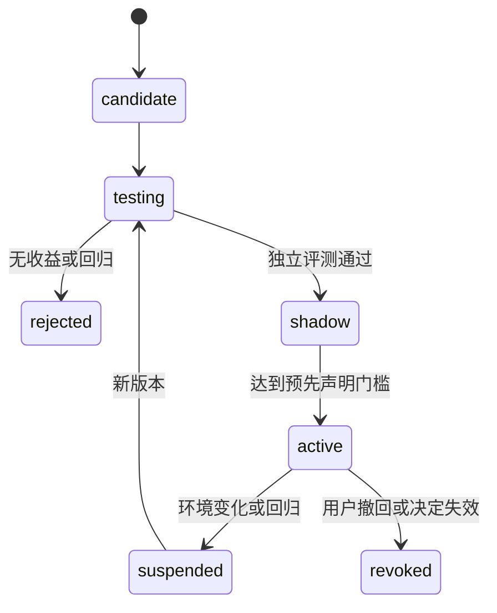

# 选择性学习与收益评估

日期：2026-11-07。本文定义最终产品的学习行为、实现边界和实验。学习不是正常委托的前置条件；当前没有训练或复现实验结果。

## 1. 研究对象与已有先例

| 工作 | 已覆盖机制 | 对本方案的约束 |
| --- | --- | --- |
| [PAHF](https://arxiv.org/abs/2602.16173) | 前后反馈、个人记忆与偏好漂移 | “越来越懂你”不单独作为创新 |
| [CLEAT](https://arxiv.org/abs/2610.12655) | 成对执行估计提问价值 | “只问有价值问题”已有先例 |
| [SynAct](https://arxiv.org/abs/2610.12651) | 选择重要决策、专家反馈、规则提炼与门控注入 | 稀缺反馈加规则启用的组合也不新 |
| [Steering](https://arxiv.org/abs/2610.22316) | 学习何时、如何纠正偏离既定目标的执行 | 执行漂移与用户改变目标必须区分 |
| [GRSE](https://arxiv.org/abs/2610.27227) | 团队 agent–skill 归因与验证更新 | 多 agent Skill 改进已有基线 |
| [CausalFlow](https://arxiv.org/abs/2605.25338) / [ReplayRCA](https://arxiv.org/abs/2610.41025) | 反事实修复及有 placebo 的干预评分 | 重放本身不构成新贡献 |
| [HASP](https://aclanthology.org/2026.emnlp-main.2086/) / [Evo-Harness](https://aclanthology.org/2026.emnlp-main.969/) | 可执行经验与 context-to-harness 编译 | “经验变程序”已有直接先例 |

本产品验证三个候选问题：I1 反馈含义与持久化对象联合选择；I2 异步团队共享决定的总人工成本；I3 目标端可验证迁移及决定撤销后的影响处理。它们不等于已证明的首创。

## 2. 一套执行核心，独立学习生命周期

真实执行的唯一生命周期来自 Ticket/Assignment。WorkIndex 只关联稳定 WorkId、contractRev 和核心 Ticket，学习记录引用这些身份，不新增一个可直接推进真实工作的状态机。

学习实验通过独立实验 lane 调用既有执行器和相同可靠调度机制，但使用限定测试环境、独立预算和低优先级。候选失败不改变真实工作或当前稳定策略。

提炼、解释和候选生成使用已有 runtime 或成熟优化器；不手写另一套通用 LLM/tool loop。可采用 GEPA 的执行/反馈接口模式，CAC Evolver 仅作为未来可选实验 adapter。

## 3. 四类对象分别处理

| 对象 | 例子 | 默认处理 |
| --- | --- | --- |
| 明确用户决定 | “以后这个项目都不要新增外部服务” | 立即记录可信来源、范围和版本 |
| 当前任务事实 | 用户删改一个补丁，但未说明长期理由 | 留在该 Work 的事实与上下文 |
| 条件化处理 | “今天服务不可用，先 mock” | 限定当前环境/任务，并带失效条件 |
| 推断技术策略 | “此类问题先验证网络再改代码” | 形成候选，独立验证后才启用 |

用户决定的规范效力不需要实验来证明；技术可行性和质量仍要验证。执行器无法表达该要求时限制执行或提出明确问题，不能把要求当作“无效经验”丢弃。

记忆和策略不扩大工具权限。worker、peer 或模型文字声称“用户同意了”不能创建可信用户决定。

公共术语统一：CoreDecision 仅指核心接单/路由；UserQuestion 由 QuestionBroker 管理问题和回答；本节的明确用户决定为 UserDecision。学习解释不回写 CoreDecision 或冒充 UserDecision。

## 4. 原始介入和证据记录

```ts
type InterventionRecord = {
  id: string;
  workId?: string;
  projectId: string;
  ticketRefs: string[];
  assignmentRefs: string[];
  actorRef: string;
  source: "direct_message" | "question_answer" | "manual_edit" | "explicit_override";
  beforeContractRef?: string;
  afterContractRef?: string;
  beforeArtifactRef?: string;
  afterArtifactRef?: string;
  environmentRef: string;
  rawFeedbackRef: string;
  occurredAt: string;
};
```

这是产品概念草图，准确字段名以公共契约为准。原始记录不可被解释模型覆盖，解释、证据与反例作为后续 revision 关联。

采集限于受管工作和用户选择的来源。人工编辑来自明确工作区差异，不监控全机键盘或任意目录；凭据和无关正文不进入学习材料。完整轨迹采集是单独的项目级实验选择。

接受产物、没有投诉或点了赞，都不能证明全部实现方法值得长期学习。

## 5. I1：解释与处理动作分离

解释可多标签或 unknown：执行违反当时要求、用户改变要求、环境临时处理、明确偏好、混合或不确定。

| 可见证据 | 当前工作动作 | 长期动作 |
| --- | --- | --- |
| 旧目标明确要求兼容，补丁破坏兼容 | 修复并重验旧目标 | 可生成兼容检查候选 |
| 用户从单机改为多实例 | 需求修订屏障，必要时关联新 Ticket | 不把旧单机方案记成错误 |
| 当前服务不可达 | 有范围的临时处理，保留假设 | 默认不推广 |
| 明确“以后本项目都这样” | 保存项目决定并引用 | 不进入推断候选实验 |
| 同时纠错和增需求 | 分开记录两个事实 | 只对有支持的缺陷部分提炼 |
| 原因无法确定 | 继续本次明确且安全的工作 | 保持局部，重大影响时补问 |

不要求用户每次填写分类表。系统可以用一条可纠正记录说明“本次按临时处理”；只有会改变较大后续范围的歧义才提出具体问题。

在线解释只使用介入时已可见的材料。离线评分可用独立标注或构造条件，不能把未来结果偷放进在线输入。

## 6. 目标变化与 agent 漂移

同一句“不要引入 Redis”应在不同背景中得到不同处理：

1. 当时已经禁止新增依赖：这是执行违约候选。
2. 当时允许远端服务，用户刚新增离线目标：这是目标修订。
3. 当前断网，用户说本次先 mock：这是环境条件处理。
4. 用户在一次修改里同时修错并新增要求：两种解释并存。

旧、新目标分别评价。新目标下成功不能倒证旧行为有错；旧目标下成功也不能证明新要求已完成。

需求修订由应用层创建新合同并处理授权/执行屏障。学习模块只提出解释与候选，不直接改 Mandate 或越过 Supervisor 启动新 writer。

## 7. 候选生成与重放证据等级

```text
介入事实 → 解释及支持证据 → 当前工作处理
                           → 可复用候选 → 实验 → shadow → active
```

候选包含机制、适用条件、排除条件、所需能力、来源、目标表示、评测引用、费用和失效条件。第一版优先小范围上下文策略；可执行动作约束另走受限表示和 adapter 验证。

| 等级 | 实际恢复范围 | 可支持的结论 |
| --- | --- | --- |
| R0 | 日志和反馈 | 解释假设 |
| R1 | 代码/dirty diff/固定检查 | 对该快照的行为证据 |
| R2 | 工具、依赖服务、数据及历史可恢复 | 对受控片段的干预比较 |
| R3 | R2 加重复匹配执行和原动作 placebo | 更可信的干预收益估计 |

git worktree、相同 seed、会话 fork 不自动构成 R2/R3。外部服务、模型和时间可能不可恢复；缺乏证据时保持 unknown。

对每个修改执行，还要从相同位置重放原动作，以扣除 agent 原本就会自行恢复的概率。所有副作用在受控测试环境或明确模拟中发生，不对生产账号重放。

## 8. 推广、冻结与撤回



candidate、testing、shadow 都不能进入真实 ContextBuilder 或改变真实动作。shadow 仅记录“本来会选择什么”；需要真实有限部署时必须使用明确的 active/canary 计划，不用 shadow 名义隐藏行为变化。

已 active 的上下文建议同样会改变行为，必须有版本。每个 Assignment 固定策略快照；升级默认影响新执行。旧决定失效涉及当前工作时，由应用层触发修订/停止屏障。

初始只在当前项目的新任务启用。用户可以查看范围、依据和撤回入口；不需要管理实验文件。

撤销先阻止未来复用，再使显式关联上下文/证据失效；产物修复另出计划并保护后续人工编辑。不承诺删除记录就消除全部潜在影响或外部副作用。

## 9. I2：团队联合提问

问题归一为决定键、适用范围、目标版本、依赖条款、原生绑定和最迟决定时点。相似文本不足以合并。

首版基线：复用明确有效决定；范围一致时去重；优先关键路径；独立分支继续。研究版再比较询问、读取来源、低成本实验和暂缓某分支的预期总成本。

一个答案可以减少多个 worker 的等待与返工，但必须保留逐 target 的真实送达结果。权限、认证和未知 native review 不作为普通事实共享。

CLEAT/SynAct 已研究提问或专家反馈价值；本方案的增量需要在异步答案复用、等待期限和团队返工外部性上得到证明。LLM 打分不是已经校准的效用函数。

## 10. I3：迁移与失效

策略包携带所需能力、范围、排除条件、来源决定版本、验证材料和失效触发。目标 harness 先检查可表达性，再做目标端行为测试。

结果可以是通过、降级、拒绝或证据不足。明确用户决定始终保留规范要求；技术执行不能满足时停止相关动作或提出替代，不静默忽略决定。

至少用两个实际不同 harness 检验迁移；换同一 runtime 的底层模型不算完成异构接入。直接复制文本、LLM 翻译、能力检查加验证均作为比较。

MemQ 的 provenance、OBLIVION 的撤销、AkasicMEM 的治理、HASP/Evo-Harness 的程序化都必须承认为先例；“曾引用过”不等于已证明因果依赖。

## 11. 强基线与实验公平性

| 问题 | 至少保留的基线 |
| --- | --- |
| I1 反馈处理 | 不长期学习、默认局部记忆、简单声明规则、PAHF 式更新 |
| I1 规则提炼/注入 | SynAct 式 authoring/error gate、既有 Evolver/GEPA 风格优化、联合对象选择 |
| I1 漂移纠正 | Steering 式既定目标纠偏，与真正目标变更分组 |
| 团队归因 | GRSE 风格对比归因，与简单全组共享经验比较 |
| I2 提问 | 逐条转发、同义去重、依赖排序、单问题价值、团队联合选择 |
| I3 迁移 | 复制文本、翻译、目标能力检查及行为验证 |

明确标记忠实复现和 paper-inspired adaptation。比较固定反馈材料、actor/工具、预算与独立评分；不能通过给新方法更多反馈或更多模型调用制造收益。

30–50 个可重建片段仅适合初步机制验证，不保证统计功效或普遍收益。真实使用研究另行报告参与者、任务与项目选择方式。

## 12. 错误学习与覆盖的权衡

同时报告误推广、漏学、负迁移、旧规则复发、后续任务质量、人工返工和费用。

完全不学习可以获得很低误推广率，但不表示方法有效。应报告风险—覆盖曲线，在相近有效学习覆盖或相近收益下比较伤害。

已知严重回归阻止推广；其余质量容忍、费用预算和分析方法在实验前声明。没有观测到伤害不是零风险证明。

同一 judge 的自评分不能兼作唯一训练与验收依据。[LUCID](https://arxiv.org/abs/2608.00017) 已提示错误相关的问题；关键结果使用独立测试、可信采集或人工审计。

## 13. 人工成本与长期测量

[METR 2026 方法更新](https://metr.org/blog/2026-02-24-uplift-update/) 指出并行 agent 会让单任务自报用时失真。产品分别报告：

- 人工主动处理时间区间的并集，不把同时处理多个任务的区间重复计入。
- 从委托到合格交付的墙上时间。
- agent 执行、排队、模型等待和用户离线等待。
- 任务质量、返工和后续复发。
- 模型与工具费用；未知用量标为未知，不算零。

UI 活动跨度只是人时代理，包含停顿且漏掉离开界面的思考；不通过全机监控假装精确。用小规模时间研究校准，主观“感觉更快”单独记录。

团队提问实验需要同等质量下比较总人工成本，不能把少弹窗但更多返工称为提升。

## 14. 数据与评测隔离

按项目、任务族和时间做开发/验证/测试划分。相同介入的复述不作为独立泛化测试，同项目连续多轮也不是多个独立用户。

固定验收依据；候选生成器不能修改隐藏测试或评价器。重复优化同一验证集会过拟合，阶段性使用真正留出任务并报告适应成本。

在线解释只看当时信息；离线评分的真实意图由明确条件或独立标注提供。模拟用户用于检查机制，真实用户用于判断人时收益。

## 15. 模块所有权与实现顺序

| 模块 | 拥有 | 对外接缝 |
| --- | --- | --- |
| Intervention recorder | 不可变介入事实和来源引用 | 接收可信应用事实，不覆盖核心执行 |
| Interpretation | 解释假设、处理建议和不确定性 | 结构化提案，不直接改授权 |
| Experiment adapter | 候选、固定评测与隔离执行引用 | 复用既有 runtime/优化器 |
| Policy registry | 候选与版本、范围和部署状态 | 只向 ContextBuilder 返回适用 active 版本 |
| Evaluation | 预声明指标、留出结果与费用 | 可重建报告，不成为新执行状态机 |

先交付明确决定与任务局部事实，再做原始介入和 shadow，最后才是有范围 active、跨 harness 迁移和衍生产物修复。独立包可以并行实现，但共享来源 ID、目标版本和结果类型必须由公共契约统一。

## 16. 需求与验收 ID

| 需求 | 对应验收 |
| --- | --- |
| FR-LRN-01 规范决定与推断分离 | AC-LRN-01 明确长期声明即时记录，一次编辑不自动全局化 |
| FR-LRN-02 原始事实可追溯 | AC-LRN-02 解释修订不覆盖原输入，保留目标和产物前后引用 |
| FR-LRN-03 混合/不确定反馈可表示 | AC-LRN-03 纠错加需求变化可并存，unknown 不强制推广 |
| FR-LRN-04 执行与目标漂移区分 | AC-LRN-04 旧目标正确方案不因新目标而被记错 |
| FR-LRN-05 重放证据分级 | AC-LRN-05 git fork 不被标成完整环境恢复，使用原动作对照 |
| FR-LRN-06 shadow 零真实影响 | AC-LRN-06 候选/测试/shadow 不进入实际上下文或修改动作 |
| FR-LRN-07 推广有范围版本 | AC-LRN-07 Assignment 固定快照，撤回阻止新执行采用 |
| FR-LRN-08 联合提问不合并授权 | AC-LRN-08 逐 target 答案可见，权限与认证保持原生决定 |
| FR-LRN-09 强基线和预算公平 | AC-LRN-09 同反馈/模型/预算比较，复现与启发式改编区分 |
| FR-LRN-10 风险与覆盖同时评价 | AC-LRN-10 不学习基线不会只因误推广低而获胜 |
| FR-LRN-11 人工时间不重复 | AC-LRN-11 并行区间取并集，等待、返工、费用独立报告 |
| FR-LRN-12 留出与隐私边界 | AC-LRN-12 隐藏测试不可改，轨迹采集限定项目，缺失证据保持未知 |

AC 是待实现的验收规格；静态文档检查不能证明算法效果、原生兼容或真实用户收益。

## 17. 继续与停止条件

若默认任务局部事实加明确声明规则已达同等效果，就保留简单实现。若去重与依赖排序已达同等人时收益，就把它作为产品功能而非新算法。负迁移、额外成本或真实用户研究不支持收益时，收窄或停止复杂机制。

即使创新实验未成功，主对话、可靠工作、决定和交付系统仍应具有日常价值。研究主张应来自可复核证据，不来自“自进化”名称。
