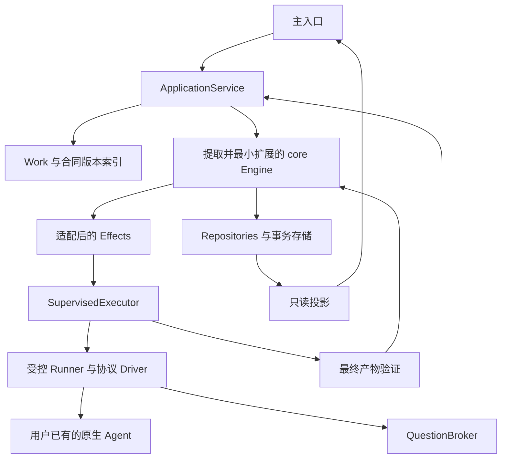
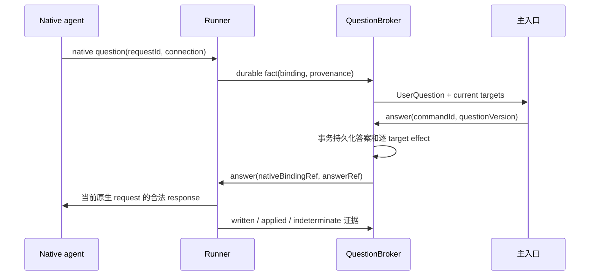
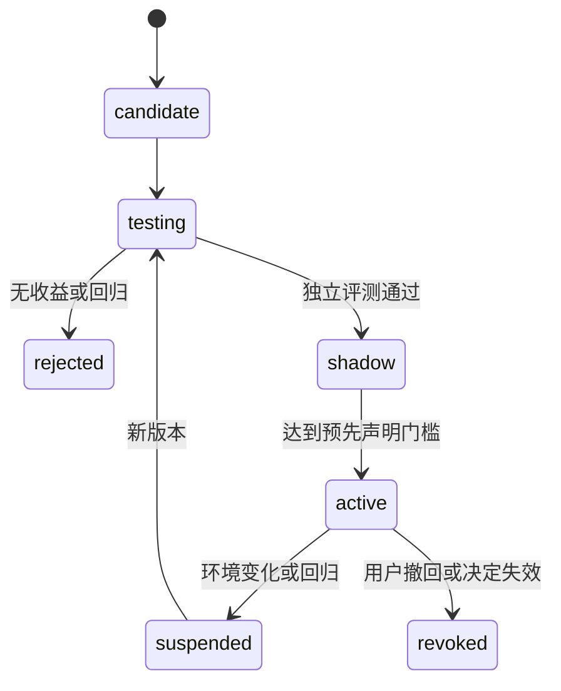

# 个人 Agent 助理方案 B：完整阅读版

---

生成日期：2026-11-07。此文件合并总览和九个专题，方便连续阅读；拆分实施请使用 [任务包索引](tasks/README.md)。当前是设计基线，尚未实现或通过 native 验收。

---

# 个人 Agent 助理：方案 B 产品实现蓝图

版本：`B-1.0-draft` · 2026-11-07 · 状态：可用于拆分实施，须先通过 G0。本文档集是本产品的当前设计基线；不是已实现产品的说明书。

交付仓库：[JokersDH/dsh-superagent-prototype](https://github.com/JokersDH/dsh-superagent-prototype)。代码位置和两个额外 Agent 的开工入口见根 [START-HERE](../START-HERE.zh-CN.md)；新产品直接落在本仓根 packages/apps/tools。

## 1. 产品结论

做一个本地优先、以主对话为入口的个人开发助理。用户在一个地方讨论、委托多个项目的工作、回答各 agent 的问题、修订要求、查看验证后的交付，并沉淀明确决定。后台协调器持续工作；关闭网页不停止任务。ZCode、DeepSeek Harness、Codex 是首批接入目标，CAC 后续以执行器接入。

**方案 B 指产品独立于 CAC 和 DSH 应用宿主，不表示全部自研。** 默认提取本仓库 superagent 的 Ticket/Assignment 内核，复用事务、队列和通知的适用部分；原生 agent 继续承担模型循环、工具执行、原生会话与原生子团队。我们实现跨运行时的可靠接线、人工交互、目标版本、验证及个人经验治理。

首版默认一个合同版本对应一个主 Ticket，优先使用该执行器已有的 team/subagent。跨 harness 的细粒度动态团队属于后续扩展，不能成为首版交付前提。

## 2. 最终产品形态

初始交付是本机 daemon + 浏览器工作台 + CLI，首先支持 macOS；不先做桌面壳、云集群或移动 App。

```text
pa start / pa status / pa doctor / pa backup / pa stop
                  │
       127.0.0.1 本地网页
 ┌──────────────┬──────────────────────────────┐
 │ 项目 / 工作  │ 主对话：讨论、委托、问题、交付 │
 │ 待你决定  2  │                              │
 │ Agent 连接   │ 当前工作与合同 / 证据 / 变更   │
 │ 决定与经验   │ 需要时展开的执行细节与诊断     │
 └──────────────┴──────────────────────────────┘
```

`pa` 是拟议命令名。完整流程、页面、空状态、失效状态和线框见 [01 产品与体验](01-product-and-experience.zh-CN.md)。主页面的价值是每天能用的助理；研发证据和实验控制放在可展开区域。

第一可用出口：一个通过验收的真实执行器、两个项目、完整提问链路、真实产物验证、关闭重开和协调器恢复、准确停止。下一出口：第二种真实协议验证扩展能力，再补齐第三个目标。若原生版本能力不足，清楚降级，不用统一绿灯掩盖差异。

## 3. 文档地图

| 文档 | 用途 | 主要读者 |
| --- | --- | --- |
| [01 产品与体验](01-product-and-experience.zh-CN.md) | 用户流程、交互、范围和 UX 验收 | 产品、UI、应用编排 |
| [02 架构与复用](02-architecture-and-reuse.zh-CN.md) | 逐文件复用、状态所有权、内核必要改造 | 集成负责人、core、存储 |
| [03 契约与数据](03-contracts-and-data.zh-CN.md) | 公共 interface、数据、事务、时序、HTTP | 全部实现者，必须先读 |
| [04 Agent 运行时](04-agent-runtime-and-extension.zh-CN.md) | DriverKit、三个接入、原生权限与扩展 | Runner、Driver 作者 |
| [05 稳定性与运维](05-reliability-and-operations.zh-CN.md) | 崩溃、取消、重试、备份、发布与诊断 | 后端、测试、发布 |
| [06 学习与创新验证](06-learning-and-evaluation.zh-CN.md) | 明确决定、选择性学习、联合提问、实验 | 经验模块、研究实现者 |
| [07 实施与验收](07-implementation-and-acceptance.zh-CN.md) | G0–G6、步骤、测试层次、发布出口 | 负责人、验收人员 |
| [08 多 Agent 开发](08-multi-agent-development.zh-CN.md) | 任务归属、依赖、RFC、分支与集成 | 所有领任务的 agent |
| [09 选型与证据](09-technology-and-evidence.zh-CN.md) | 选型理由、替代项、来源和已知限制 | 架构、依赖维护 |
| [任务包索引](tasks/README.md) | 可逐包复制给不同 agent 的实现指令 | 派工者 |
| [公共类型草案](contracts/contracts.ts) | 单一公共类型候选，G0 冻结为实现契约 | 契约负责人 |
| [类型化样例](contracts/fixtures.ts) | 委托、主对话、原生问题和答案的最小样例 | UI、应用、Driver |
| [任务清单](work-packages.json) / [验收目录](acceptance-catalog.json) | 机器可检查的依赖与验收索引 | 自动化、集成 |

阅读顺序：本页 → 01 → 02 → 03 → 07 → 自己的任务包及其专题。并行实施规则以 08 为准。契约变动先 RFC；不得在各 Driver 内复制一个私有版本。

需要连续阅读时打开 [完整合并版](FULL-BLUEPRINT.zh-CN.md)；需要派工时直接打开对应任务包。合并版由同一来源生成，不能另行编辑。

当前有主 Agent 加两个额外 Agent 时，按 [三 Agent 分工与首轮指令](three-agent-dispatch.zh-CN.md) 执行：先在 WP-00 内并行完成契约、core 提取、平台验证，再进入正式模块开发。

## 4. 关键决定

| 决定 | 原因与约束 |
| --- | --- |
| 复用 core，独立组合根 | 本仓 core 主要依赖本目录与 node:crypto；先独立提取验证，不能直接依赖原 DSH 插件根入口 |
| Ticket/Assignment 是唯一执行生命周期 | Work 仅保存稳定身份、目标版本和 Ticket 关联，展示状态从事实派生 |
| 单 coordinator writer + SQLite WAL | 首期本机单用户工作负载；避免多个写入权威和分布式恢复成本 |
| Supervisor + 每 attempt 受控 Runner | 协议与进程失败可隔离；平台崩溃后仍需核对实际 writer |
| 协议 Driver + 产品 Profile | 同协议优先复用 Driver；新协议才增加 Driver；能力由实际测试证明 |
| 主对话 Reasoner 复用已有 runtime | 不自建 LLM loop；只给读和结构化提案能力，执行授权由可信入口决定 |
| 问题集中，原生批准逐请求 | 业务答案可有条件复用，权限/认证不能因文本相似而共享 |
| 可信完成 gate | 原生 end_turn 不等于交付合格，core 最终完成须绑定当前候选与验证 |
| 先明确决定，再研究自动学习 | 日常价值先交付；推断规则须经过独立实验和版本化推广 |

## 5. 复用、自研与延期

直接复用：本仓 core slice 与测试、Git worktree、厂商 agent runtime、ACP 官方 SDK、HTTP/UI/测试基础库。适配复用：Store 的领域 SQL 和事务行为、Effects 算法、文本 Outbox、原生协议与版本 schema。新增：产品索引、Source/Policy、completion/report guards、Supervisor、QuestionBroker、Verifier、工作台与兼容报告。

暂缓：自研 agent 推理框架、Redis/Temporal、Kubernetes、多机调度、全自动跨 harness 子团队、共享账号权限代理、自动部署/合并、全局无审查自进化。完整设计保留扩展 interface，首版不为空想功能建一套通用平台。

## 6. 创新定位

多 agent 接入、问题上浮、后台任务、自动开发流水线本身已有成熟先例。本方案把它们作为产品基础，不宣称突破。

研究重点是：区分用户“改变目标”与 agent“偏离目标”的选择性学习；在团队总等待、返工和人工成本下选择提问；带适用条件、来源和失效测试的跨 harness 策略迁移。每项都给出强基线、停止条件和实验门槛，详见 06。创新收益没有被本次文档工作证明。

## 7. 从哪里开始

先派发 [WP-00](tasks/WP-00.md)：复用提取试验、契约/仓库/bootstrap、版本与来源锁定。通过 G0 后，core、存储、DriverKit、UI fixture 可以分开推进；Driver 的正式接入验收必须等待 Runner 与原生策略链路，不能仅靠 parser 单测。

随后按 [实施计划](07-implementation-and-acceptance.zh-CN.md) 完成一条真实纵向链路，再扩大并行。所有任务包区分 `startAfter` 与 `acceptAfter`，允许先用 fixture 开发，但不会把 mock 联调算成产品验收。

## 8. 当前证据与检查

设计调研阶段运行的原仓 144 个测试仅作为 reference baseline。随后 G0 已完成：Agent A 的独立提取/144 测试和 AST 复核，主 Agent 的单一来源契约包/183 测试/独立构建，Agent B 在打包补正后的 darwin-arm64 目标组合/30 探针与独立复验。当前 G0 结论和范围见 [交接报告](../docs/adr/bootstrap/g0-main-report.md)。

G1 已交付正式 core 的候选/可信完成、Assignment-scoped report/read、当前版本/退役守卫，以及共享 workspace/检查入口；见 [G1 交接](../docs/adr/core/g1-core-handoff.md)。core 176 项和契约 183 项测试通过，真实 Store/Runner 联调尚未通过，因此整体 G1 仍在进行。

尚未实现完整产品协调器，也未运行原生 agent 模型任务或学习实验。原生产品版本/协议调研依然不代表接入通过，未实际执行的平台能力保持 NOT_TESTED。

文档一致性检查：`node product-spec/tools/verify-spec.mjs`。公共类型检查命令见 07。这些检查只证明规格内部一致和草案可编译，不证明产品稳定性或学习收益。

整合时发现的接口与依赖问题及修正见 [复核记录](reviews/integrated-design-review.md)，可作为后续架构评审和回归依据。

本目录优先于 `.artifacts/personal-agent-architecture/` 和 `.artifacts/personal-agent-b-plan/` 中旧的实现草案；历史调研来源仍可引用。遇到冲突以本目录当前契约和 ADR 为准。


---

# 个人开发助理：产品与使用体验

日期：2026-11-07。状态：可用于分工实施的产品规格，尚未实现产品或通过真实 agent 验收。

## 1. 最终产品是什么

这是一个常驻的个人项目伙伴：用户在主对话中讨论、委托、补充和改变目标，助理安排已有 agent 执行，把必要问题和可验证结果集中带回。

首批执行器目标为 ZCode、DeepSeek Harness、Codex。首个可用版本可以先启用一个通过真实兼容门禁的执行器，其余准确显示接入状态；列举顺序不自动成为固定调度顺序。

产品以独立协调器运行，不要求 CAC。已有 agent 负责模型查询、工具执行、原生认证与上下文管理；产品不重新手写通用 LLM/tool loop。

主对话是第一入口。工作列表、执行器列表和诊断是支撑视图，不能把最终产品降格成只能点任务的 agent 仪表盘。

## 2. 用户、目标与边界

| 用户情形 | 要完成的事 | 成功标准 |
| --- | --- | --- |
| 日常推进多个项目 | 用一个入口连续委托工作 | 不重复说明背景，不串项目 |
| 当前工作中有新想法 | 补充或修改已有目标 | 保持工作身份，说明变化影响 |
| agent 需要人决定 | 在当前入口回答 | 问题归属和答案用途明确 |
| 隔天继续 | 找到结果和未决事项 | 不需要重述任务或重建团队 |
| 混用不同 agent | 按项目选择执行器 | 能力限制提前说明，切换不丢工作 |

第一阶段面向单用户、本机、已有 git 项目。多机、多用户、自动发布、任意账号操作和模型训练不是完成正常委托的前提。

知识库连接、长期学习和并行团队优化均可后接入；它们不能阻塞第一次正常工作。

## 3. 产品对象与唯一事实源

- **主对话**：用户交互记录和 AssistantReasoner 的推理载体，支持讨论而不必每句话都创建执行任务。
- **Work**：一次用户委托的稳定身份。需求修订和执行器更换后仍可沿用同一个 WorkId。
- **WorkIndex**：维护 `(workId, contractRev) -> rootTicketId/children`、目标与交付引用，不维护第二份执行状态机。
- **Ticket/Assignment**：执行授权和执行生命周期的唯一权威。范围扩大需要新 Mandate/Ticket 时，通过 WorkIndex 关联到同一用户工作。
- **WorkView**：由核心 Ticket、Assignment、验证、决定和 Supervisor 事实派生的用户投影。缓存可重建，不反向覆盖执行状态。
- **CoreDecision**：核心的接单/路由判断，保留 superagent 原有含义。
- **UserQuestion**：有归属、版本和原生绑定的用户问题及回答生命周期。
- **UserDecision**：用户明确表达的规范决定，保存来源、范围和版本。
- **Result**：某个目标版本下的产物、验证和人工接受事实。

物理主聊天不直接映射成所有 Ticket 共同订阅的同一领域 Thread。新委托具有独立逻辑归属，明确回复才进入对应工作，避免新消息扇出到旧任务。

## 4. 主对话怎样工作

AssistantReasoner 由一个已有 runtime 承载，使用受限制的读取和结构化提案能力。它可以理解请求、读取允许的工作/知识快照、提出计划或说明结果。

它不能自行伪造用户身份、批准工具、改写授权或直接写核心状态。提案经确定性应用入口校验，执行继续走 Ticket/Assignment。

| 输入 | 正常处理 |
| --- | --- |
| “这个项目接下来应该做什么” | 讨论与计划建议；未经委托不自动启动所有建议 |
| “把导出功能做出来，交一个可评审版本” | 生成明确目标和范围，创建关联 Ticket |
| 回复导出工作：“先加 UTF-8” | 关联原 Work；需要时创建目标新版本 |
| “aiVideo 的字幕问题也查一下” | 独立只读分析委托，其他工作继续 |
| “现在有哪些卡住了” | 确定性读取账本，不逐个唤醒 worker |
| 点击“停止这项工作” | 确定性控制入口，绕过模型队列 |

答案提交、停止、已知状态查询和验收提交不等待 AssistantReasoner。模型不可用时，这些基本操作仍然可用。

Reasoner 不持续空转。输入、必要结果或需要解释的变化触发有限调用；普通进度和健康事件由投影呈现。

## 5. 信息架构

| 视图 | 主要内容 | 默认关注 |
| --- | --- | --- |
| 主对话 | 自然表达、关联工作、必要决定和结果 | 当前协作 |
| 待决定 | 澄清、权限、认证、主观验收 | 需要用户动作 |
| 工作 | 项目、目标、实际状态、产物 | 进行中和最近交付 |
| 执行器 | 身份、兼容版本、能力和原生登录状态 | 是否适合当前任务 |
| 知识与决定 | 项目来源、明确决定、引用与失效 | 当前有效内容 |
| 学习 | 候选、验证、已启用变化及撤销 | 影响未来行为的变化 |
| 设置 | 项目、默认执行器、预算、数据与运行 | 少量全局控制 |

主视图草图，供实现排版使用，不是营销页：

```text
主对话                    项目 MerchantOps     执行器 ZCode

你：导出功能继续做，先支持 CSV。字幕问题也查一下。
助理：导出工作已补充；字幕定位作为 aiVideo 的独立工作。

导出功能   正在推进，1 处待决定
  本版本是否必须支持断网导出？
  来源：当前目标缺少该条件   影响：导出、认证配置
  [需要] [不需要] [稍后]

字幕定位   结果可查看
  已定位时间轴偏移来源；未改代码。
  [查看证据] [继续修复]

输入你的下一步……        回复对象：无       项目：MerchantOps
```

界面保持紧凑列表和可展开细节。没有待决定事项时不显示巨大空状态；正在推进和最近结果仍可查看。

## 6. 第一次使用

1. 启动本地协调器，打开实际主对话；选择一个项目目录。
2. 从本机探测到的 ZCode、DSH、Codex 中选择执行器。显示实际路径和版本，不把“已安装”当作“已验证”。
3. 核对工作范围与原生权限方式；没有可表达且已验证的权限映射时不开始业务执行。
4. 只读身份/握手检查与可能产生模型费用的 smoke 分开。已完成兼容检查的安装不要求用户重复完整测试。
5. 必要时进入正确执行器的原生登录流程；完成后核实状态，不在主对话索取 token。
6. 直接提交第一项工作。知识库、学习、后台开机启动均不是前置选择。

用户不先编辑 profile JSON、创建 team、选角色数量、配置消息队列或决定实验阈值。高级配置可从设置进入。

## 7. 完整日常流程

### 委托与并行

请求先持久化，界面立即显示已记录及归属，再进行模型解释和派工。相同输入重试不会重复建单。

不同项目建立独立上下文。写任务使用独立受控工作区；只读任务使用限定范围。资源不足显示排队，用户控制和答案不排在普通 worker 后。

### 补充和歧义

显式 WorkId、回复锚点和项目选择优先。用户可以一键清除回复对象，避免误把新任务追加到旧工作。

低风险歧义允许先做只读定位并给出可纠正归属；可能写错项目或扩大范围时提出一个具体选择。原输入保留，不要求用户重新描述。

### 回答问题

问题显示来源工作、问题类型、适用范围和受影响工作。推荐答案必须附可展开来源，不能用过期记忆压过用户当前意思。

同一事实可在范围一致时帮助多个任务，但权限请求、认证和未知来源 native review 不按普通答案共享。答案先落盘，再向有效原生绑定投递。

### 修改需求

用户将单机改成多实例时，WorkId 保持；新 ContractRevision 记录后经过修订屏障。受影响旧输入失效，旧 writer 停止/核对后才进入新执行。

界面显示“需求已记录，执行切换中”，直到新版本真正可执行。旧目标下正确的行为不自动变成错误经验。

### 暂停、停止与继续

暂停默认是暂停后续派工；当前运行仍可能完成。只有核验支持的原生能力才提供更强暂停。

停止先显示“停止中”；不能把发送取消或核心 Ticket 已结束误作进程静止。实际旧 writer 未确认结束时不复用其可写目录。继续是明确用户动作，核对后使用新 Assignment/必要的新 Ticket。

### 交付与验收

worker ready、可信验证、用户接受、外部提交是不同事实。最终集成失败时，多个子任务成功也不能显示整体完成。

客观条件可以按合同自动完成；主观项要求查看实际产物后决定。用户没有查看结果，不应让无关工作全部停止。

个人助理 Ticket 必须采用核心的显式 external-completion 扩展：受信验证/必要人工接受通过后，才由核心结束 Ticket。界面不另写 Work closed，也不伪造一个 GitHub Thread 来拖住或结束执行。

## 8. 工作详情与产物

```text
CSV 导出                             项目 MerchantOps
目标 v3：离线导出，保持兼容            正在验证

当前产物：分支 / 文件差异 / 可打开结果
验证：格式测试通过；兼容性检查运行中
剩余：列顺序需要确认
沿用决定：本项目保留旧接口（用户，2026-11-07）

时间线：已记录 → 执行 → 需求更新 → 继续 → 验证
操作：补充   暂停后续派工   停止   查看差异
```

详情默认提供可理解事实，不暴露全部 native ID。诊断展开后可看到 Ticket、Assignment、执行器版本、目标和证据引用，方便定位问题。

产物预览进程若保留，需要可见入口、所属工作和停止方式；关闭预览不自动等于停止整个执行器服务。

## 9. 执行器、知识和学习页

执行器页区分已发现、已连接、已认证、当前任务可用。显示限制和可行动诊断；同协议新增 agent 尽量导入 profile，新协议明确需要 driver。

ZCode 源码可见不等于安装版已兼容；DSH 的 profile/SDK 版本分别检查；Codex 本机 schema 不等于已跑通。版本锁表示发现变化后重新核验，不表示能回滚第三方 binary。

知识页首版以只读来源引用和明确用户决定为主。来源变更触发核对；索引可重建，不成为项目事实的另一个权威副本。

学习页分开显示原始介入、待验证推断和已启用策略。明确用户决定立即记录，不要求 A/B 证明偏好；推断候选在 active 前不进入真实上下文。

用户可以查看某项改变会影响哪里、依据什么、如何暂停或撤回。普通用户不管理全部实验文件或内部 Skill 命名。

## 10. 状态、故障与默认值

| 显示 | 实际含义 | 用户下一步 |
| --- | --- | --- |
| 已记录/排队 | 输入已持久化，执行未就绪 | 等待、调整、取消 |
| 正在推进，1 处待决定 | 其他有效分支仍能继续 | 稍后回答 |
| 等待授权/登录 | 原生动作或认证被暂停 | 进入正确原生决定流程 |
| 已回答，等待送达 | 本地答案已保存，原生应用未确认 | 保留输入，核对连接 |
| 需求切换中/停止中 | 控制已受理，旧执行未确认静止 | 查看实际进展 |
| 状态待确认 | 启动或外部动作结果未知 | 核对，避免盲目重复 |
| 正在验证 | 有候选产物，没有最终交付结论 | 查看中间结果 |
| 结果可查看/部分完成 | 有当前版本交付或明确缺口 | 查看、验收、修改 |

默认：一个项目和一个已验证执行器即可使用；小并发；结果与必要决定通知；学习后台观察；候选不改真实行为；不自动跨账号、权限或费用换 agent。

磁盘失败不能显示“已记录”；模型失败不阻断停止、答案和状态查询；主入口离线不销毁决定。恢复时先读快照和 cursor，事件重复不重复轰炸。

## 11. 可访问性与响应

- 主对话、问题和产物均支持键盘操作；焦点不被新进度强行抢走。
- 类型、项目、错误和状态不只依赖颜色；图标有名称，重要操作有可理解文本。
- 流式输出不会不断打断屏幕阅读器；关键问题使用受控 live region，重复事件不重复朗读。
- 移动和窄屏保留项目、工作归属、答案与停止入口；长文本换行，不遮挡按钮。
- 停止与回答受理使用本地确定性路径，慢模型不让操作变成无限 spinner。
- 提问允许稍后；原生超时按真实状态处理，不自动批准或假装仍可回答。

## 12. 模块责任与实现分工

| 模块 | 负责 | 不负责 |
| --- | --- | --- |
| Console | 主对话、收件箱、详情和投影 | 不写核心执行状态 |
| Conversation application | 持久输入、回复锚点、Reasoner 调用和提案校验 | 不重写 agent loop 或批准工具 |
| AssistantReasoner adapter | 已有 runtime 的受限推理会话 | 不持有 Ticket/Assignment 写权 |
| Core/application bridge | WorkIndex、合同引用、可信命令及投影 | 不新增 Work 执行状态机 |
| QuestionBroker | UserQuestion、有效绑定与答案路由 | 不把可见问题等同批准或 CoreDecision |
| Catalog/Doctor | 身份、兼容与可用范围 | 不替用户静默升级产品 |

各实现包通过父规格的版本化契约联调。UI 开发者可先用场景 fixtures，不需要同时修改核心；Reasoner 与 native worker 的兼容报告分别管理。

## 13. 需求与验收 ID

| 需求 | 对应验收 |
| --- | --- |
| FR-UX-01 主对话支持讨论与委托 | AC-UX-01 讨论不会自动启动建议列表；明确委托才建立工作 |
| FR-UX-02 查询、答案、控制绕过模型 | AC-UX-02 模型不可用时仍能查看、回答、停止 |
| FR-UX-03 稳定工作身份与唯一执行权威 | AC-UX-03 修订保持 WorkId，执行投影由 Ticket/Assignment 等事实重建 |
| FR-UX-04 项目和回复归属明确 | AC-UX-04 两项目同名任务不串台；可清除回复锚点 |
| FR-UX-05 问题集中且类型准确 | AC-UX-05 澄清可有条件复用；权限/认证不可作为普通答案共享 |
| FR-UX-06 修订和停止状态真实 | AC-UX-06 旧 writer 未静止时不显示已切换/已停止或交接同目录 |
| FR-UX-07 交付有新鲜证据 | AC-UX-07 子任务全成功但集成失败时不显示整体完成 |
| FR-UX-08 首次使用低负担 | AC-UX-08 未连接知识库、未启用学习也能完成第一项真实任务 |
| FR-UX-09 执行器可用性诚实 | AC-UX-09 安装、连接、认证、兼容与任务能力分别可见 |
| FR-UX-10 离线和错误可恢复 | AC-UX-10 重开保留输入、原问题和结果；旧答案不唤醒已停止工作 |
| FR-UX-11 学习变化可控制 | AC-UX-11 明确决定即时记录，推断变化可查看范围、暂停和撤回 |
| FR-UX-12 基本可访问性 | AC-UX-12 键盘完成一次委托与回答，新进度不抢焦点或重复朗读 |

所有 AC 是待实现的验收要求，不是本次文档检查已经通过的运行测试。

## 14. 研究依据与限制

[Microsoft HAI 指南](https://www.microsoft.com/en-us/research/blog/guidelines-for-human-ai-interaction-design/) 支持高效纠正、不确定时缩小范围、谨慎适应及说明变化后果。[METR 2026 方法更新](https://metr.org/blog/2026-02-24-uplift-update/) 提醒并行 agent 下任务用时与人工时间不能混为一谈。

统一入口、问题上浮和工作列表属于成熟产品能力。创新假设位于选择性学习和团队联合提问；它们必须通过独立实验，而不是靠界面名称成立。


---

# 02 架构、代码复用与唯一状态来源

日期：2026-11-07。本文是方案 B 的实施蓝图并补充 G0/G1 进度；整体产品实现和 G1 跨模块验收仍未完成。

阶段更新：蓝图之后，G0-A 的隔离 core 提取已通过独立验收，详见 [复核记录](../docs/adr/bootstrap/reviews/g0-agent-a.md)。本文原有“原仓 reference baseline”与后来“独立提取通过”的证据不可混用；正式扩展的后续进展见下一段。

后续 G1 更新：`packages/orchestrator-core` 及完成/报告/候选/退役扩展已实现第一批，见 [G1 核心交接](../docs/adr/core/g1-core-handoff.md)。以下设计门槛仍用于后续真实存储和运行时验收，不能将纯核心测试替代物理停止/事务接线证据。

## 1. 最终选择

**优先提取本仓库 superagent 领域内核，保留 Ticket/Assignment 作为唯一执行生命周期。** 独立产品新增的是本地入口、目标版本、原生执行器适配、可靠人工交互和可信验收，不重新发明同等职责的 WorkKernel。

Work 是用户的一次长期委托：稳定 ID、项目、原始请求、不可变 ContractRevision 和 Ticket 关联。它的排队、推进、停止、就绪等显示来自关联 Ticket、当前 Assignment 与物理资源事实的投影。Work 不拥有另一个 running/ended/completed 状态机。

首版每个当前 ContractRevision 默认一个授权 Ticket，其 Executor 可以使用目标 agent 原生 team/subagent。复杂跨 Ticket 派工作为后续受约束能力；首版完整产品不依赖它。

## 2. 核实结果与复用门槛

源基线为本仓库 commit `8c32a9dc5d72c033816c6a8110b37f40cf94fba4`。

- [src/core](../src/core/index.ts) 的运行时依赖为本目录模块和 `node:crypto`，不直接依赖 Cordis、DSH Session、GitHub 或 Feishu。
- [core-engine.spec.ts](../tests/core-engine.spec.ts) 使用 MemoryRepositories、fake Policy/Assessor/Executor/Outbox；[stage.spec.ts](../tests/stage.spec.ts) 直接测试阶段和重试语义。
- 本轮主任务在**原仓**运行上述两文件，结果为 2 个文件、144 个测试通过。该结果是 reference baseline，不是独立提取、原生 agent 兼容或产品完成的证据。
- [Store](../src/app/store.ts) 通过迁移、策略、提示词和通知存在应用耦合；[Effects](../src/app/effects.ts) 直接使用 Store SQL；[Outbox](../src/app/outbox.ts) 连接 SourceRegistry/Commands，不能整包无差别复制。

### R0：先证明可以提取

R0 必须在独立 harness 中复制精确 core slice 和对应测试、提供最小 package 入口，并重复 reference baseline。需要同时检查运行时和 TypeScript type graph 不含 `@deepseek-ai/*`；不能仅凭本次 import 阅读就宣布提取成功。

R0 之前不接原生 agent，不做生产状态迁移，不给 UI 编造完成率，也不让别的实施包重写 Ticket 规则。

R0 失败时默认动作是定位并裁剪真正的应用依赖、补测试或缩小首版功能。只有形成具体阻塞证据、确认无法以小范围适配保留领域规则，并由负责人批准新的 ADR 后，才讨论替代内核。不得将“写起来更顺手”当作全量重建理由。

## 3. 唯一权威与新增记录

| 数据 | 唯一权威 | 新增部分允许做什么 |
| --- | --- | --- |
| Trigger、Thread、准入 Decision、Mandate | core Engine | 本地 Source 翻译可信输入，PersonalPolicy 收窄入口 |
| Ticket、Assignment、Input、Report | core Engine | 原生 adapter 报告事实；投影不能另写执行阶段 |
| Work 与 ContractRevision | 产品 ApplicationService | 保存用户目标和版本；关联 Ticket，不替代其生命周期 |
| RuntimeBinding、DispatchReceipt | Executor/Supervisor | 原生身份、发送和取消证据；不自行完成 Ticket |
| NativeQuestion、AnswerDelivery | QuestionBroker | 原生请求、可信用户答案、逐 target 投递 |
| Verification、Artifact | 可信 verifier | 生成验收事实；通过 core 完成命令结束 Ticket |
| PolicyCandidate、PolicyRevision | 学习 module | 单独管理经验；不更改当前 Ticket 的授权来源 |

尤其要区分三个名字：core `Decision` 是准入/路由决定，core `Attention` 是 Ticket 的待人工摘要，产品 `NativeQuestion` 是完整的原生问题及答案生命周期。它们可以关联，不能因都叫“决定”就混存或互相授予权限。

RuntimeBinding 可以记录 `nativeObservedStatus`、进程身份、connection epoch、取消回执与静止证据。这些是物理运行观察，不是另一个 Ticket/Assignment 状态机。

## 4. 选定的模块和进程



规范性逻辑 module：

```text
packages/orchestrator-core   原 core slice；仅本包拥有 Ticket/Assignment 转换
packages/contracts          产品命令、ContractRef、原生请求与 Driver schema
packages/storage            core Repositories、QueueStore、产品附加表、迁移
packages/effects            复用队列算法、Channel Outbox 与重试分类
packages/execution          SupervisedExecutor、原生绑定、工作区和停止屏障
packages/driver-kit         连接、帧、原生事实流和 conformance 辅助
packages/drivers             协议差异：Codex native、ACP v1、ZCode native
packages/verification       冻结产物、新鲜事实与可信完成提案
apps/coordinator            组合根、ApplicationService、Source/Policy、HTTP/SSE
apps/console                委托、问题与结果；只调用产品 interface
```

这是归属划分，不要求一次创建全部空 npm 包。首次实现可以在一个 workspace 内先按目录隔离，真实消费者出现后再发布包。

默认技术栈沿用已选方案：TypeScript、拟锁 Node 24.22.2、拟锁 better-sqlite3 13.0.3、一份本机 SQLite WAL、一个 coordinator writer、受控 Runner。该发行组合仍需 native load、恢复、备份和兼容测试；本次没有安装或验证它。

提取 core 不需要把根 package.json 的 DSH peers 全部带入。不能直接 import 原插件根入口 `src/index.ts` 或 `Runtime`，再称为独立版。

## 5. 按文件的复用决定

| 原文件 | 决定 | 具体范围与限制 |
| --- | --- | --- |
| `src/core/model.ts`、`ids.ts`、`errors.ts`、`reasons.ts` | 原样提取后小扩展 | 保留已有概念、ID 与错误语义；产品字段采用明确可选扩展 |
| `src/core/engine.ts`、`part.ts`、`ports.ts` | 原样提取后小扩展 | 保留事务入口与角色 interface；补可信完成、报告 fence，禁止平行状态机 |
| `src/core/intake.ts`、`evals.ts` | 直接复用 | 保留去重、batch、gate、授权与候选超时；本地 Source 负责正确 Thread 划分 |
| `src/core/tickets.ts` | 直接复用并加有测试的最小差异 | 现有 retry/resume/stop/handback；完成 gate 与业务输入失效需在这里保持一致 |
| `src/core/assignments.ts` | 直接复用并最小修改 | 上游 ready 会终结未跟随 Thread 的 Ticket；个人模式必须延迟可信完成 |
| `src/core/replies.ts`、`stage.ts` | 直接复用为基线 | 结果发送需再检查完成 gate；产品显示验证中属于投影，不重复写 Ticket stage |
| `src/core/memory.ts` | 测试复用 | MemoryRepositories 用于 R0 和快速核心测试，不能代替真实事务/effect 验证 |
| `src/app/store.ts` | 拆出并适配 | 保留领域表、active index、事务/savepoint、afterCommit 与 receipt 算法；去掉设置和旧应用迁移耦合 |
| `src/app/store-read.ts` | 选择性复用 | 保留领域查询；产品索引另加，不把所有旧 panel 查询带进来 |
| `src/app/effects.ts` | 复用算法并适配 port | 保留 key/coalescing/generation/并发/backoff；替换具体 Store 类型和 effect payload |
| `src/app/outbox.ts` | 适配复用 | 保留 Channel 消息 receipt/顺序；ChannelTransport 取代 SourceRegistry/Commands |
| `src/app/passes.ts` | 适配复用 | 保留串行 pass、合并请求；configured/closing 改为产品 readiness |
| `src/infra/health.ts` | 适配复用 | 保留每项 health 单 writer，Health 类型不再引入 Sources host |
| `src/policy.ts` | 提取所需算法，不整包照搬 | PersonalPolicy 实现 core Policy；默认只接可信用户与显式规则 |
| `src/kv.ts`、`src/app/migration.ts` | 新建产品版本体系 | 不默认承担 schema10→11、GitHub/Feishu 历史数据兼容 |
| `src/app/runtime.ts`、`sessions.ts`、`executor/dsh.ts` | 不作平台运行依赖 | 产品自有组合根和原生 Driver；其中调度/恢复经验作为参考 |
| `src/sources/github*`、`feishu*`、旧 client panel | 非首版依赖 | 保留原代码；B 版不以 GitHub/Feishu 账号和 DSH Web 宿主作为启动条件 |

### Store 为什么不能原封不动搬走

`store.ts -> migration.ts -> notices.ts -> executor/dsh.ts` 是一条实际 import 链；还有 `policy.ts`、`prompts.ts`、`context.ts` 及来源链接/旧数据处理。`kv.ts` 的一些依赖虽然只是 type import，也会影响提取后的 type graph。

所以选择复用领域存储的 SQL 与行为，裁掉产品不需要的应用历史，而不是装完整 DSH 来让原 Store 编译。新增产品 schema 使用自己的标识和版本，默认新建 state directory，不能误开用户旧 superagent DB。

## 6. Work 到 Ticket 的确定映射

```text
Work stable-id
  ContractRevision 1 --authorized-by user-message-A--> Ticket T1
    Assignment A1 -> A2       正常失败重试仍由 core 管理
  ContractRevision 2 --authorized-by user-message-B--> Ticket T2
    Assignment B1             目标变化后新授权，旧版本保留历史
```

ContractRevision 只存目标、验收、scope、来源和 digest。关联表存 `workId/revision/ticketId/role/sourceCommandId`，不存自己计算的 Ticket running/completed 字段作为真相。

V1 每个当前 revision 一个 primary Ticket。多个 worker 的协作先交给该 Executor 所用原生 agent 的 team/subagent 能力；不支持 team 时可以顺序执行，不伪造支持。

两个独立用户请求通常是两个 Work/Ticket，可由现有 scheduler 并行。不要为了展示并行而让模型伪造几个“用户已授权”的 Trigger。

## 7. 本地 Source 与授权

本地 Source 将可信 UI/CLI 用户消息变成 Trigger，actor 和 human 标志来自认证入口，不来自文本。每个新请求/合同版本有自己的 domain Thread；一个聊天窗口不是所有 Tickets 的共同广播 Thread。

- 新需求：新的 request Trigger，经过 core gate/Eval/accept。
- 同范围补充：明确指向当前 Ticket，复用 attach/Input；上下文不扩大 Mandate。
- 只读查询：查投影，不逐个唤醒 worker。
- 模型/peer 报告：是上下文或执行事实，不能自行升格为 human request。
- 已撤销 revision 的 Thread：LocalSource/Policy 拒绝其恢复或重新关联；显式用户继续动作重新核对授权与当前目标。

默认 proactive mode 为 off 或 observe。当前用户提出的工作按明确授权推进；定时或外部事件产生的新工作，必须通过单独的书面规则和准入方式。

未来 V2 的 internal delegation 需要明确的父 Mandate、允许的项目/路径/动作和条款范围，以及经过验证的子范围关系。core 目前没有这种完整的继承 interface，届时应以新 ADR 和测试扩展，不能把内部 agent 的任务消息标记为用户亲口要求，也不能复用普通 peer 消息绕过 gate。

## 8. 需求修订：新授权加物理屏障

默认流程保持原 Mandate 不可变：

1. 用户的修订命令、ContractRevision v2 和来源立即持久化，UI 显示“已记录，执行切换中”。
2. 通过 core 停止当前 revision 的 live Tickets，清理尚未派发的旧业务 effects；保留已有产物。
3. Supervisor 请求原生取消并核实受控 writer 静止。未知状态不能被 core 的 ended 代替。
4. 完成屏障后，才物化 v2 的新 domain Trigger，并受理为新 Ticket；原用户命令与新 Trigger 通过稳定 key 关联。
5. 新 Ticket 的 Assignment 由 core 创建，Executor 从选定快照和新策略执行。旧报告及旧问题不能推进新 Ticket。

延迟的是域内新工作的启动，不是用户原始修订记录。若在屏障前就启动 Eval，它可能在等待物理停止时无谓超时，因此默认到屏障完成后再 receive/evaluate 新 revision。

已经完成的旧 Ticket 调 stop 不一定能把它改成 human-stopped；上游 `Tickets.end` 对已结束 Ticket 直接返回。必须额外用当前 revision/Policy/SourceScope guard 阻止旧版本因后续消息复活。对旧 Ticket 的显式 attach 同样要检查该 guard。

若旧 writer 不明，首版不自动在新副本重复同样外部写操作；只能进入受控的只读/patch-only 核对或等待可靠 fence。不能仅因新目录隔离，就声称旧外部副作用不存在。

## 9. 完成语义的最小 core 扩展

上游 [Assignments.report](../src/core/assignments.ts) 收到 `ready`，当 Ticket 没有 follows 时会直接以 completed 结束。它尚不提供本产品的最终快照验证与用户主观验收。

### 选定：显式 completion gate

在 vendored core 加入可选 completion mode 与 candidate generation：legacy 保持上游语义；产品 Ticket 必须选择 verified 或 human-review 模式。

产品模式中：

- worker ready 记录报告与候选，但 Ticket 仍 open；不能先 completed 再由 Work 宣称等待验证。
- generation 随后续业务输入、重新执行或新候选失效。时间戳不能充当可靠的唯一版本号。
- 新增可信完成入口，核对 Ticket、当前 Assignment、合同/候选 generation 和验证结果引用，最后仍由 core 调用 Tickets.end。
- 该入口不在 worker 的 EngineForExecutor interface 中；QuestionBroker 的用户接受也经 ApplicationService 检查当前版本和所需证据。
- 确定性任务由可信 verifier 自动确认；主观条件由真实用户确认。用户点击接受不能伪造尚未通过的机器条件。
- input/report 改变候选后，旧 verifier 结果、旧按钮和旧接受命令失效。

`dropped/closed/stopped` 均不自动表示满足用户目标；投影显示相应原因和未完成项。只把对应当前合同的可信 completed 展示为完成。

原 `replies.ts` 对 ready 结果的发送规则也要纳入 gate：候选可作为 preview 展示，但正式结果通知不能在验证前以最终完成名义发送。

### 不选定：伪造 GitHub 或验收 Thread

虽然 `bindThread/threadClosed` 能让 ready 暂不结束，它当前的结束结果是 merged/closed。把用户接受伪装成 PR merge 会污染领域语义，并把机器验证依赖藏到来源实现里。

真实存在的 review conversation 可以作为普通 Channel/Thread，但不能靠虚假 GH Thread 代替 completion gate。默认扩展集中在 core 的完成规则，保持 Locality。

## 10. 报告与重启的 fence

现有 `assignmentStarted/inputsDelivered/turnEnded` 带 assignmentId，但 `Engine.report(ticketId, report)` 没有 assignmentId，内部会选当前 running/latest Assignment。旧 runner 的迟到 report 在重试后可能落到新 Assignment。

产品接线必须增加单一的 fenced report 入口：建议 additive `reportAssignment(ticketId, assignmentId, report)`，旧入口只保留在上游兼容测试范围，产品 worker interface 不导出它。

检查包括：当前 core Assignment ID、NativeBinding 所属、revision 关联与资源 epoch。Runner 不能只提供 ticketId 让接收方自行猜执行身份。

启动时不能无条件调用 `assignmentInterrupted`。先 reconcile：仍存活的旧 runner 重新绑定；确认已停止且需要继续时才调用 core 的中断/重试路径；未知情况保留物理不确定记录，不创建新 writer。

## 11. 逻辑停止不等于物理停止

[Tickets.end](../src/core/tickets.ts) 先写 Ticket.ended、结束 Assignments、释放相关输入，然后调用 Executor.stop。该 port 设计要求只排外部工作，因此事务提交并不证明原生进程静止。

本产品不反转这一授权撤销顺序：用户 stop 后 core 立即撤销继续工作的资格，同时以持久 effect 请求物理停止。

UI 的“停止中”由 core stopped 加未确认的 StopReceipt/WriterLease 投影；“已停止”还需要所有相关受控 writer 的静止证据。不能把原本的 `ticketStage=ended` 直接翻译成“所有进程已停止”。

retry 的上游实现也会先结束旧 Assignment、创建新 pending Assignment，并调用 stop/start。SupervisedExecutor 的新 launch 必须检查旧 writer 的停止屏障，不能因为 core 已生成新 Assignment 就立即复用旧目录。

共享 DSH/ZCode 服务的所有权是 external_service；取消本产品的一次原生 run 不允许停止整个服务。Coordinator 崩溃也不证明独立 runner 或外部工具已经退出。

## 12. Effects 与 Outbox 的保留方式

保留 [Effects](../src/app/effects.ts) 的 key、coalescing、generation、queue order、并发与 backoff 算法；把 Store 类型收窄为 QueueStore，payload 扩展为本产品有类型的 launch/delivery/cancel/reconcile/verify/notify。

**未知发送不能落入原来的普通异常重试。** 原代码对 handler 抛错有限延迟后重试，隐含外部 handler 已具备适当幂等性。原生业务可能已接收但回执丢失时，handler 必须先持久化 indeterminate DispatchReceipt，再安排只读 reconcile，原业务 effect 不再盲目重发。

可选择保留队列算法、让 handler 成功表示“已可靠分类并交给 reconcile”，而非“原生工作成功”；也可以给队列增加明确的 held/indeterminate 分类。首版默认前者，避免为所有 effect 扩展第二份执行状态。

[Outbox](../src/app/outbox.ts) 继续承担产品 Channel 文本通知。移除 Feishu 专有长度判断，注入 ChannelTransport。原 receipts 的 pending/sent/dropped 不够表达原生答案的 written/native-applied/indeterminate，QuestionBroker 的答案投递必须有单独的原生绑定回执。

同一事务写 core 状态、effect、命令 receipt 和必要产品索引；外部 I/O 在提交后。MemoryRepositories 的 rollback 只覆盖其内存 maps，fake ports 数组不会自动成为真实持久队列，不可用纯内存全绿证明该事务边界。

## 13. 数据库和 schema 选择

新产品一个数据库包含 core 领域表、effect/outbox，以及 Work/Contract/Question/RuntimeBinding/Verification 等附加表；通过一份事务连接保持受理和派工一致。多个独立 DB 之间不能声称同一个 atomic。

产品新 schema 从独立版本开始，记录 upstream commit/model revision。复用核心 JSON shape 与索引算法，不把原 schema 10/11 应用迁移带入首版。旧 superagent 状态导入另立迁移任务，不静默处理。

better-sqlite3 与 node:sqlite 在 statement、整数、错误和 backup 上有差异。SQL/Repositories facade 负责适配；原 SQL 可复用不代表换个 import 即完成。必须验证 rollback、nested savepoint、afterCommit、active working set、receipt 去重和真实恢复。

Node/binding/SQLite engine 的发版选择及 WAL 入场、backup/restore、回滚限制沿用 B 可靠性规格；不能因本次复用 core 就宣称这些生产条件已经通过。

## 14. 原测试保留与新测试

| 测试 | 处理 |
| --- | --- |
| `tests/core-engine.spec.ts` | R0 精确复用，保留全部已有断言；源版本 baseline 144 测试的一部分 |
| `tests/stage.spec.ts` | R0 精确复用，保留 legacy 阶段和 retry 规则 |
| `tests/effects.spec.ts` | 保留行为断言；用提取后的真实 QueueStore/数据库 fixture 替换旧 Store 装配 |
| `tests/store.spec.ts` | 复用 Repositories parity、transaction、receipt/working-set 用例；旧 settings/KV/迁移部分独立保留为源参考 |
| `tests/outbox.spec.ts` | 原 fixture 启动 Cordis/Runtime/来源，不能当成独立可跑；保留通知行为并改为 fake ChannelTransport 集成 |
| `tests/passes.spec.ts` | 适配 readiness/health 装配后保留串行 pass 断言 |
| `tests/runtime*.spec.ts`、`tools.spec.ts` | 当前是 DSH 插件集成；不冒称已适配，产品另补新组合根/Driver 用例 |

以下是在**当前原仓**可用的命令，后续提取包需提供对应脚本：

```sh
./node_modules/.bin/vitest run tests/core-engine.spec.ts tests/stage.spec.ts
./node_modules/.bin/vitest run tests/effects.spec.ts tests/store.spec.ts
./node_modules/.bin/vitest run tests/outbox.spec.ts tests/passes.spec.ts
pnpm typecheck
pnpm check
```

本次只获得第一条 reference baseline 的实际结果；未运行其余命令，不以命令存在代替通过。

产品必须新增：ready 不提前完成、旧 generation 验证拒绝、用户主观接受、原生权限不被接受结果代批、旧 Assignment report 拒绝、stop/retry 物理屏障、旧 revision 自动恢复拒绝、未知发送不重发、Source 不广播聊天、完整 App 的事务与崩溃窗口。

## 15. 多 agent 实施包的所有权

| 实施包 | 独占责任 | 交付给其他包的契约 |
| --- | --- | --- |
| R0/Core | core slice、上游测试、completion/report fence 扩展 | Engine 与角色 interface；其他包不得复制 Ticket 转换 |
| Storage/Effects | 领域 Repository、事务、队列、receipt 和迁移 | 同一 atomic、只读查询、稳定 effect key |
| Execution/Drivers | SupervisedExecutor、Runner、原生 Driver、物理停止与恢复 | core Executor port 与 fenced facts；不得改用户目标 |
| Application/UX | LocalSource、PersonalPolicy、Work 索引、合同命令、投影和 UI | 小型用户入口；不得写第二份执行 stage |
| Verification/Questions | 原生问题投递、候选产物、可信验证和接受提案 | 绑定 Ticket/Assignment/generation 的结构化事实 |
| Learning | 原始介入、候选解释、实验与策略 | 有范围、有版本的提案；不得修改核心评分依据 |

首先冻结 core interface 和契约测试，再并行实现包。涉及 core 转换的修改只由 Core 包合并；用同一变更集评审上下游，不让多个 agent 同时各写一套“兼容 Engine”。

## 16. 不可绕过的验收顺序

1. R0 独立 harness 导入闭包、原样核心基线和 MIT 来源记录通过。
2. core 完成 gate、report fence、产品 factory 强制模式通过新旧测试。
3. 真实存储的 Repository parity、事务 effect、restart 和未知发送处理通过。
4. fake runner 证明停止、重试、合同修订和旧 revision 恢复屏障。
5. 一个原生 Driver 在 scratch 项目走完输入、问题、验证和重启，不以 mock 代替。
6. 第二种真实 agent 检验同一 Executor seam；Work UI 无品牌执行分支。
7. 日常 beta、备份恢复、发布矩阵和最终产品验收通过后，才启用推断学习实验。

## 17. 许可、来源与升级

[原 LICENSE](../LICENSE) 为 MIT，copyright 为 2026 DeepSeek Harness Team。提取或实质改写 core、SQL、队列和测试时保留许可证与版权声明，记录源 commit、源路径、内容 hash 和本地修改清单。

建议分发包中保留 `THIRD_PARTY_NOTICES`、vendored MIT License 与来源 manifest。原研究原型非官方产品的性质不能被新 branding 混淆；产品自己的运行验证由自己的发布证据承担。

上游升级先比较源码和测试差异，在隔离分支运行 legacy suite 与产品新语义 suite；不能覆盖本地 completion/fence 改动，也不能让两个版本的 model 同时写同一数据库。

## 18. 本章的边界

本文明确了复用和实现责任，没有完成提取、兼容适配、数据库迁移或原生执行。R0 的独立验证仍是下一步必须完成的工程任务。


---

# 03 公共契约、数据和关键时序

版本 `B-1.0-draft`。G0 主 Agent 已实现 [packages/contracts](../packages/contracts/README.md) 的 v1 契约，类型、运行时校验、JSON Schema 和哈希来自单一来源。[contracts.ts](contracts/contracts.ts) 仅为类型重导出，不再维护字段副本。G0 已结合独立提取和平台复验证据通过，范围见 [交接](../docs/adr/bootstrap/g0-main-report.md)；契约通过本身不等于产品实现或 native 兼容。core 原有领域类型继续从提取内核导出。

## 1. 术语与权威

| 术语 | 定义 | 可写入者 |
| --- | --- | --- |
| Conversation | 用户可见主对话，可跨多个 Work | Conversation module |
| Work | 长期委托的稳定身份、项目与合同关联 | ApplicationService |
| ContractRevision | 不可变目标、验收条件、scope 与授权来源 | 可信应用命令 |
| domain Thread | 某个请求/版本的核心输入范围 | LocalSource；不是整个主对话广播 |
| Ticket / Assignment | 核心接单和一次派工 | core Engine |
| Attempt | 某 Assignment 的物理执行绑定与恢复身份 | Supervisor；不成为第二套工作生命周期 |
| UserQuestion | 原生澄清/权限/认证请求及有效绑定 | QuestionBroker |
| UserDecision | 用户明确声明的规范与适用范围 | 可信应用入口 |
| candidateGeneration | 当前完成候选的逻辑版本 | core completion 扩展 |
| PolicyRevision | 经验策略的不可变版本 | PolicyRegistry，推广须有证据 |

02 的 NativeQuestion 指这里的 UserQuestion；统一代码名采用 UserQuestion。核心 Decision 仍然是接单/路由；核心 Attention 是摘要，不能替代完整原生问题。

WorkRecord 没有 running/completed 字段。WorkView 可以有 `phase`，但只能由 Ticket、当前 Assignment、Question、Verification 和 Supervisor 事实计算。缓存可删除重建，禁止 UI 直接 PATCH phase。

WorkView.actions 是派生的可操作上下文：当前 Assignment、当前 CandidateRef/验证引用、可执行操作及 dispatch hold revision。刷新后所有按钮从公共投影恢复，不读取私有 coreSnapshotRef。失败启动可能没有候选，因此 retry 绑定 AssignmentRef + 当前 action token，不强制 CandidateRef；token 是乐观并发检查材料，不是新的授权来源。点击时仍在事务内重新检查 core canRetry、合同/绑定/资源屏障。pause/resume 核对 expectedHoldRevision，防止旧页面覆盖新控制。

## 2. 必须保持的不变量

1. 一条受理命令在一个事务内保存命令 receipt、Work/合同索引、核心变更和 durable effects；缺一项回滚。
2. 所有核心与产品存储调用使用同一连接和嵌套 savepoint。事务内不 await，不调用原生进程、网络或模型。
3. 当前写入身份是 `ticketId + assignmentId + attemptId + fenceEpoch + contractRef`；任何异步事实和答案不能只带 workId。
4. 每个资源的当前 writer lease 唯一。租约过期只代表平台失联，不能证明进程死去，也不能据此重复外部写。
5. 核心停止先撤销授权，物理停止随后核对；新 attempt 的 begin 必须等待资源屏障。
6. 相同 commandId 的语义参数必须相同；同 ID 异 payload 返回 conflict，不能覆盖历史。
7. 原生收到了命令但回执丢失时，状态为 indeterminate；稳定本地 ID 不等于原生支持幂等。
8. 当前候选、机器验证和必要的人类接受必须一致，只有可信应用入口可以确认 core 完成。
9. worker/tool 输出不能伪造 trusted user，模型提案不能创造 human Trigger。
10. 原生权限请求不能通过批量答案复用获得批准；认证完成必须有原生事实。

## 3. 公共 interface 与依赖方向

```text
UI / CLI -> ApplicationService.dispatch, inspect, changes
ApplicationService -> Engine + product repositories + QuestionBroker
Engine -> synchronous ports -> durable Effects
Effects -> Supervisor -> Runner -> AgentDriverV1
Runner -> CriticalFact ingress -> atomic fence -> core fact methods
Verification -> CompletionProposal -> trusted completion gate
Reasoner -> read-only context + proposal tools -> ApplicationService
```

ApplicationService 的 dispatch 只受理命令，不等待模型结束。返回 command receipt、关联 workId 和 event cursor。inspect 读取一致投影；changes 提供可恢复 SSE。只读查询、回答、停止、接受、撤回决定不依赖 Reasoner 可用性。

Driver interface 固定 inspect/serve/reconcile。Driver 只对规范化输入输出负责；其本地 SQL、调度器、长期记忆和核心生命周期修改均禁止。Reasoner 用结构化提案，不能调用 Driver、数据库、用户批准或 shell。

### 3.1 输入的可信来源

HTTP 请求体不允许提供 actor.kind=human。身份由本地认证入口生成 TrustedActor，token 只用于认证不入事件正文。重放模型 transcript 或导入文件得到的是 untrusted/context provenance。

同一个用户消息可以在主对话展示，但只路由到明确选择的 Work。多个活跃任务时用 replyAnchor；无目标的补充先澄清，不全量 fan-out。

### 3.2 核心最小新增接口

- `reportAssignment(ticketId, assignmentId, report)`：带绑定的 additive 入口；完整 attempt/epoch/合同 fence 在同事务 bridge 中核对。
- `completionMode`：legacy / verified / human_review；个人产品必须选后两者。
- `confirmCompletion(ref)`：仅可信 verifier/ApplicationService 可用，核对当前 Assignment、generation、合同和证据，最终由原 Tickets.end 完成。
- candidate invalidation：新业务输入、新结果、重试，或会恢复业务执行的原生答案，使旧 generation 失效，按当前候选重新验证。Broker 在排 answer effect 的同一事务中调用受限失效入口，不制造重复 core Input。

确切新增字段和返回值在 WP-01 的 ADR 中与原 core model 对齐；不得同时由 WorkDB 实现一个替代完成状态机。旧模式的 144-test baseline 必须保留。

## 4. 数据表及约束

以下是逻辑 schema 和约束，迁移作者负责将它与提取 core SQL 对齐；这不是可直接迁移生产数据的 DDL。

| 表/组 | 关键字段与约束 | 所有权 |
| --- | --- | --- |
| core_* | 保留 Ticket、Assignment、Input、Trigger、Eval 等领域索引和不变量 | core + storage |
| works | id PK, project_id, conversation_id, title, created_at；无执行 phase | Application |
| contracts | (work_id, revision) PK, digest, immutable_json, authority_ref；更新采用新 revision | Application |
| work_tickets | (work_id, revision, ticket_id) UNIQUE，role；Ticket 不能误属多个合同 | Application |
| revision_transitions | command_id UNIQUE，from/to，屏障事实 ref，intake_key | Application/Supervisor |
| messages | id, conversation_id, reply_anchor, provenance, body_ref | Conversation |
| commands | command_id PK, actor_ref, payload_digest, result_ref | Application |
| effects | 复用 key/generation/nextAt/claim 等队列语义 | Effects |
| runtime_bindings | attempt_id PK，Assignment、epoch、ownership、native refs、config fingerprint | Supervisor |
| writer_leases | resource_key 唯一有效所有者，binding，fencing evidence，last_seen | Supervisor |
| runtime_facts | fact_id PK, binding tuple, payload_ref, received_at, disposition | ingress |
| dispatch_receipts | command_id + target UNIQUE，not_sent/written/native_accepted/indeterminate | Supervisor |
| questions | question_id, contract_ref, kind, decision_key, native_binding, validity | QuestionBroker |
| answers | answer_id, question_id, trusted_actor_ref, answer_ref, idempotency_key | QuestionBroker |
| answer_deliveries | answer_id + target_binding UNIQUE，local/written/applied/indeterminate | QuestionBroker |
| artifacts | id, contract_ref, generation, tree/diff/content digest, immutable path | Verification |
| verifications | id, artifact_digest, criteria_digest, tool/env identity, outcomes, provenance | Verification |
| user_decisions | id, scope, version, source, supersedes/revokes, normative content | Knowledge |
| policy_* | 候选、实验、不可变 revision、部署范围和撤回 | Learning |
| event_log | 单调 seq PK, topic, entity_ref, payload_ref；与变更同事务 | Application |
| channel_receipts | 复用文本 Outbox 的 pending/sent/dropped；不存原生答案 ACK | Outbox |
| schema_meta | product_schema, upstream_commit, migration checksum, release identity | Storage/Release |

大产物和日志放 state directory 的受限文件中，DB 存引用、digest、大小和保留策略。先写临时文件再 fsync/rename，事务引用只指向已完成文件；失败产生 orphan 由宽限期 GC。不能把大型 base64、native token 或整份 home 配置塞进事件表。

时间用 UTC ISO8601 或统一 epoch，持续时间另存；逻辑先后使用 seq/generation 而非本地时钟。约束检查包含外键、唯一索引、payload hash 和 core active working set。SQL 执行参数化。

## 5. 接受一项委托

1. UI 提交 create_work(commandId, projectId, request, scope)，入口建立可信 actor 与 conversation anchor。
2. 同步事务去重、保存 Work 与合同 v1、LocalSource Trigger、core 受理/评估请求和必要 effects/event。若准入评估异步，receipt 表示已记录，不提前显示已派工。
3. effect 在提交后运行；core 接受后创建 Assignment，Executor port 仅排 launch effect。
4. Supervisor 预留 workspace/lease、Runner 握手和权限准备；critical fact 持久化。
5. 核对 PreparedExecutionPolicy、绑定、合同、当前 profile fingerprint 和资源屏障后 begin。
6. 进度可合并；问题、权限、终止、受理和候选必须有 durable fact。

崩溃恢复从 command receipt 与 effects 继续，不从聊天文本重新猜是否接单。

## 6. 原生问题与答案的唯一通路



关键约定：**回答原生问题只走 QuestionBroker 的 answer effect，不再额外生成相同内容的泛化 chat deliver 或 core Input。** 主对话可以记录一份展示消息，但它带 answer provenance，LocalSource 排除其重复业务路由。若业务答案还需要影响合同/长期决定，另发显式修订或记录决定命令，各自去重。

业务问题可以使 WorkView 显示 blocked_question，而 core Assignment 保持进行中的合法生命周期；核心 Attention 若要镜像，只存关联摘要，不成为第二个答案队列。Broker 负责原生问题的有效性，不通过 worker report/block 再次投递同一答案。

共享答案前同时检查：语义决定键、项目/路径/合同 scope、尚有效的来源、答案适用时点、原生 target 绑定。文本相似不够。每个 target 保存送达结果；一个成功不使全组都成功。

旧连接 requestId 不能在新连接回复。普通业务答案可保留为语义事实，待新合法问题或显式后续输入接续；权限和认证必须出现新的合法原生请求。响应写出不能虚构 native_applied。取消后迟到的回答仅保留审计，不唤醒工作。

原生 request ID 保留 wire 类型和精确值：数字 `43` 与字符串 `"43"` 不是同一请求。公共契约使用 tagged WireRequestId，整数用十进制值保存，binding ID 另行生成。Driver 使用可信 lossless JSON parser/serializer 或明确拒绝不支持的数值精度，不能先经不安全 Number 解析再声称无损。

UI 只消费统一 QuestionPresentation/QuestionAnswer（选项、有限平面表单、自由文本、经过校验的 URL-flow、人工 review）；原始厂商 payload 仅供 Driver/provenance。选项使用稳定 opaque IDs 映射回原生值，未知表单/权限类型进入 review，不在 UI 增加品牌解析。打开 URL 不代表认证成功，密码/token 不通过普通答案字段采集。

凡答案可能使 worker 恢复写入或改变结果，在持久答案和 answer effect 的同事务里先使当前候选失效；旧验证/接受立即被 gate 拒绝。即使不生成 core Input，也不能漏掉这一步。core 已停止的 Ticket 仍可接收取消确认、writer 静止等物理事实并更新 Supervisor；拒绝的是旧业务核心变更，不是丢弃恢复证据。

## 7. 需求变化与停止

合同不可原地修改，修订创建 vN+1。先持久化用户意图，再通过 core 撤回旧授权并取消未发送旧业务 effects；Supervisor 确认旧 writer 静止后，才为新版本物化新 domain Trigger/新 Ticket。WorkId 不变，旧 Mandate 不变。

revision_transitions 的记录用于恢复这个应用工作流，不拥有新的 Ticket execution phase。步骤完成标志必须引用原有 core/物理事实，可幂等重入。

旧 Ticket 已 ended 时 stop 可能 no-op。LocalSource、PersonalPolicy、attach、resume 和完成 gate 都需当前 revision guard，阻止旧 Thread 因后续消息复活。retry 新 Assignment 已存在也不能绕过物理屏障先 begin。

用户“停止”命令和“退出 daemon”不同。前者撤销指定工作的授权；后者按运维策略先 drain/stop。未知旧 writer 时，隔离的新目录仅可用于已证实受限的读取/patch 生成，不重复同类外部写。

`pause_dispatch` 是显式调度 hold，阻止后续 launch/业务派发，不声称暂停了当前工具；`resume_dispatch` 仅释放仍有效授权的 hold。`retry_assignment` 检查当前合同/Assignment/action token 并复用 core canRetry/retryTicket，同时失效已有候选；不能绕过 stopped/旧 revision。`continue_work` 在人工停止后取得新用户授权，创建新合同 revision（内容可相同）和新 Ticket，保留 WorkId。所有操作确定性处理，不等待模型。

暂停 hold 不阻塞 cancel、原生答案和核对控制通道；若回答会恢复当前执行，界面说明其影响。用户需要撤回当前执行授权时使用 stop，不用“暂停后续派工”暗示当前进程冻结。

## 8. 最终验证与完成

每个 ContractRevision 固定 criterion IDs，区分机器检查、人工判断、依赖要求和不适用条件。Verifier 不以 agent 自述代替结果。

运行时 schema 拒绝空 criteria、全 optional 或空白条件；至少一条有意义的 required criterion。required machine 条件必须指向已登记 checkDefinition，不能只有一句自然语言。非机械任务必须有明确人工/evidence 接受路径。自动建议出的验收不能静默缩小用户目标，也不能利用空集合获得 verified success。

1. core 记录当前 candidateGeneration。
2. Supervisor 暂停/确认不再写候选资源，Verification 冻结 tree、dirty diff、必要文件和环境引用。
3. 在独立受控工作区执行项目已批准的检查；保存 exit code、产物、digest、命令及环境。检查命令也是可执行行为，不自动运行来自不可信文档的任意 shell。
4. 生成 Verification，引用 artifactDigest、criteriaDigest 和 generation。主观条件显示真实用户接受入口。
5. 可信入口在同事务检查 candidate 未失效、当前合同/Assignment、所有必需机器条件及必要用户接受，调用 core confirmCompletion。
6. Outbox 发布完成结果和验证摘要。预览可提前展示，但明确不是最终交付。

测试期间被修改、接受按钮过期、缺依赖、超时和 SKIPPED 必须阻止相应必需条件通过。只有显式 criterion 定义允许的 not_applicable 才不阻塞，不能默默当 PASS。

## 9. HTTP、SSE 和 CLI

所有写请求使用 POST 命令 + commandId；错误返回稳定 code、可读 message、retryClass 和 evidenceRef，不把 stack/raw token 发给页面。

| Interface | 输入/输出要点 |
| --- | --- |
| `POST /v1/commands` | discriminated UserCommand；返回 receipt，重复 ID 返回同结果 |
| `GET /v1/snapshot` | 用户可见投影 + 与快照一致的 event cursor |
| `GET /v1/works/:id` | 当前合同、Ticket 投影、问题、结果、停止事实 |
| `GET /v1/conversations/:id/messages?before=SEQ&limit=N` | 分页消息、回复锚点、项目上下文和来源；可恢复讨论/助理回复 |
| `GET /v1/learning` | 全局暂停与策略部署投影；写入走版本化命令 |
| `GET /v1/knowledge?projectId=ID&cursor=C` | 分页规范决定/来源、scope/version/有效性；与 learned policies 分开 |
| `GET /v1/events?after=SEQ` | SSE，event id=持久 seq；支持 Last-Event-ID |
| `GET /v1/artifacts/:id` | 只返回允许的产物引用/流，不接任意本机路径 |
| `GET /v1/health` | 最小健康信息，无认证材料 |
| `POST /v1/diagnostics/export` | 明确范围和脱敏导出；不自动上传 |

snapshot 与 cursor 同一读取视图；客户端应用 seq>cursor 的事件并去重。保留窗口内重连补发；cursor 已过期返回 cursor_expired，客户端重新 snapshot。SSE 是可恢复通知，不是核心事实权威；进度帧可丢，用户问题从持久投影补回。

主对话恢复同时读取分页消息；不能只恢复任务列表而丢掉讨论。每条 chat 固化发送时选择的 projectId/profile 与 anchor，后续切换项目不改变历史路由；anchor 与项目矛盾时拒绝/澄清，不猜测。Reasoner 失败或等待提示是对话投影，不是新的 Work 生命周期。

学习控制使用 `set_learning_paused` 和 `control_policy`（suspend/revoke/request_evaluation），不复用 revoke_decision，也不允许 UI PATCH deployment。暂停阻止新推广/后续 Assignment 采用推断策略；在途快照保持冻结，涉及明确规范撤回的当前工作走修订屏障。UI 不能直接把候选 promote active，须由经过门槛的 Registry 完成。

record_decision receipt 返回 decisionId，knowledge 查询恢复其版本/范围/来源与撤销 ID。验收必须包含记录→重启→分页查看→撤销；不能只在刚记录时靠前端内存显示。明确决定与 learned policy 使用不同投影和控制命令。

Reasoner 使用独立受限 Profile，其工具白名单是读取工作/消息/允许来源、返回 reply/propose_work/propose_revision/propose_decision。原生运行时必须实际支持该工具限制并完成准备，不能只用 prompt 声称禁用 shell。普通进度不触发持续推理；每次调用有预算/超时，重复提案以来源消息和命令 key 去重。明确委托可以在已授权范围内推进，无须每步再次确认；范围不明或新增副作用再提出具体问题。

默认 loopback binding、每次安装的本地认证、Origin/Host allowlist、写请求防 CSRF 和本地恶意网页隔离。CORS 不用 *。若以后开放局域网/远程访问，需要独立身份与部署设计，不能只改监听地址。

CLI 是同一 ApplicationService 的客户端，不直接开 DB 写入。网页关闭可继续工作；CLI `status/answer/stop` 不需要 LLM。`pa stop` 的超时返回实际未停资源，不伪造 success。

## 10. 错误与兼容

稳定应用错误至少包括 conflict、stale_contract、stale_candidate、stale_binding、unsupported_capability、auth_required、policy_unprepared、writer_indeterminate、verification_failed、cursor_expired、storage_unavailable、budget_exceeded。错误类别与原生发送结果分别记录。

contracts 有 API major 与 schema hash；Driver 只支持它声明的 major。可选字段添加须有旧消费者 fixture；改变语义、枚举或删除字段需新版本与迁移。未知协议字段可保留受限诊断，但未知权限/批准类型默认进入 review，不能宽松执行。

完整 schema validation 使用 Zod 从单一声明生成 wire schema/TS，或由一个经过测试的生成流程生成；不能维护互不校验的 TS、JSON Schema 和 Driver 私有副本。本草案 TypeScript 先固定语义，WP-00 选择生成方向并记录 ADR。

G0 已选择 Zod 4.4.3 单一来源并记录 [ADR 0001](../docs/adr/bootstrap/0001-contract-source-and-g0-workspace.md)。JSON Schema 2020-12 只负责结构和可表达约束；关键入口必须使用导出的 Zod/contextual parsers。schemaHash 同时覆盖结构、语义校验和 ports 源哈希，不能通过只改 validator 绕过版本身份。旧草案示例不是 native 兼容报告。

CriticalFact 的 payloadRef 解析为统一 RuntimeFactPayload `{ kind, value }`，覆盖全部 RuntimeFactKind；不允许 Driver 自行定义另一份载荷。Runner begin/deliver 的 inputRef 使用 ExecutionInput，answerRef 使用 NativeAnswerPayload，preparedPolicyRef 使用 PreparedExecutionPolicy。解析和 binding 对齐不代替 ingress 同事务 freshness fence。

## 11. 验收映射

契约/事务：DATA-01..DATA-08；core guards：CORE-01..CORE-10；应用和事件：API-01..API-06；原生绑定：RT-01..RT-10；用户流程：AC-UX-01..12。完整可执行要求以 [验收目录](acceptance-catalog.json) 和 07 中的证据规则为准。


---

# 04 Agent 运行时与扩展规格

版本：方案 B 基线，2026-11-07。本文是实现约束，不代表三个厂商接入已经通过运行验收。首批目标为 ZCode、DeepSeek Harness、Codex；CAC 后续接入。

## 1. 范围与唯一所有权

复用 superagent 的核心工作生命周期。产品中的 Work 是根 Ticket 的元数据与派生视图；Assignment 是一次派工，Attempt 是与 Assignment 关联的受控运行绑定。不得新增另一套独立任务状态机或由 Driver 自建 Work 数据库。

术语固定：核心 `Decision` 仍表示接单/路由判断；用户的结构化问题为 `UserQuestion`，由 `QuestionBroker` 管理；明确长期偏好为 `UserDecision`。不能把原核心 Decision 表重用为问题表。

应用层保留 `dispatch / inspect / changes`；驱动层固定 `inspect / serve / reconcile`。Supervisor 承接核心 `Executor.start / deliver / stop` port，将其转换成事务后的外部执行，而不是重写核心的接单、续接和授权规则。

复用依据见 [core ports](../src/core/ports.ts)、[Engine](../src/core/engine.ts)、[事务 Store](../src/app/store.ts)。Driver 不直接调用 Engine，不直接修改 Ticket、Assignment、决定或问题状态。

```text
Kernel / Engine（唯一工作生命周期）
  -> Executor port -> durable effect -> AttemptSupervisor
  -> owned Runner -> bundled Driver -> native agent
  <- fenced CriticalFact <- Runner
  -> 事务核对后调用核心事实入口
```

第一版一个协调器拥有调度与持久写入。每个 attempt 默认独立 Runner；是否独立原生进程由 ownership 明确决定。共享服务不能靠关闭一个连接来证明整个服务已终止。

## 2. 代码归属与并行实现规则

下列为目标模块归属；共享契约的准确文件由总架构契约章统一冻结，Driver 作者不得直接扩展公共 schema。

| 模块/目标路径 | 所有者职责 | 禁止越界 |
| --- | --- | --- |
| 核心 Executor bridge | 把核心 port 转为 effect，将 fenced 事实回送核心 | 不出现 vendor 品牌分支 |
| `apps/runner/` | 进程、IPC、控制优先级、资源和受限 journal | 不判断 Work 验收或长期学习 |
| `packages/driver-kit/` | Driver host、规范化命令/事实辅助、稳定错误和 fixture harness | 不持有核心 DB writer，不决定用户批准 |
| `packages/drivers/codex-native/` | Codex schema、协议序列、原生映射和该产品 fixtures | 不改其他 Driver 与产品 UI |
| `packages/drivers/acp-v1/` | ACP v1 协议、SDK 适配、DSH profile 验证材料 | 不把 DSH SDK JSON-RPC 当 ACP |
| `packages/drivers/zcode-native/` | ZCode 安装版 wire 对齐、解析、映射和 fixtures | 不假定兼容 Codex/ACP |
| `packages/testing/` | 通用故障子进程与契约 runner | 不把 fixture 通过称为厂商兼容 |

三个 Driver agent 可在共享契约和 Runner fixture 冻结后并行工作，各自拥有本模块源码、goldens、单测和兼容报告。需新增语义时提交 RFC，说明旧契约无法表达的事实、兼容方式和失败场景，由契约所有者合并。

## 3. 驱动 interface

```ts
interface AgentDriverV1 {
  inspect(profile: AgentProfile, host: ProbeHost): Promise<ProbeReport>;
  serve(spec: AttemptSpec, io: AttemptIO): Promise<ServeExit>;
  reconcile(ref: RuntimeReference, host: RecoveryHost): Promise<ReconcileReport>;
}
type AttemptIO = {
  commands: AsyncIterable<RunnerCommand>;
  record(fact: CriticalFact): Promise<DurableReceipt>;
  publishProgress(update: ProgressUpdate): void;
  runtime: OwnedProcessHost;
};
type RunnerCommand = {
  id: string;
  ticketId: string;
  assignmentId: string;
  attemptId: string;
  fenceEpoch: number;
} & (
  | { kind: 'begin'; inputRef: string; preparedPolicyRef: string }
  | { kind: 'deliver'; inputRef: string; expectedTurnRef?: string }
  | { kind: 'answer'; nativeBindingRef: string; answerRef: string }
  | { kind: 'cancel' }
  | { kind: 'pause_at_boundary' }
);
```

以上是产品规范化契约摘要，不是厂商原生类型。公共类型只在共享契约中定义一次。三个方法不能掩盖有限命令、顺序和错误的复杂性。

- `inspect`：默认仅检查路径、版本和配置引用。握手不发送模型任务；会初始化 home/profile 的行为必须作为明确接入步骤。收费 smoke 与发现检查分开。
- `serve`：服务已持久化的 attempt；只有收到合法 begin 才能执行业务。等待模型、工具或用户时仍处理 cancel/answer，不把长 Promise 变成控制通道锁。
- `reconcile`：核对原生运行、进程身份、journal 和产物，不发新业务。返回 running、terminal、missing、indeterminate 及证据引用；不能通过重新执行伪装恢复。
- Driver 返回值不表示 Work 完成。Native turn 结束、候选产物、验证通过与用户接受是不同事实。

## 4. Profile、能力与配置身份

AgentProfile 包含可信 executable/argv、Driver release/API version、原生配置引用、认证方式、权限策略 revision、预期引擎版本和 requiredFeatures。Profile 不携带 raw token、自动批准脚本或“支持全部能力”标志。

兼容记录必须同时绑定：

```text
profile revision + executable identity/digest + native agent version
Driver release/API version + SDK version/import entrypoint
wire major/schema hash + resolvedConfigFingerprint
permissionPolicyRevision + configStability + tested capability snapshot
OS/architecture/runtime + report timestamp + evidence refs
```

配置摘要只包含非敏感的有效配置和引用身份：bundle/profile/patch revision、相关 argv、环境引用元数据和权限设置。不得把密钥值或密钥散列放进兼容报告。

| 能力 | 至少区分 | 禁止推断 |
| --- | --- | --- |
| 恢复 | 无、历史加载、原生恢复 | 新建上下文包不等于恢复旧 Session |
| 运行中输入 | 无、下一 turn、原生 steer | stdin 可写不表示可安全 steer |
| 问题 | 未知、结构化工具、form、URL | 支持权限请求不等于支持业务澄清 |
| 暂停/取消 | 停派、检查点暂停、取消请求、原生确认 | cancel 已写不等于 writer 静止 |
| 文件限制 | advisory、approval-guarded、enforced | cwd/worktree 不等于 OS 沙箱 |
| 事件恢复 | 无、Runner journal、原生 cursor/replay | journal 只覆盖实际收到的事件 |

每项保留 advertised、observed、test（PASS/FAIL/SKIPPED/NOT_TESTED）、policy 和 evidenceRef。Profile 硬下限不能被 UI 静默豁免；完整交互任务额外需要实际通过的业务提问链路。

## 5. 开始执行前的原生权限准备

```ts
type PreparedExecutionPolicy = {
  ticketId: string;
  assignmentId: string;
  attemptId: string;
  fenceEpoch: number;
  requestedPolicyRevision: string;
  nativeAppliedSettingsRef: string;
  effectiveConfigFingerprint: string;
  enforcement: 'enforced' | 'approval_guarded' | 'advisory';
  verification: 'passed' | 'failed' | 'not_tested';
  evidenceRef: string;
};
```

顺序固定：受理派工、预留工作区、启动受控 Runner、握手/认证、映射原生权限、持久化 `policy.prepared`、Supervisor 核对同一绑定与任务要求、最后发送 begin。

映射失败、版本不符或无法表达限制时不开始。把范围写进 prompt 只是一条指令，不能冒充原生权限已经生效。认证与 bootstrap 不能偷偷运行用户业务任务。

真实 smoke 必须验证一个明确禁用且无害的动作被拒绝或要求授权，同时验证允许动作仍可执行。后续 HMR/配置漂移使对应准备事实失效；停止新业务输入并核对，不继续复用旧准备记录。

## 6. Runner 提供的 implementation

- 直接 argv 启动；路径解析与身份核对；stdout 协议和 stderr 诊断分开。
- 有界分帧、UTF-8 解码、最大帧/逻辑消息限制、退出与 EOF、启动/请求/取消期限。
- 独立接收 pump 和控制 pump；critical 通道保留容量，progress 合并不阻塞控制。
- OwnedProcessHost 登记 PID、启动身份、nonce、进程组、原生 run/session 和预览资源。
- 普通进度是尽力而为；问题、权限、受理、取消、结束和产物身份必须经过 durable critical-fact 通道。
- 协调器暂不可用时受限 journal 只保留必要事实，不无限积压；不得伪造 durable receipt。恢复后按稳定 factId 重送。
- 认证材料、MCP headers、完整 native config 不进入普通日志；raw wire 调试默认关闭，脱敏导出有范围。

Driver 作者只提供协议解析、方法序列、事件分类、原生控制与恢复证据。Driver 不持有数据库、不调用 UI、不批准权限、不判定最终验收、不启动自己的常驻调度器。

## 7. 核心复用与 fenced 事实入口

```ts
type CriticalFact = {
  factId: string;
  ticketId: string;
  assignmentId: string;
  attemptId: string;
  fenceEpoch: number;
  source: string;
  kind: RuntimeFactKind;
  nativeRef?: string;
  payloadRef: string;
};
```

核心、runtime binding、inbox receipt 和 effect 使用同一事务存储。Ingress 在同一个同步事务中去重、核对当前 Ticket/Assignment/Attempt/epoch、保存事实，再调用相应核心事实入口；事务内不 await 外部 I/O。

**强制修正点：** 现有 `Engine.report(ticketId, report)` 不带 assignmentId，会写当前 Assignment。未经上述原子 fence 的原生报告严禁进入该 legacy 方法。可以增量增加带绑定的安全入口，但不能只在事务外先检查、稍后调用。

迟到事实可留在 runtime 审计记录；不能改变新派工。重复 factId 不重复回送核心。用户已停止的 Ticket 不因旧 worker 重新报告而恢复。

**原生 completed/end_turn 不直接映射核心 ready。** 原核心对没有跟随 Thread 的 ready 可结束 Ticket。B 版个人 Ticket 必须启用增量的 external completion mode；旧模式对非 B 工作保持兼容。不能制造假的 GitHub Thread 来阻止结束。

候选结果先登记为 Kernel 分配的 candidateGeneration，再进入最终验证。最终确认在事务内核对当前 Assignment、合同与 candidateGeneration，仅当前候选可以触发核心完成。Driver 不分配或覆盖候选 generation，也不能自己确认验收成功。

核心可以立即撤回授权并结束 Ticket，再异步调用 `Executor.stop`。UI 的“停止中/资源待确认”来自 Supervisor 的物理事实，不能从 Ticket.ended 推断所有进程已停止。

## 8. 结果、不确定性与重试

```ts
type NativeDispatch = {
  commandId: string;
  delivery: 'not_sent' | 'written' | 'native_accepted' | 'indeterminate';
  retry: 'same_key_safe' | 'reconcile_first' | 'user_action' | 'none';
  nativeRef?: string;
  error?: { code: DriverErrorCode; message: string };
};
```

稳定错误至少有 executable_missing、version_mismatch、auth_required、unsupported_capability、protocol_error、rate_limited、transport_lost、process_exited、budget_exceeded、state_indeterminate。

错误类别与发送结果独立。超时、EOF、退出可能发生在业务已受理后；不能统一重试。same_key_safe 需要原生幂等证据或平台可证明尚未发送，仅稳定本地 commandId 不足以保证外部副作用去重。

退避有限、有 jitter、遵守可用的 Retry-After。认证故障停止付费重试，保留工作并提供原生登录入口。启动回执丢失先 reconcile；不能把重新 launch 当作无害恢复。

## 9. 问题、权限与认证 UX

所有请求都绑定 attempt、合同版本、connection epoch 和 native request ID。先持久化问题再通知主入口；先持久化用户答案再派发 response。

| 请求 | 规则 |
| --- | --- |
| 业务澄清 | 同义和作用域均一致时可共享答案，逐 target 保留送达结果 |
| 原生权限 | 保存工具、参数、原始选项和范围；不沿用另一请求的批准 |
| 认证/URL | 展示原生安全流程；打开 URL 的同意与认证完成分开 |
| 来源不明 review | 保留人工审查，不归类成可复用事实 |

响应等级为 local_recorded、response_written、native_applied（仅有实际可观察证据时）。ACP response 写出没有额外持久消费 ACK；Codex resolved 也可能是清理，不能据此虚构应用结果。

断线后旧 JSON-RPC ID 不可跨连接回复。普通语义答案可在新有效绑定下接续；权限和认证需新的合法原生请求，不能自动重放旧批准。一个 target 成功不覆盖其他 target 的不确定状态。

原生账号由各产品管理。专用 home 与用户已有账号的关联仅使用厂商支持的方式；不自动读取、复制桌面私有 token 文件。用户看到“已安装、需登录、已通过只读检查、当前任务可用”等具体状态，不得到一个含混绿灯。

## 10. 取消、检查点与实际 writer

1. 核心结束授权/撤销待输入，Supervisor 记录 stop_requested 并走优先控制通道。
2. Driver 发原生取消；记录发送与确认，继续接收可能迟到的原生更新。
3. Runner 核对进程组、工具、子任务与登记预览资源；协议 turn 取消不自动等于全部资源静止。
4. 无法确认时保持 indeterminate。新副本也不能隔离远端写入或共享 git 元数据，仅允许确有能力限制的只读/patch-only 接续。
5. 确认静止后冻结 commit、dirty diff、必要文件和环境；下一 Assignment/Attempt 获得新 epoch 与工作区。

检查点至少标注 native context 是否可恢复、代码快照、环境、外部副作用和未决问题。仅 git snapshot 或 conversation fork 不能被标成完整环境重放。

ownership 必须区分 spawned_process 与 shared_service_session。前者可管理自己的进程组；后者只能取消/关闭自己拥有的 session，不能 kill 共享 service 或其他用户工作。

## 11. 首批目标的证据与 spike

| 目标 | 当前静态证据 | 不能当成已验证能力 |
| --- | --- | --- |
| Codex | 安装版 0.164.0；本机导出 320 个 schema；官方 app-server 文档 | 认证、真实 turn、问题、权限、取消和后台资源均未实跑 |
| DSH | 安装版 0.2.1-rc.2；官方 `dsh --profile acp` 与 `sdk` 入口 | master/较新 rc 的全部能力不能套到安装版 |
| ZCode | 安装版 0.16.5；官方源码 commit `aac4755...` 可见 | source CLI 0.1.0 不保证对应安装版；v4 模块内 wire=3、projection=1，且草稿未冻结 |

每个 spike 必须独立完成：identity、配置/home bootstrap、握手/schema、认证状态、scratch session、允许与禁用动作、结构化问题及拒绝/取消、运行中停止、原生状态核对、断线恢复。没有执行到的场景写 NOT_TESTED，不补绿色结论。

### Codex Native agent 的交付

- 以安装版生成 schema 编译 parser，固定 method 白名单与 schema hash；不把最新网页字段盲套到旧 CLI。
- 映射 initialize/initialized、thread/start/resume、turn/start/steer/interrupt，以及 thread/turn/item/request 来源。
- command/file/permissions 批准与 requestUserInput、MCP elicitation 按真实工具来源分类。requestUserInput 也可能承载 connector 副作用批准。
- 以真实 scratch turn 验证结束/取消/后台资源；保留 stdout 与 stderr 独立证据。详细方法名差异以安装版 schema 为准。

### ACP v1 / DSH agent 的交付

- 使用官方 TypeScript SDK stable v1 入口；所读 SDK 2.4.0 的默认仍是 v1，v2 有单独实验入口，SDK major 不等于 wire major。
- DSH 优先以 `--profile acp` 复用通用 Driver；专用 home、bundle/profile/patch 身份纳入 fingerprint。bootstrap 不覆盖用户现有环境。
- load/resume/close/elicitation 各自核验；form/url 显式协商，`{}` 不代表 form 支持。缺业务问题能力时降级，不能猜终端问句。
- `session/cancel` 等原 prompt cancelled response；通用 `$/cancel_request` 与嵌套取消传播是可选机制，不据此宣称全部子进程已停止。
- 能力不足再评估原生 SDK Driver；SDK JSON-RPC 方法不是 ACP 方法。sdk-minimal 的工具与权限不同，不作为完整助理默认。

### ZCode Native agent 的交付

- 首先对齐安装版 launcher、engine、wire/schema、事件和 interaction，不复用同名的 Codex app-server Driver。
- 公开 design/v2 只作线索，按当前 server、transport、shared v4 core 与安装版实际响应验证。
- 专门捕获 projection/replay、interaction binding、stop 与 background cancellation 的 goldens；不能混用 package、module、wire 和 projection 版本。
- headless 帮助的 yolo 默认不能成为平台的隐含权限。没有通过 prepared native policy 就不 begin。
- 若安装版与公开源不能匹配，维持实验/未就绪状态；不能借源码可见声称有稳定外部 API 承诺。

## 12. 三个 Driver agent 的独立验收包

每个模块提交同样结构的材料，允许三个实现并行评审：

```text
driver/<vendor>/
  semantic-map.md       发送、受理、结束、取消、问题、权限、恢复映射
  source-lock.json      官方来源、commit/schema、安装版与 digest
  fixtures/goldens/     脱敏原生请求/响应/事件及 normalization 期望
  tests/                parser、mapping、真实子进程 fixture、contract tests
  reports/native.json   每个产品/版本/配置的 PASS/FAIL/SKIPPED/NOT_TESTED
  reports/recovery.md   具体故障窗口、核对来源、剩余不确定性
```

Goldens 必须包含：拆帧/UTF-8、未知通知、错误、EOF、问题来源、decline/cancel、过期绑定、取消迟到更新、受理后丢回执、版本不符。生产日志材料只能经有范围采集并脱敏，不能直接搬用户整个原生会话目录。

Native 报告至少记录 agent/Driver/SDK/schema/配置/权限版本、OS、命令资产身份、capability 声明、实际测到的能力、证据与费用。模拟 fixture 和实际 native 的结果分开，不用 schema 导出代替运行验收。

## 13. 通用契约用例

| 用例 | 可观察验收 |
| --- | --- |
| RT-01 旧 report 在 retry 后到达 | 新 Assignment 不被 legacy report 修改，旧事实仍可诊断 |
| RT-02 begin 在 policy.prepared 前到达 | 拒绝业务执行，正常 cancel/诊断仍可处理 |
| RT-03 等待答案时 cancel | 控制通道响应，不等待用户或正常 prompt Promise 完成 |
| RT-04 已受理但回执丢失 | indeterminate/reconcile，不重复发起副作用 |
| RT-05 新连接收到旧答案 | 不复用旧 request ID；保留语义答案并重新判断有效性 |
| RT-06 取消已发、writer 未静止 | UI 停止中，不复用其可写目录或重复外部写 |
| RT-07 关键流拥塞 | 问题/权限/结束不丢，progress 有界，停止控制有保留容量 |
| RT-08 profile/HMR 改变但 binary 相同 | fingerprint 失配，旧准备事实失效并进入核对 |
| RT-09 共享服务 session 取消 | 只影响归属 session，不退出别人的 service/work |
| RT-10 native end_turn | 仅产生运行事实，不能绕过最终验证使 Ticket ready |

ACP TCK 可作为补充；它仍实验性且不完整，不称官方兼容认证。默认不做 logout 等账号状态操作。短任务没测到取消属于未覆盖，不是通过。

## 14. 扩展与升级的具体出口

同协议 agent：新增 staged Profile、版本锁、认证引导和兼容报告；当语义完全落在现有子集时不改 Kernel/QuestionBroker/UI。新协议：新增 Driver 与原生 fixture，不复制平台生命周期。

首版 Driver 随应用打包，在 owned Runner 内运行；不动态 import 工作仓库插件或下载脚本。外置 Driver 生态仅在真实需求出现后，通过相同版本化 Runner 契约评估。

升级候选只影响新 attempt；运行中的已记录绑定不静默替换。外部产品/HMR 不能冻结时记录 opaque/observable_drift，不宣称底层配置永远不变。无法观测的限制不能标为 enforced。

回退只改变后续分配，不保证旧产品能读取新原生会话，也不撤销外部副作用。恢复旧备份先 paused/reconcile，绝不把未记回执的动作全部重发。

## 15. 完成定义与证据引用

一个 Driver 完成意味着：实现与类型通过、没有跨包写状态、适用 RT fixtures 通过、对应产品安装版 native 报告齐全、实际权限准备通过、取消/恢复窗口可解释、诊断能给具体动作。首个 beta 可只启用一个完整通过的目标，其余保持准确状态。

未来 CAC 仍使用同一 Driver/Runner/Question/验收契约；拿到新版 sub team 后验证真实接口，不因 CAC 关系熟悉就绕过门禁。

主要原始依据：

- [ACP SDK](https://agentclientprotocol.com/libraries/typescript.md)、[初始化](https://agentclientprotocol.com/protocol/v1/initialization.md)、[elicitation](https://agentclientprotocol.com/protocol/v1/elicitation.md)、[取消](https://agentclientprotocol.com/protocol/v1/prompt-turn.md#cancellation)、[TCK](https://agentclientprotocol.com/libraries/testing.md)。
- [OpenAI 官方 app-server 文档](https://developers.openai.com/codex/app-server)；安装版 schema 位于本仓前期调研的 `research/schemas/codex-0.164.0/`，不是已经运行成功的证明。
- [DSH CLI 官方 README](https://github.com/deepseek-ai/deepseek-harness/blob/master/apps/cli/README.md)、[SDK guide](https://deepseek-harness.github.io/deepseek-harness/en/guide/python-sdk)。
- [ZCode 官方固定源码](https://github.com/zai-org/ZCode/tree/aac4755666d09fdcd70272fcf063c077a639015f)，重点为 bootstrap server/transport 与 shared protocol-v4 core。
- 本仓既有 `Engine`、`Store.atomic` 与 `Executor` port 是复用和安全 ingress 的实现证据；并非上述规范化 Driver 已存在。


---

# 05 稳定性、运行与发布

本章的数值是拟议验收预算，须在 G0 固定硬件/负载后校准；不是已有性能承诺。依赖锁与官方依据见 [09](09-technology-and-evidence.zh-CN.md)。

## 1. 失效模型

首版按单机单用户设计，但将 UI、coordinator、Runner、原生进程和外部服务视为会独立失败的主体。SQLite 提交成功不等于外部执行成功；coordinator 退出不等于 Runner 退出；原生 turn 结束不等于所有工具停止。

| 故障窗口 | 可知事实 | 正确恢复 |
| --- | --- | --- |
| 事务提交前进程退出 | 无受理 receipt | 相同 commandId 重发，不能半接单 |
| 提交后 effect 尚未运行 | receipt/effect 均存在 | 正常重取 effect |
| 启动原生前已准备、未发送 | 可证明 not_sent | 同 key 安全继续 |
| 写出 begin 后丢回执 | 可能已执行 | indeterminate，先只读 reconcile |
| native 问题收到，UI 尚未通知 | 问题 durable fact 存在 | 重建问题投影，不依赖通知送达 |
| 回答写出后断线 | 答案已记录，消费不明 | 不跨连接重用 RPC ID、不自动重放权限 |
| core stopped 后 cancel 未送达 | 授权撤回，writer 可能仍活 | 停止中，重试安全 cancel/核对 |
| 验证执行中出现新输入 | 原 generation 失效 | 丢弃完成提案，重新冻结验证 |
| 文件写成但 DB 未引用 | orphan 文件 | 宽限期 GC；不误删活跃文件 |
| DB commit 后 UI 掉线 | 状态已接受 | snapshot/SSE 恢复，不二次创建工作 |

这些场景均有故障注入用例。不能只测 happy path 后宣称可靠。

## 2. 单 writer、锁与事务

coordinator 独占产品 state directory 和数据库 writer lease。CLI/Runner 通过 IPC/HTTP 通信，不能旁路写 SQLite。第二实例启动应明确指向已有实例或报告 state_in_use；锁文件路径与实际 DB path canonicalize 后一致。

文件锁超时不是 writer 已死的证明。结合进程启动身份、持有 nonce、DB 与监听实例核对；PID 单独可被复用。NFS、同步盘、网络文件系统不作为支持的 state directory。项目代码可另放位置，状态库应本机持久磁盘。

数据库一份连接写，PRAGMA 配置、外键、busy budget、WAL/checkpoint 与 backup 行为在启动自检里记录。拟锁 better-sqlite3 13.0.3、Node 24.22.2；发行入场检查实际 `sqlite_version()` ≥3.51.3 及已知修复清单。版本阈值不是完整缺陷证明；出现新缺陷时提高 admission 要求。

同步 DB 操作保持短小，事务内不 await；外部 I/O 经提交后 effect。不要跨两个独立 DB 宣称原子性。nested savepoint、rollback、afterCommit、同事务队列和 receipt 必须在真实 binding 上测试。

## 3. 外部投递与重试

本地队列保证的是有记录、可重取，不保证原生副作用 exactly-once。四种发送状态保持独立：not_sent、written、native_accepted、indeterminate。错误 code 和发送状态分开。

普通 read/notify 依据各自幂等性重试。launch、prompt、tool action 和权限 response 一旦 unknown，不落入原 Effects 的通用 throw/backoff 重发。原 effect 记录已分类并交给 reconcile；新 reconcile effect 不发送新业务。

退避带上限和 jitter，遵守有效 Retry-After。认证失败转需要登录，版本/配置失败转兼容核对，预算耗尽转需要用户行动。无明确结果时不循环付费重试。

effect key、factId、commandId、native binding、generation 都有不同用途；不能用其中一个全局字符串代替所有身份。

## 4. 取消、崩溃和恢复

用户 stop 在本地事务内撤销 core 授权，排优先取消。控制通道不与长模型调用共用串行等待锁。优先级：cancel/失效通知 > answer/关键 ACK > 业务 begin/deliver > progress。

恢复流程：

1. 获取协调器独占身份，读取未完成 bindings、effects、问题、revision transitions。
2. 逐资源核对 Runner、进程启动身份、native run/session、journal 与原生状态。
3. running 且仍授权：重新绑定、补关键事实；不重复 start。
4. terminal 且静止：按绑定导入事实，必要时由 core 走重试/结束。
5. missing 但无静止证据：保持 indeterminate；不能因为找不到连接就假设外部写消失。
6. stopped/旧 revision：仅做安全 cancel/reconcile，禁止继续业务输入。
7. 屏障成立后才启动新 writer；重建 UI 投影和通知。

Runner journal 只保存它实际收到的必要事实。没有原生 cursor 的事件缺口要明示；不能用完整性未知的 journal 宣称恢复全部历史。

spawned_process 可以操作本产品拥有的进程组；shared_service_session 只取消自己的会话。原生后台子工具若无法登记/控制，该 profile 不能声称支持可靠自动切换。

## 5. 有界负载与预算

初始测试基线建议：1 用户、2 项目、4 并发 attempts、每 attempt 100 progress/s 的合成峰值、关键事实突发 100 条；普通模型时延单独计算。G0 固定机器与压力脚本后调整。

建议入场预算：本地无模型写命令记录 p95 <250ms，停止命令本地记录 p95 <250ms，收到的 native 问题到可见投影 p95 <1s，控制 pump 排队 <500ms。原生取消最终时长不能伪造统一 SLA，报告每 Driver 的 deadline 和实际分布。

进度合并、队列深度、帧/消息大小、stdout/stderr ring、critical journal、磁盘水位和 SSE client backlog 都有硬上限。critical 容量不足时停止接受新业务并告警，不悄悄丢问题或权限。

预算分别限制并发、模型/工具调用、费用、wall time、磁盘和子进程。未知 token/费用记 unknown，不能当零。费用上限需要原生可控机制；平台事后观测不能承诺精确硬截断。

## 6. 工作区与验证隔离

每个写 attempt 使用受控 worktree/快照，并记录 base commit、用户 dirty diff、产物与环境。用户原工作区不可被强制 reset；共享 git index/元数据、hooks、submodule、ignored 文件和预览端口需要单独考虑。worktree 不是安全沙箱，也不隔离网络和远端写。

冻结验证前确认候选资源不再写。验证命令和环境与合同关联，在 scratch 中执行允许的检查，不使用 worker 自述的“测试已通过”。合并到用户分支/发布到外部系统属于独立显式动作；默认交付 patch/branch 与证据，不自动 merge/deploy。

若旧 writer 无法确认停止，新副本仅在原生限制实际有效时允许只读/patch-only；外部服务更新不得重复执行。预览服务需要绑定 attempt、端口和 ownership，结束清理可独立核对。

## 7. 配置漂移与账号

profile、二进制、Driver、wire/schema、SDK、native config、权限和 policy snapshot 形成兼容身份。DSH HMR 或同路径二进制替换均可使 PreparedExecutionPolicy 失效；不仅监听版本号。

默认配置冻结或可观测 watch；无法核对的配置标 unverified，不满足要求原生约束的任务不能 begin。变更先暂停业务输入、核对或重新准备，不在活动 attempt 内静默扩权。

厂商登录使用原生官方流程。产品记录 credential reference 和认证状态，不读取、复制桌面私有 token。专用 home bootstrap 不能 reset 用户 profile。认证失败保持已接工作与问题，展示具体恢复入口。

## 8. 本地安全与诊断

默认 loopback、本地认证、Host/Origin 校验、写请求防 CSRF。绝对文件路径、artifact 下载、诊断导出都经受控 ID 解析，禁止任意路径读写和符号链接逃逸。远程访问不属于首版。

日志包含 command/work/ticket/assignment/attempt/fact/effect IDs、release、Driver 与 schema 版本、错误和证据引用。raw protocol 默认关闭；普通日志排除 token、MCP headers、完整 prompt/context 和账号配置。项目内容也可能敏感，导出先选择范围并提供脱敏预览。

health 分 readiness 与 liveness；数据库不可写、critical journal 满、无法完成必要取消等分别报告。观测至少含队列年龄、unknown dispatch 数、未静止 writer、问题等待、取消耗时、恢复结果、验证失败及磁盘量。告警不自动上传用户材料。

## 9. 备份、保留与迁移

使用 SQLite 官方 backup 机制/等价一致快照，不在运行中只复制 `.db` 丢掉 WAL。备份包含 schema/release manifest、被引用的 artifact 文件和必要 journal；密钥仍由原系统管理。恢复到新 state directory，运行 integrity/foreign_key 检查，再以 reconcile 模式打开；不能立即重发旧业务。

迁移前停止新受理、drain 或停止活动 writer、备份并检查空间。只由 storage owner 持有连续 migration 序号。迁移需要校验 checksum、事务/断点语义和新旧兼容矩阵；不得多个 agent 竞争编辑同一迁移。

应用旧二进制不一定能读取新 schema。破坏性迁移的回滚使用已验证备份；若升级后产生新工作数据，必须先导出/核对，不能用旧备份覆盖后声称无损。artifact GC 遵守引用、活跃任务和备份保留，明确删除会失去哪些重放能力。

## 10. 打包与升级

首发 macOS arm64，x64 通过同等 native-load/恢复测试后启用；其他 OS 为后续支持。Node 与 binding 的组合锁定到 release manifest，原生 prebuild 存在不等于当前发行包已能加载。

Driver 可以独立发版，但只加载产品随包审计和锁定的本地 Driver；不做运行时任意 npm 远程插件。profile 更新和 Driver 升级分别测试，SDK minor 变化也需重新跑受影响 conformance。不能把升级原生 agent 当作自动无风险修复。

CLI 安装产生清晰 state path；`pa doctor` 输出身份、能力、配置漂移、恢复建议，避免含糊“已连接”。后台启动首期显式 `pa start`；launchd 自动启动作为 release 包功能，卸载只移除本产品登记项，不删用户项目和原生 agent 数据。

## 11. 运行手册

| 现象 | 排查与处理 |
| --- | --- |
| 一直停止中 | 查看资源证据；重试安全取消/核对，不能先点“重建”重复外部写 |
| 问题已答但 agent 不动 | 查看逐 target written/applied/unknown；检查当前连接绑定与原生状态 |
| 模型不可用 | 查询/回答/停止仍可用；任务保留，Reasoner 故障不瘫痪控制入口 |
| 登录过期 | 打开该产品原生登录流程，刷新 profile 检查，不复制 token |
| 配置突然不兼容 | 比对 fingerprint/Driver/schema；暂停 begin，恢复已锁配置或重新验收 |
| DB busy/损坏 | 停新受理、保存诊断、核查独占 writer；从验证备份恢复到新路径 |
| 磁盘不足 | 阻止新业务，保留关键事实预算；按引用清理，不删除活动 journal |
| SSE 无进度 | snapshot 核实；cursor_expired 重载；不因此重启原生任务 |

对应验收 REL-01..REL-12、OPS-01..OPS-06 和 RT-01..RT-10。所有实际报告须区分 fixture、fault injection、native smoke 和真实日常使用证据。


---

# 选择性学习与收益评估

日期：2026-11-07。本文定义最终产品的学习行为、实现边界和实验。学习不是正常委托的前置条件；当前没有训练或复现实验结果。

## 1. 研究对象与已有先例

| 工作 | 已覆盖机制 | 对本方案的约束 |
| --- | --- | --- |
| [PAHF](https://arxiv.org/abs/2602.16173) | 前后反馈、个人记忆与偏好漂移 | “越来越懂你”不单独作为创新 |
| [CLEAT](https://arxiv.org/abs/2610.12655) | 成对执行估计提问价值 | “只问有价值问题”已有先例 |
| [SynAct](https://arxiv.org/abs/2610.12651) | 选择重要决策、专家反馈、规则提炼与门控注入 | 稀缺反馈加规则启用的组合也不新 |
| [Steering](https://arxiv.org/abs/2610.22316) | 学习何时、如何纠正偏离既定目标的执行 | 执行漂移与用户改变目标必须区分 |
| [GRSE](https://arxiv.org/abs/2610.27227) | 团队 agent–skill 归因与验证更新 | 多 agent Skill 改进已有基线 |
| [CausalFlow](https://arxiv.org/abs/2605.25338) / [ReplayRCA](https://arxiv.org/abs/2610.41025) | 反事实修复及有 placebo 的干预评分 | 重放本身不构成新贡献 |
| [HASP](https://aclanthology.org/2026.emnlp-main.2086/) / [Evo-Harness](https://aclanthology.org/2026.emnlp-main.969/) | 可执行经验与 context-to-harness 编译 | “经验变程序”已有直接先例 |

本产品验证三个候选问题：I1 反馈含义与持久化对象联合选择；I2 异步团队共享决定的总人工成本；I3 目标端可验证迁移及决定撤销后的影响处理。它们不等于已证明的首创。

## 2. 一套执行核心，独立学习生命周期

真实执行的唯一生命周期来自 Ticket/Assignment。WorkIndex 只关联稳定 WorkId、contractRev 和核心 Ticket，学习记录引用这些身份，不新增一个可直接推进真实工作的状态机。

学习实验通过独立实验 lane 调用既有执行器和相同可靠调度机制，但使用限定测试环境、独立预算和低优先级。候选失败不改变真实工作或当前稳定策略。

提炼、解释和候选生成使用已有 runtime 或成熟优化器；不手写另一套通用 LLM/tool loop。可采用 GEPA 的执行/反馈接口模式，CAC Evolver 仅作为未来可选实验 adapter。

## 3. 四类对象分别处理

| 对象 | 例子 | 默认处理 |
| --- | --- | --- |
| 明确用户决定 | “以后这个项目都不要新增外部服务” | 立即记录可信来源、范围和版本 |
| 当前任务事实 | 用户删改一个补丁，但未说明长期理由 | 留在该 Work 的事实与上下文 |
| 条件化处理 | “今天服务不可用，先 mock” | 限定当前环境/任务，并带失效条件 |
| 推断技术策略 | “此类问题先验证网络再改代码” | 形成候选，独立验证后才启用 |

用户决定的规范效力不需要实验来证明；技术可行性和质量仍要验证。执行器无法表达该要求时限制执行或提出明确问题，不能把要求当作“无效经验”丢弃。

记忆和策略不扩大工具权限。worker、peer 或模型文字声称“用户同意了”不能创建可信用户决定。

公共术语统一：CoreDecision 仅指核心接单/路由；UserQuestion 由 QuestionBroker 管理问题和回答；本节的明确用户决定为 UserDecision。学习解释不回写 CoreDecision 或冒充 UserDecision。

## 4. 原始介入和证据记录

```ts
type InterventionRecord = {
  id: string;
  workId?: string;
  projectId: string;
  ticketRefs: string[];
  assignmentRefs: string[];
  actorRef: string;
  source: "direct_message" | "question_answer" | "manual_edit" | "explicit_override";
  beforeContractRef?: string;
  afterContractRef?: string;
  beforeArtifactRef?: string;
  afterArtifactRef?: string;
  environmentRef: string;
  rawFeedbackRef: string;
  occurredAt: string;
};
```

这是产品概念草图，准确字段名以公共契约为准。原始记录不可被解释模型覆盖，解释、证据与反例作为后续 revision 关联。

采集限于受管工作和用户选择的来源。人工编辑来自明确工作区差异，不监控全机键盘或任意目录；凭据和无关正文不进入学习材料。完整轨迹采集是单独的项目级实验选择。

接受产物、没有投诉或点了赞，都不能证明全部实现方法值得长期学习。

## 5. I1：解释与处理动作分离

解释可多标签或 unknown：执行违反当时要求、用户改变要求、环境临时处理、明确偏好、混合或不确定。

| 可见证据 | 当前工作动作 | 长期动作 |
| --- | --- | --- |
| 旧目标明确要求兼容，补丁破坏兼容 | 修复并重验旧目标 | 可生成兼容检查候选 |
| 用户从单机改为多实例 | 需求修订屏障，必要时关联新 Ticket | 不把旧单机方案记成错误 |
| 当前服务不可达 | 有范围的临时处理，保留假设 | 默认不推广 |
| 明确“以后本项目都这样” | 保存项目决定并引用 | 不进入推断候选实验 |
| 同时纠错和增需求 | 分开记录两个事实 | 只对有支持的缺陷部分提炼 |
| 原因无法确定 | 继续本次明确且安全的工作 | 保持局部，重大影响时补问 |

不要求用户每次填写分类表。系统可以用一条可纠正记录说明“本次按临时处理”；只有会改变较大后续范围的歧义才提出具体问题。

在线解释只使用介入时已可见的材料。离线评分可用独立标注或构造条件，不能把未来结果偷放进在线输入。

## 6. 目标变化与 agent 漂移

同一句“不要引入 Redis”应在不同背景中得到不同处理：

1. 当时已经禁止新增依赖：这是执行违约候选。
2. 当时允许远端服务，用户刚新增离线目标：这是目标修订。
3. 当前断网，用户说本次先 mock：这是环境条件处理。
4. 用户在一次修改里同时修错并新增要求：两种解释并存。

旧、新目标分别评价。新目标下成功不能倒证旧行为有错；旧目标下成功也不能证明新要求已完成。

需求修订由应用层创建新合同并处理授权/执行屏障。学习模块只提出解释与候选，不直接改 Mandate 或越过 Supervisor 启动新 writer。

## 7. 候选生成与重放证据等级

```text
介入事实 → 解释及支持证据 → 当前工作处理
                           → 可复用候选 → 实验 → shadow → active
```

候选包含机制、适用条件、排除条件、所需能力、来源、目标表示、评测引用、费用和失效条件。第一版优先小范围上下文策略；可执行动作约束另走受限表示和 adapter 验证。

| 等级 | 实际恢复范围 | 可支持的结论 |
| --- | --- | --- |
| R0 | 日志和反馈 | 解释假设 |
| R1 | 代码/dirty diff/固定检查 | 对该快照的行为证据 |
| R2 | 工具、依赖服务、数据及历史可恢复 | 对受控片段的干预比较 |
| R3 | R2 加重复匹配执行和原动作 placebo | 更可信的干预收益估计 |

git worktree、相同 seed、会话 fork 不自动构成 R2/R3。外部服务、模型和时间可能不可恢复；缺乏证据时保持 unknown。

对每个修改执行，还要从相同位置重放原动作，以扣除 agent 原本就会自行恢复的概率。所有副作用在受控测试环境或明确模拟中发生，不对生产账号重放。

## 8. 推广、冻结与撤回



candidate、testing、shadow 都不能进入真实 ContextBuilder 或改变真实动作。shadow 仅记录“本来会选择什么”；需要真实有限部署时必须使用明确的 active/canary 计划，不用 shadow 名义隐藏行为变化。

已 active 的上下文建议同样会改变行为，必须有版本。每个 Assignment 固定策略快照；升级默认影响新执行。旧决定失效涉及当前工作时，由应用层触发修订/停止屏障。

初始只在当前项目的新任务启用。用户可以查看范围、依据和撤回入口；不需要管理实验文件。

撤销先阻止未来复用，再使显式关联上下文/证据失效；产物修复另出计划并保护后续人工编辑。不承诺删除记录就消除全部潜在影响或外部副作用。

## 9. I2：团队联合提问

问题归一为决定键、适用范围、目标版本、依赖条款、原生绑定和最迟决定时点。相似文本不足以合并。

首版基线：复用明确有效决定；范围一致时去重；优先关键路径；独立分支继续。研究版再比较询问、读取来源、低成本实验和暂缓某分支的预期总成本。

一个答案可以减少多个 worker 的等待与返工，但必须保留逐 target 的真实送达结果。权限、认证和未知 native review 不作为普通事实共享。

CLEAT/SynAct 已研究提问或专家反馈价值；本方案的增量需要在异步答案复用、等待期限和团队返工外部性上得到证明。LLM 打分不是已经校准的效用函数。

## 10. I3：迁移与失效

策略包携带所需能力、范围、排除条件、来源决定版本、验证材料和失效触发。目标 harness 先检查可表达性，再做目标端行为测试。

结果可以是通过、降级、拒绝或证据不足。明确用户决定始终保留规范要求；技术执行不能满足时停止相关动作或提出替代，不静默忽略决定。

至少用两个实际不同 harness 检验迁移；换同一 runtime 的底层模型不算完成异构接入。直接复制文本、LLM 翻译、能力检查加验证均作为比较。

MemQ 的 provenance、OBLIVION 的撤销、AkasicMEM 的治理、HASP/Evo-Harness 的程序化都必须承认为先例；“曾引用过”不等于已证明因果依赖。

## 11. 强基线与实验公平性

| 问题 | 至少保留的基线 |
| --- | --- |
| I1 反馈处理 | 不长期学习、默认局部记忆、简单声明规则、PAHF 式更新 |
| I1 规则提炼/注入 | SynAct 式 authoring/error gate、既有 Evolver/GEPA 风格优化、联合对象选择 |
| I1 漂移纠正 | Steering 式既定目标纠偏，与真正目标变更分组 |
| 团队归因 | GRSE 风格对比归因，与简单全组共享经验比较 |
| I2 提问 | 逐条转发、同义去重、依赖排序、单问题价值、团队联合选择 |
| I3 迁移 | 复制文本、翻译、目标能力检查及行为验证 |

明确标记忠实复现和 paper-inspired adaptation。比较固定反馈材料、actor/工具、预算与独立评分；不能通过给新方法更多反馈或更多模型调用制造收益。

30–50 个可重建片段仅适合初步机制验证，不保证统计功效或普遍收益。真实使用研究另行报告参与者、任务与项目选择方式。

## 12. 错误学习与覆盖的权衡

同时报告误推广、漏学、负迁移、旧规则复发、后续任务质量、人工返工和费用。

完全不学习可以获得很低误推广率，但不表示方法有效。应报告风险—覆盖曲线，在相近有效学习覆盖或相近收益下比较伤害。

已知严重回归阻止推广；其余质量容忍、费用预算和分析方法在实验前声明。没有观测到伤害不是零风险证明。

同一 judge 的自评分不能兼作唯一训练与验收依据。[LUCID](https://arxiv.org/abs/2608.00017) 已提示错误相关的问题；关键结果使用独立测试、可信采集或人工审计。

## 13. 人工成本与长期测量

[METR 2026 方法更新](https://metr.org/blog/2026-02-24-uplift-update/) 指出并行 agent 会让单任务自报用时失真。产品分别报告：

- 人工主动处理时间区间的并集，不把同时处理多个任务的区间重复计入。
- 从委托到合格交付的墙上时间。
- agent 执行、排队、模型等待和用户离线等待。
- 任务质量、返工和后续复发。
- 模型与工具费用；未知用量标为未知，不算零。

UI 活动跨度只是人时代理，包含停顿且漏掉离开界面的思考；不通过全机监控假装精确。用小规模时间研究校准，主观“感觉更快”单独记录。

团队提问实验需要同等质量下比较总人工成本，不能把少弹窗但更多返工称为提升。

## 14. 数据与评测隔离

按项目、任务族和时间做开发/验证/测试划分。相同介入的复述不作为独立泛化测试，同项目连续多轮也不是多个独立用户。

固定验收依据；候选生成器不能修改隐藏测试或评价器。重复优化同一验证集会过拟合，阶段性使用真正留出任务并报告适应成本。

在线解释只看当时信息；离线评分的真实意图由明确条件或独立标注提供。模拟用户用于检查机制，真实用户用于判断人时收益。

## 15. 模块所有权与实现顺序

| 模块 | 拥有 | 对外接缝 |
| --- | --- | --- |
| Intervention recorder | 不可变介入事实和来源引用 | 接收可信应用事实，不覆盖核心执行 |
| Interpretation | 解释假设、处理建议和不确定性 | 结构化提案，不直接改授权 |
| Experiment adapter | 候选、固定评测与隔离执行引用 | 复用既有 runtime/优化器 |
| Policy registry | 候选与版本、范围和部署状态 | 只向 ContextBuilder 返回适用 active 版本 |
| Evaluation | 预声明指标、留出结果与费用 | 可重建报告，不成为新执行状态机 |

先交付明确决定与任务局部事实，再做原始介入和 shadow，最后才是有范围 active、跨 harness 迁移和衍生产物修复。独立包可以并行实现，但共享来源 ID、目标版本和结果类型必须由公共契约统一。

## 16. 需求与验收 ID

| 需求 | 对应验收 |
| --- | --- |
| FR-LRN-01 规范决定与推断分离 | AC-LRN-01 明确长期声明即时记录，一次编辑不自动全局化 |
| FR-LRN-02 原始事实可追溯 | AC-LRN-02 解释修订不覆盖原输入，保留目标和产物前后引用 |
| FR-LRN-03 混合/不确定反馈可表示 | AC-LRN-03 纠错加需求变化可并存，unknown 不强制推广 |
| FR-LRN-04 执行与目标漂移区分 | AC-LRN-04 旧目标正确方案不因新目标而被记错 |
| FR-LRN-05 重放证据分级 | AC-LRN-05 git fork 不被标成完整环境恢复，使用原动作对照 |
| FR-LRN-06 shadow 零真实影响 | AC-LRN-06 候选/测试/shadow 不进入实际上下文或修改动作 |
| FR-LRN-07 推广有范围版本 | AC-LRN-07 Assignment 固定快照，撤回阻止新执行采用 |
| FR-LRN-08 联合提问不合并授权 | AC-LRN-08 逐 target 答案可见，权限与认证保持原生决定 |
| FR-LRN-09 强基线和预算公平 | AC-LRN-09 同反馈/模型/预算比较，复现与启发式改编区分 |
| FR-LRN-10 风险与覆盖同时评价 | AC-LRN-10 不学习基线不会只因误推广低而获胜 |
| FR-LRN-11 人工时间不重复 | AC-LRN-11 并行区间取并集，等待、返工、费用独立报告 |
| FR-LRN-12 留出与隐私边界 | AC-LRN-12 隐藏测试不可改，轨迹采集限定项目，缺失证据保持未知 |

AC 是待实现的验收规格；静态文档检查不能证明算法效果、原生兼容或真实用户收益。

## 17. 继续与停止条件

若默认任务局部事实加明确声明规则已达同等效果，就保留简单实现。若去重与依赖排序已达同等人时收益，就把它作为产品功能而非新算法。负迁移、额外成本或真实用户研究不支持收益时，收窄或停止复杂机制。

即使创新实验未成功，主对话、可靠工作、决定和交付系统仍应具有日常价值。研究主张应来自可复核证据，不来自“自进化”名称。


---

# 07 分阶段实施与验收

目的：从可提取核心到可日常使用的产品，每阶段都有运行出口；不以文档齐全、mock 演示或子任务全绿代替整体完成。机器索引见 [work-packages.json](work-packages.json) 和 [acceptance-catalog.json](acceptance-catalog.json)。

## 1. 实施节奏

| Gate | 目标 | 主要任务包 | 必需出口 |
| --- | --- | --- | --- |
| G0 复用/契约可行 | 证明独立内核与公共 interface 可用 | WP-00 | 隔离提取、原测试基线、依赖图、契约与版本锁；失败先解具体阻塞 |
| G1 确定性骨架 | 不用真实模型也能验证核心可靠性 | WP-01/02/03/16 | core guard、事务队列、假进程、恢复与 writer 屏障 |
| G2 单执行器闭环 | 一项真实委托到验证交付 | WP-04/05/06/07 或 08/09，WP-10/11/16 | 真实权限、提问、取消、产物验证，主入口工作 |
| G3 日常可用 Alpha | 两项目、重开/重启、错误恢复 | WP-10/11/12/13/16 | 接入引导、明确决定、可靠恢复、备份与本机包 |
| G4 可扩展 Beta | 第二真实协议，再完成首批三目标能力矩阵 | WP-07/08/09/16 | 新 Driver 不改 core/Question/UI；每目标支持/降级状态诚实 |
| G5 创新实验 | 在稳定基线之上验证收益 | WP-14 | 基线、隔离、预声明评估、shadow 零真实影响 |
| G6 CAC/高级协作 | 后续适配，非首版依赖 | WP-15 + 新 ADR | CAC 不替换主权威，跨子委派有可验证授权 |

首个真实执行器优先选当前安装版最早通过 identity/权限/问题/取消门槛的目标；建议先做 Codex native 的纵向试验，同时允许 DSH/ZCode 只读 spike 并行。列表顺序不是硬性质量排序。

以 2–3 个有效开发通道估算，G0–G1 约 1–2 周、G2–G3 约 2–4 周、G4 约 1–3 周；只作排期假设，原生版本限制可能延长。每天以 gate 证据更新计划，不承诺 agent 数增加就线性加速。G5/G6 单独预算，不拖住可用产品。

## 2. G0：先验证复用，不先造空平台

1. 在独立工作目录建立最小 TS package，从固定 commit 提取 `src/core/**` 和两个原测试文件，保留 MIT 及来源；不 import 原插件根入口。
2. 安装/解析仅最小测试依赖并输出运行时和 type import graph；确认没有 DSH peers/宿主依赖。此动作由实施任务完成，本次文档未安装依赖。
3. 在提取目录运行 144-test baseline，保存命令、lock、版本和结果；测试数量变化解释原因。
4. 对 completion/report/stop 三个必要改造写 ADR 和失败测试设计，不在多个任务内各实现一套。
5. 将公共草案变成单一运行时 schema 源，生成 TS/JSON，添加合法/非法及旧消费者 fixtures；冻结 contracts v1/hash。
6. 精确锁 Node、pnpm、binding 和前端/HTTP/测试版本；运行 native-load/SQLite 版本入场试验。
7. 集成负责人确认路径 ownership 与任务依赖，准备 G1 fixture 和 CI 命令。

G0 验收：CORE-01、DATA-01、OPS-01。原仓 144 个测试已通过不替代第 3 步；拟议依赖还没加载也不允许标通过。

## 3. G1：先把失败处理做实

1. WP-01 复用 core，增量 completion gate、candidate invalidation、fenced report 和旧 revision guard；legacy 模式保留。
2. WP-02 实现一连接事务、Repositories、effects、receipt 和投影事件；持久化 fault harness 在每个 commit 窗口退出子进程。
3. WP-03 以假原生子进程实现 Runner、控制泵、journal、Supervisor、writer ownership、reconcile。
4. WP-16 接线，验证受理→派工→问题事实→取消→恢复；不需要真实模型或账号。
5. 用实际 SQLite binding 注入：commit 前后退出、effect claim/发送窗口、旧 epoch 迟到、空间/背压、同 state 第二 writer。

G1 验收：CORE-02..10、DATA-02..08、RT-01..08、REL-01..08。必须有真实 subprocess 和持久化集成；纯 MemoryRepositories 不足。

## 4. G2：一条完整真实链路

用临时 git 项目，目标是“增加一个带测试的小功能并交付 patch”，检查命令和外部动作预先限制。不是把用户主仓直接当协议实验场。

1. Catalog 探测产品身份、配置与认证，Driver spike 验证实际版本。
2. 准备 native policy，明确允许写 scratch、拒绝某个无害禁用动作。准备未通过不 begin。
3. 用户从主对话明确委托，目标/验收/范围形成合同。
4. 真实触发一个业务问题和一个权限请求；主入口正确显示、回答、拒绝、取消，答案逐 target 可追踪。
5. 一次正常完成经过候选冻结、项目检查和必要接受；一次故意测试失败不能显示交付完成。
6. 在模型/工具运行时停止，记录本地受理、native 取消与物理静止；无法证明的资源保持 unknown。
7. 重启 coordinator，核对未完成原生任务，不重复发起。

G2 验收：RT 全部适用用例、NATIVE-01 对所选 profile 的 required cases、AC-UX-01..10、REL-09/10。一个字段不支持就降级相应产品功能，不把 SKIPPED 记成通过。

## 5. G3：可日常使用

完成两个项目的任务、不同 reply anchors、关闭浏览器重开、daemon restart、登录失效、预算不足、候选被编辑、需求修订和过期问题等流程。知识库不连接也能交付；明确项目决定即时可用且可撤回。

按固定场景进行至少 48h soak，含多个可重复的委托/停止/重启周期，记录资源、重复业务、未决问题和内存/磁盘增长。时间长度不等于可靠性证明，必须同时列出场景覆盖和失败。

发布前验证 backup→新目录 restore→reconcile；验证破坏性迁移的恢复步骤。Playwright 覆盖桌面 1440×900、笔记本 1280×800、窄屏 390×844，检查问题表单/长文本/错误内容不溢出、焦点和键盘流程。产品不是营销首页。

G3 验收：UX 全部、OPS 全部、REL 全部、AC-LRN-01/02/03/04/07/12 的明确决定/局部记录适用部分。自动经验推广仍关闭。

## 6. G4：证明扩展能力

第二目标必须真实使用不同协议/原生实现；只把相同 runtime 换模型不算异构扩展。实现者按公共 Driver 契约接入，不修改 core、Broker 或 UI 的厂商分支。若确有公共语义缺口，走 RFC 并回归已有 Driver。

分别提交三个目标的 identity、schema、配置和 capability 矩阵。首批“支持三目标”只在各自 required cases 全通过时宣称；ZCode 安装版与公开源若仍无法对齐，可发布实验入口并明确不进入稳定调度。

记录新增 agent 的修改文件分布、接入工时/人工时间、公共契约变更次数和回归数量。同协议产品应主要增加 Profile/fixture，不能把“只写一个 JSON”作为不经真实测试的承诺。

G4 验收：NATIVE-01/02/03、EXT-01/02/03、原 Driver 回归、RT-08/09。

## 7. G5/G6：研究与未来适配

G5 按 06 的 I1/I2/I3 分别预声明假设、基线、反馈/模型/预算、留出集、推广与停止条件。30–50 个片段只支持初步机制检查；不宣称普遍收益。先记录，再候选，再隔离实验/shadow，最后有范围 active。验收为 AC-LRN 全部和可重建报告，算法效果单独判断。

G6 收到 CAC 公开 interface 后先 spike。复用其已有 agent/session/team 能力，而 coordinator 保留唯一 Ticket 权威；原生子团队问题归主入口。最新版代码未拿到时 WP-15 只能交付设计/fixture，不能宣称兼容。跨 harness 子委派另立 ADR 并验证父授权下的 scope 继承。

## 8. 测试层次和命令约定

| 层 | 覆盖 | 可以证明 / 不能证明 |
| --- | --- | --- |
| spec static | 依赖 DAG、ID、文档链接、契约编译 | 规格一致；不能证明产品实现 |
| core unit | legacy、授权、派工、generation/fence | 领域规则；不能证明外部 I/O |
| DB integration | 真 binding、事务/队列/备份 | 持久化行为；不能证明 native 协议 |
| fixture subprocess | 分帧、异步取消、退出、故障窗口 | Runner/Driver 接线；不是厂商兼容 |
| native smoke | 固定产品/版本/配置/OS | 该组合测到的能力；不外推所有版本 |
| E2E/soak | UI→真实链路、恢复、长时间负载 | 具体场景产品行为；不证明无缺陷 |
| research evaluation | 固定基线、留出、质量/成本/人时 | 特定实验增量；不等于日常稳定性 |

实施仓由 G0 注册以下命令，任务包必须注明真实存在的脚本，不得把本节示例复制成“已执行”：

```sh
pnpm check:contracts
pnpm test:core
pnpm test:storage
pnpm test:runtime-fixture
pnpm test:conformance --profile <profile-id>
pnpm test:e2e
pnpm test:recovery
pnpm test:release
```

当前仅文档检查可立即执行：

```sh
node product-spec/tools/verify-spec.mjs
pnpm check:contracts
pnpm check:bootstrap
```

原仓 reference baseline 命令为 `./node_modules/.bin/vitest run tests/core-engine.spec.ts tests/stage.spec.ts`，已由本轮运行通过。它不属于已经完成的 G0 提取结果。

## 9. 验收报告格式

每条记录至少包括 caseId、status、runKind、commit、contractsHash、release/lock、OS/arch、native/Driver/SDK/schema/profile/config 身份、命令、输入 fixture、证据路径、费用、日期、限制及复现步骤。状态仅 PASS/FAIL/SKIPPED/NOT_TESTED；SKIPPED 必须给理由，不满足 required gate。

所有证据引用进入固定报告目录，日志脱敏，源码和 artifact digest 可核对。失败不能通过修改期望/隐藏测试消失；发现规格错误先 RFC。至少一位未写该实现的集成人员核对关键门槛。

## 10. Definition Of Done

模块完成要求：只改拥有路径、公共契约一致、必须用例有证据、错误/取消/未知状态有实现、说明兼容范围和剩余限制、无未登记迁移/依赖漂移、可由下一包消费。

产品完成要求：目标 gate 的全部必要模块已接受；真实端到端流程通过；备份和恢复可执行；未确认 writer、过期答案和不合格产物不会被 UI 报成成功；已有能力不被新 Driver 破坏。必须功能缺失用明确范围发布，不能以“以后补测试”宣布全部完成。


---

# 08 多 Agent 分工与集成协议

本章给你一个可直接派工的开发机制。17 个任务包是实现职责，不要求同时启动 17 个 agent；先形成一条可验收链路，再按瓶颈增加资源。

## 1. 四个唯一所有者

| 共享资产 | 唯一 owner | 其他 agent 的动作 |
| --- | --- | --- |
| 公共 schema/生成类型/版本 | WP-00 契约负责人 | 提交 RFC + 失败 fixture，不私自 fork types |
| Ticket/Assignment 核心规则 | WP-01 | 提出领域事实/接口需求，不另建 Work engine |
| DB schema/迁移/事务连接 | WP-02 | 提交表/索引需求，由 storage owner 分配迁移号 |
| root manifests/lockfile/组合根/跨模块 E2E | WP-16 集成负责人 | 提交依赖请求和组合样例，不竞争改 lockfile |

WP-00 交付的 bootstrap 模板由 WP-16 集成到根文件；这样没有两位 agent 同时拥有同一 lockfile。模块内部 tests、fixtures、文档与源码由各模块 owner 一起维护。

## 2. 任务包怎样用

先读 [索引](tasks/README.md)，打开对应 `WP-XX.md`，把“可复制派工指令”发送给选定开发 agent。该包包含目标、输入、owned/read-only/forbidden paths、输出 interface、实施步骤、mock、开始/验收依赖、证据和交接格式。

`startAfter` 表示开始实现必须满足的基线；`acceptAfter` 表示最终集成验收依赖。两者不同，例如 UI 可以基于冻结 fixture 开发，但正式接受必须有应用接口和问题/产物链路；Driver 可以做 parser，但不能在 Runner 尚未验收时宣称稳定接入。

依赖所说的“模块接受”与“产品 gate 通过”分开：公共包先凭自身 interface/fixture/真实存储或子进程测试接受，可由下游消费；跨包 E2E/native 断言由组合根在对应 gate 最终验证。公共 Catalog 的模块接受不依赖三个 native Driver，原生 Driver 在它之上提交真实兼容证据。验收目录共用 ID 时，每包报告自己负责的层次/断言，不能把局部 fixture PASS 汇总为产品 PASS。

交付仓库已确定为用户 fork `JokersDH/dsh-superagent-prototype`。任务包路径均相对于这个仓库根目录：新产品新增 `packages/`、`apps/`，G0 试验位于 `tools/reuse-spike/`；原 `src/` 保留为提取来源。根 workspace 的具体配置仍由 G0/WP-16 验证和集成。代码位置、分支和首轮入口见 [START-HERE](../START-HERE.zh-CN.md)。工作分支统一以 `codex/` 开头。

## 3. 推荐派工波次

| 波次 | 可同时推进 | 先集成什么 |
| --- | --- | --- |
| 0 | WP-00；其他 agent 仅只读熟悉资料 | 提取试验、contracts v1、版本/路径规则 |
| 1 | WP-01 core、WP-02 storage、WP-03 runtime、WP-11 UI fixtures、WP-16 bootstrap | 确定性 fake subprocess 闭环 |
| 2 | WP-04 验证、WP-05 问题、WP-06 catalog、WP-07/08/09 协议开发、WP-10 应用 | 一个通过真实门槛的 Driver |
| 3 | WP-11 UI 联调、WP-12 运维、WP-13 知识决定、其余 Driver | 两项目 Alpha、恢复/备份、第二协议 |
| 4 | WP-14 学习研究、WP-15 CAC 后续 | 独立实验和能力矩阵，不拖住稳定版本 |

同一包可以在单独分支/worktree 由一个 agent 负责；若内部再拆分，必须保持唯一模块 owner，先划不重叠路径，禁止两个实现同时写同一迁移或共享类型。

## 4. 每包的统一过程

1. 读取上游 commit、contracts hash、任务包和相关专题；输出本包风险与依赖核对。
2. 先确定本包调用/输出 interface 的 fixture，覆盖成功、取消、过期、未知和失败；不为每行实现写镜像测试。
3. 在 owned paths 实现，以注入依赖替代跨包私有 import。不得跨模块读内部 SQL 或用 UI vendor if/else 绕契约。
4. 跑本包测试，记录实际执行和 NOT_TESTED；提交 evidence 和模块 README。
5. 由集成人在共同基线拉取，执行 acceptAfter 对应集成测试；失败退回原 owner 修复。
6. 合并后更新交接版本与兼容矩阵；另一个 agent 再 review 关键不变量。

## 5. 契约变更 RFC

```text
RFC ID / owner / 影响任务包
现有契约无法表达什么具体场景
最小失败 fixture 与实际 native/领域证据
拟议 schema/语义变化及旧消费者行为
数据迁移/版本/取消/恢复/权限的影响
备选方式与推荐；验收 ID；回滚条件
```

RFC 进入 `docs/rfcs/` 自己的包目录，契约 owner 审核并更新唯一来源。受影响包先基于已冻结旧版继续无关工作，不能默默加入私有可选字段再让其他模块猜。通过后提高版本、生成 types/fixtures、跑旧消费者和所有受影响 Driver。

每个任务包自动拥有 `docs/rfcs/WP-XX/`，因此提出契约/迁移请求不需要编辑别人模块。Owned 子路径优先于 Read-only 父目录的泛化规则；除此之外只读。禁止项仍然有效。

一般实现选择无需反复问你；权限边界、唯一状态来源、破坏性数据变更、范围扩张和研究推广需在 ADR/门槛上明确决定。

## 6. 集成 discipline

WP-16 维护可运行纵向样例和 root lock，不顺手接管各模块源码。若模块需要修复，优先由 owner 在其分支修；紧急跨包改动必须登记 ownership 交接，重新 review 并回归。

所有包以共同 contracts release 和最新接受基线构建；禁止把整个 workspace 的未提交变更复制给另一个 agent 当依赖。合并顺序遵循 acceptAfter DAG；startAfter DAG 只决定何时能用 mock 开始。

Driver goldens、mock 与 native reports 必须分开。不得编辑模拟 fixture 让某个未支持能力“看起来支持”。native 的 SKIPPED/NOT_TESTED 不转为通用 PASS。

## 7. 完成交接模板

```text
任务包 / 分支 / commit / contractsHash
实现的用户或模块行为
改动路径（与 owned paths 比对）
公开 interface、配置和调用样例
实际执行的命令与结果（含失败/未测）
验收 ID -> evidence 路径
原生身份/兼容范围；迁移与依赖请求
已知限制、未决 RFC、下游接入步骤
```

下游无需阅读上游整个对话；模块 README、公共 fixture 和这份交接应足以继续开发。

## 8. 停工与返工条件

发现需要复制一个新的任务状态机、原生 unknown 必须盲重试、权限只能靠 prompt 声称、共享 DB 连接无法保持原子、旧 writer 不明却准备重复写，先阻止相关上线并给出最小复现。其他独立模块可继续。

发现 spec 错误以具体 P1/P2、场景和 interface 影响报告；修订文档和契约后再继续受影响实现。目标是可集成产品，不是最大化并行 agent 数。


---

# 09 技术选型、复用和研究证据

调研截点：2026-11-07。版本号区分“本机观察”“拟议锁定”和“实际运行通过”；本章不将三者混用。已有观察摘要见 [observations.json](research/observations.json)。

## 1. 选型表

| 层 | 默认选择 | 理由 | 替代与触发条件 |
| --- | --- | --- | --- |
| 领域调度 | 本仓 superagent core slice | 已有授权、接单、派工、输入、重试规则和测试；执行器 port 可替换 | G0 有具体不可裁剪阻塞才重新 ADR，不默认重建 |
| 语言与工具 | TypeScript；pnpm workspace | 复用原代码与协议生态，单 lockfile 便于兼容管理 | 不为初期多语言重写核心 |
| Node | 拟锁 24.22.2，非“最新 LTS”主张 | 保守发行基线；本机观察 24.21.0 | 新 LTS 作为独立兼容 lane，通过再升 |
| 包管理 | 拟沿用 pnpm 11.7.0 | 当前仓声明此版本；G0 验证目标 Node 与 CI，再精确锁 | 不依赖用户全局随机 pnpm |
| SQLite binding | 拟锁 better-sqlite3 13.0.3 | 同步事务适合现有 core，成熟 SQL interface；13 使用 N-API/随包 prebuild | node:sqlite 24.x 所读文档为 RC，需独立 ADR/同等测试，不静默切换 |
| 持久化 | 单机 SQLite WAL + 受限 artifact 文件 | 满足个人数据量，事务内接单/排队/receipt 一致 | 多用户/多机形成真实需求时评估 PostgreSQL/成熟 workflow backend |
| HTTP | Hono + 官方 Node adapter | 少量命令/读取/SSE；基于 Web 标准，业务集中在 ApplicationService | 不让 Hono ctx 进入 core；若已有成熟宿主再评估嵌入 |
| 推送 | SSE + 持久 cursor + snapshot | 当前主要是单向投影；重连语义清楚 | 交互流媒体/双向场景出现再引 WebSocket |
| UI | React + Vite + TypeScript | 常见维护栈；真实操作工作台，适合 fixture 并行开发 | G0 固定稳定版本；不原样继承 DSH client peers |
| UI 基础 | TanStack Query、Router；Radix primitives；lucide-react | 服务端投影缓存、路由、可访问控件与现成图标 | 只引实际需要的模块，不同时上两套 UI 框架 |
| schema | Zod 单一 schema 源与生成流程 | 运行时入口校验，避免 TS/JSON 双写 | 草案 TS 转实现 schema 的方向在 G0 冻结 |
| 原生进程 | Node spawn argv + Runner + 有界 IPC | 控制生命周期与进程身份，避免 shell 拼接 | 不是 OS 沙箱，权限仍需原生准备 |
| Codex | native app-server stdio | 双向事件、请求/权限、会话控制 | JSONL exec 可作受限批处理，不作为完整交互默认 |
| DSH | ACP stable v1 + 官方 TS SDK | 复用已有标准协议，产品差异主要落 Profile | ACP 缺关键事实时才评估 DSH native SDK adapter |
| ZCode | 独立 native Driver，安装版优先 | 官方源码有协议线索，安装版仍需对齐 | 对齐不明则保持实验状态，不能假设兼容 ACP/Codex |
| Reasoner | 现有原生 agent runtime + 受限工具 | 不重写模型/tool loop，平台校验提案 | 独立配置与 worker 验收，不授予通用 shell |
| 测试 | Vitest、真实 fake subprocess、Playwright | 分开覆盖领域、事务、进程、交互和 native 兼容 | 付费 smoke 只在明确测试项目/预算下运行 |
| 知识 | 只读文件/Obsidian adapter + provenance | 先复用现有笔记，不先复制全部内容到向量库 | 检索证据表明必要时再加 FTS/向量索引 |
| 学习 | 自有小规模策略治理；GEPA 等可选实验 adapter | 创新位于解释/选择/推广，而非再造优化器 | CAC Evolver 后接；无收益时保留简单明确规则 |

除明确标注的拟锁版本，其他库的精确 patch 在 G0 从官方稳定版选定、写 lockfile/manifest 并验证；不能在本文编造一个“已测组合”。运行时不使用 latest 自动漂移。

## 2. 为什么不是把一整套框架搬进来

LangGraph/Temporal/DBOS 可以解决部分持久流程，但不能替代原生执行器的发送不确定性、真实停止、问题绑定和工作区所有权。当前仓已有可提取的领域规则，首期引入第二个全权调度框架反而增加状态同步。未来跨机器/多人或长流程需求出现时，应优先评估成熟 backend，而不是继续手写分布式框架。

ACP 统一一部分 client-agent 通信，MCP 主要统一工具/资源，A2A 关注 agent 间协作；它们不自动提供本产品的合同、可信完成和人类决定归属。按具体适用层复用，不用“支持协议”替代端到端验收。

现有 superagent 的 GitHub/Feishu/DSH 宿主部分服务其原产品。B 版复用其通用 core，不要求个人用户先部署这些入口。MIT 允许提取，但必须保留版权、LICENSE、上游 commit 和改动清单。

## 3. 关键证据与结论限制

| 一手来源 | 支撑的决定 | 仍需实施验证 |
| --- | --- | --- |
| [本仓 core](../src/core/index.ts)、[ports](../src/core/ports.ts)、[144-test 基线文件](../tests/core-engine.spec.ts) | 优先提取，Executor 可适配 | 独立 import/type graph、产品完成扩展和原生接线 |
| [本仓 Store](../src/app/store.ts)、[Effects](../src/app/effects.ts) | 复用领域 SQL 与队列算法 | 去应用耦合、真实 binding 事务、unknown-send 分类 |
| [DSH 官方 CLI](https://github.com/deepseek-ai/deepseek-harness/blob/master/apps/cli/README.md) | acp/sdk/headless profile 候选 | 本机 0.2.1-rc.2 不能直接套 master 能力 |
| [DSH 官方 SDK](https://deepseek-harness.github.io/deepseek-harness/en/guide/python-sdk) | SDK 与打包 runtime 路径可选 | 专用 home、认证、权限和 HMR 身份 |
| [Codex app-server](https://developers.openai.com/codex/app-server)、[non-interactive](https://developers.openai.com/codex/non-interactive-mode) | native 双向控制优先 | 本机 0.164.0 schema 与真实问题/取消/恢复 |
| [ACP TS SDK](https://agentclientprotocol.com/libraries/typescript.md)、[测试工具](https://agentclientprotocol.com/libraries/testing.md) | 官方 SDK stable v1，TCK 补充 | SDK 2.4.0 不等于 wire v2；TCK 不完整，不是认证 |
| [ZCode 固定源码](https://github.com/zai-org/ZCode/tree/aac4755666d09fdcd70272fcf063c077a639015f)、[Agent Server 设计](https://github.com/zai-org/ZCode/blob/aac4755666d09fdcd70272fcf063c077a639015f/apps/zcode-cli/docs/design/v2/zcode-protocol-agent-server.md) | 不必默认抓终端文案，可做协议 spike | source CLI 0.1.0 与安装 0.16.5 对应关系未知；v4 module / wire 3 / projection 1 各自独立 |
| [Node 24 SQLite 文档](https://nodejs.org/docs/latest-v24.x/api/sqlite.html)、[发行索引](https://nodejs.org/dist/index.json) | 区分 runtime/binding/SQLite engine | 拟议组合未安装/加载验证 |
| [better-sqlite3](https://github.com/WiseLibs/better-sqlite3)、[SQLite WAL](https://www.sqlite.org/wal.html#walreset)、[backup](https://www.sqlite.org/backup.html) | native-load、WAL 修复入场与一致备份 | 实际包内版本、OS/arch、restore 与故障测试 |
| [Hono Node](https://hono.dev/docs/getting-started/nodejs)、[streaming](https://hono.dev/docs/helpers/streaming) | 官方 adapter 与 SSE helper | 持久 cursor、背压和应用认证仍由产品实现 |
| [Git worktree](https://git-scm.com/docs/git-worktree) | 独立工作目录复用 Git | 共享 metadata、dirty 文件、外部副作用与安全隔离不自动解决 |

共享的一手来源和重新采集步骤见 [research/README.md](research/README.md)。原始 Hono HTML 快照、原生资料、Codex 320 份本机 schema 和 hash 保留在本机调研缓存，未作为编译或验收依赖上传。静态 schema 导出、网页内容和源代码存在，都不是运行兼容证明。

## 4. 原始需求和历史研究的延续

原始个人助理方向来自用户知识库中的《个人Agent开发助理设计（我的Trae宝）》及多轮研究。CAC 源码路径为 `/Users/hh/Desktop/huawei/ade/cac`；最新版 sub-team 暂不可得，其主入口提问/工作 session 接收消息是需求输入，不宣称已验证对应实现。

历史双方案比较和创新调研保留在本机可选归档 `.artifacts/personal-agent-architecture/` 与 `.artifacts/personal-agent-innovation-research/`，新 clone 无需存在这些目录。其中重建 WorkKernel/Work 独立执行状态的草案被本目录复用决定取代。论文、产品与实践比较的当前研究门槛见 [06](06-learning-and-evaluation.zh-CN.md)。

历史 `.artifacts` 是本机调研附件，可能被 Git ignore；不能把它当发布时一定存在的依赖。正式实施由 G0 把需要的来源锁、生成命令和脱敏 fixtures 带入各包；本机观察的持久摘要在 [research/observations.json](research/observations.json)，外部一手链接和固定 commit 见本章。新 clone 不应依赖私有绝对目录才能编译或验收。

## 5. 建议记录的 ADR

G0：独立组合根与提取范围；唯一状态所有权；契约生成方向；Node/binding/包管理发行锁。

G1：可信完成模式；fenced report；真实事务/effect 语义；WriterLease 与恢复。

G2：原生权限准备；QuestionBroker 与 core Attention 的关系；候选冻结和验证。

G3/G4：首个正式 profile；配置漂移；第二协议和新增 agent 成本；发布/迁移。

G5/G6：学习研究预注册、active 推广范围、CAC adapter 与跨 harness 子委派授权。每份 ADR 包含背景、证据、决定、替代项、已知风险、验收引用和撤销条件。
